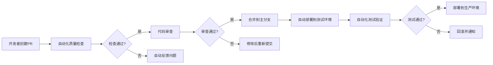

# AlkaidSYS 工作流程优化体系

> 本文档描述了 AlkaidSYS 项目的全面优化工作流程体系，旨在提高开发效率、代码质量、团队协作和项目可维护性。
> 
> 基于对现有工作流程和规则的深入分析，结合行业最佳实践，设计了一套统一、简化、自动化的工作流程体系。

---

## 1. 优化背景与目标

### 1.1 现状分析

#### 优势保持
- ✅ **完整的规则体系**: 有清晰的Always Rules、Auto Guidelines、开发工作流
- ✅ **设计文档优先**: 强调先设计后实现的原则
- ✅ **低代码优先**: 创新的动态实体管理方式
- ✅ **多租户支持**: 完善的租户隔离机制
- ✅ **Docker标准化**: 统一的开发和部署环境
- ✅ **测试覆盖**: 完整的测试套件和CI流程

#### 问题识别
- ❌ **规则分散**: 规则文档分布在多个位置，缺乏统一性
- ❌ **流程复杂**: 开发流程步骤较多，新手难以快速上手
- ❌ **工具链割裂**: 前后端工具链不够统一
- ❌ **文档维护成本高**: 多个文档需要同步维护
- ❌ **缺乏自动化检查**: 规则合规性检查不够自动化
- ❌ **反馈机制不完善**: 缺乏有效的规则反馈和改进机制

### 1.2 优化目标

1. **统一化**: 将分散的规则整合为统一体系，降低维护成本
2. **简化**: 简化开发流程，提高上手效率和开发速度
3. **自动化**: 增加自动化检查和工具支持，减少人为错误
4. **可扩展**: 支持未来功能扩展和技术栈演进
5. **质量保证**: 强化代码质量和安全检查，提升项目可维护性

---

## 2. 统一规则体系架构

### 2.1 三层规则结构

```
┌─────────────────────────────────────────────────────────────┐
│                AlkaidSYS 统一规则体系                │
├─────────────────────────────────────────────────────────────┤
│  Core Rules (核心规则) - 硬性约束，不可违反        │
│  • 架构原则与分层约束                              │
│  • 安全与多租户要求                                │
│  • 低代码优先原则                                  │
│  • API设计规范                                    │
├─────────────────────────────────────────────────────────────┤
│  Implementation Guidelines (实现指南) - 最佳实践        │
│  • 代码风格与命名规范                              │
│  • 开发工具使用指南                                │
│  • 测试策略与质量标准                              │
│  • 文档编写规范                                    │
├─────────────────────────────────────────────────────────────┤
│  Process Workflow (流程工作流) - 开发流程            │
│  • 开发生命周期管理                                │
│  • 工具链集成指南                                │
│  • CI/CD流程规范                                  │
│  • 团队协作规范                                  │
└─────────────────────────────────────────────────────────────┘
```

### 2.2 规则优先级与冲突解决

1. **优先级顺序**:
   - Level 1: Core Rules (最高优先级)
   - Level 2: Implementation Guidelines
   - Level 3: Process Workflow

2. **冲突解决机制**:
   - 当规则冲突时，以高优先级规则为准
   - 无法解决时，通过技术委员会评审决定
   - 所有规则变更需经过影响评估

### 2.3 规则文档组织结构

```
.kilocode/rules/
├── core-rules.md              # 核心规则 (原always-alkaidsys-project-rules.md)
├── implementation-guidelines.md # 实现指南 (原auto-alkaidsys-guidelines.md)
├── process-workflow.md         # 流程工作流 (本文档)
├── tools-configuration.md     # 工具配置指南
└── compliance-checklist.md    # 合规检查清单
```

---

## 3. 简化开发流程

### 3.1 四步开发法

#### 传统流程问题
- 过多的文档阅读和确认步骤
- 复杂的设计对齐流程
- 分离的编码和测试阶段

#### 优化后的四步开发法

```
┌─────────────────────────────────────────────────────┐
│              四步开发法 (4-Step Dev)           │
├─────────────────────────────────────────────────────┤
│  Step 1: 需求理解与设计对齐                  │
│  • 快速阅读核心设计文档                          │
│  • 使用自动化工具检查设计契合度                    │
│  • 确定技术方案和实现路径                        │
├─────────────────────────────────────────────────────┤
│  Step 2: 快速原型与验证                        │
│  • 使用脚手架工具生成基础代码                      │
│  • 快速实现核心功能                              │
│  • 早期验证和反馈                                │
├─────────────────────────────────────────────────────┤
│  Step 3: 完整实现与测试                        │
│  • 完善功能实现                                │
│  • 编写全面的测试用例                            │
│  • 性能和安全检查                                │
├─────────────────────────────────────────────────────┤
│  Step 4: 文档同步与发布                        │
│  • 更新相关文档                                │
│  • 代码审查和合并                                │
│  • 部署和监控                                  │
└─────────────────────────────────────────────────────┘
```

### 3.2 开发流程详细规范

#### Step 1: 需求理解与设计对齐

**目标**: 15-30分钟内完成需求理解和方案确定

**关键活动**:
1. **智能文档检索**:
   ```bash
   # 使用自动化工具快速检索相关设计文档
   alkaid-dev-tools docs --search="用户管理" --type="design"
   ```

2. **设计契合度检查**:
   ```bash
   # 检查当前实现与设计的契合度
   alkaid-dev-tools compliance --check-design --module="用户管理"
   ```

3. **技术方案确认**:
   - 确定使用低代码Schema还是传统表结构
   - 确认权限和安全要求
   - 确定测试策略

**输出物**:
- 技术方案简报 (1页A4)
- 实现任务清单
- 风险评估报告

#### Step 2: 快速原型与验证

**目标**: 1-2小时内完成可演示的原型

**关键活动**:
1. **脚手架代码生成**:
   ```bash
   # 低代码Schema脚手架
   alkaid-dev-tools scaffold --collection="用户表单" --fields="name,email,phone"
   
   # 传统CRUD脚手架
   alkaid-dev-tools scaffold --crud --entity="User" --actions="create,read,update,delete"
   ```

2. **核心功能实现**:
   - 优先实现业务核心逻辑
   - 跳过非关键功能和边缘用例
   - 使用Mock数据快速验证

3. **早期验证**:
   - 本地功能演示
   - API接口快速测试
   - 用户体验初步验证

#### Step 3: 完整实现与测试

**目标**: 完成生产就绪的代码实现

**关键活动**:
1. **完整功能实现**:
   - 补充所有边缘用例
   - 完善错误处理和异常情况
   - 性能优化和安全加固

2. **全面测试覆盖**:
   ```bash
   # 自动化测试生成
   alkaid-dev-tools test:generate --entity="User" --coverage="80%"
   
   # 测试执行
   alkaid-dev-tools test:run --suite="unit,integration,e2e"
   ```

3. **质量检查**:
   - 代码风格检查
   - 安全漏洞扫描
   - 性能基准测试

#### Step 4: 文档同步与发布

**目标**: 完成发布准备和知识沉淀

**关键活动**:
1. **文档自动更新**:
   ```bash
   # 自动生成API文档
   alkaid-dev-tools docs:generate --type="api" --output="docs/api/"
   
   # 更新架构文档
   alkaid-dev-tools docs:update --section="architecture"
   ```

2. **代码审查流程**:
   - 自动化代码审查检查
   - 人工审查重点模块
   - 安全专项审查

3. **发布准备**:
   - 生成发布说明
   - 准备回滚方案
   - 部署前最终检查

### 3.3 流程优化指标

| 指标 | 当前值 | 目标值 | 测量方式 |
|--------|--------|--------|----------|
| 需求理解时间 | 60-90分钟 | 15-30分钟 | 自动化工具跟踪 |
| 原型开发时间 | 4-8小时 | 1-2小时 | 脚手架效率统计 |
| 测试覆盖率 | 60-70% | 85%+ | 自动化测试报告 |
| 代码审查时间 | 2-3天 | 4-6小时 | 自动化预检查 |
| 发布频率 | 2-3周 | 1周 | 发布周期统计 |

---

## 4. 自动化工具链

### 4.1 统一开发工具 (alkaid-dev-tools)

#### 核心功能模块

```bash
# 项目初始化
alkaid-dev-tools init --project="新模块" --template="lowcode-crud"

# 设计文档管理
alkaid-dev-tools docs --search="关键词" --type="design|spec"
alkaid-dev-tools docs --validate --against="current-code"

# 代码生成
alkaid-dev-tools generate --scaffold --type="lowcode|crud|api"
alkaid-dev-tools generate --test --entity="User" --coverage="85%"

# 质量检查
alkaid-dev-tools check --style --fix --auto
alkaid-dev-tools check --security --scan="dependencies,code"
alkaid-dev-tools check --performance --baseline="main"

# 测试执行
alkaid-dev-tools test --run --suite="unit,integration"
alkaid-dev-tools test --coverage --report="html"

# 构建与部署
alkaid-dev-tools build --env="dev|staging|prod"
alkaid-dev-tools deploy --env="staging" --rollback-enabled
```

#### 工具配置文件

```yaml
# .alkaid-tools.yml
project:
  name: "AlkaidSYS"
  type: "multi-tenant-saas"
  
development:
  default_stack: "lowcode"
  auto_fix: true
  pre_commit_checks: ["style", "security", "test"]
  
quality:
  min_test_coverage: 85
  max_complexity: 10
  security_scan_level: "high"
  
deployment:
  environments: ["dev", "staging", "prod"]
  auto_rollback: true
  health_check_timeout: 300
```

### 4.2 自动化检查体系

#### 预提交钩子 (Pre-commit Hooks)

```bash
#!/bin/sh
# .git/hooks/pre-commit

echo "🔍 执行预提交检查..."

# 1. 代码风格检查
alkaid-dev-tools check --style --fix

# 2. 安全扫描
alkaid-dev-tools check --security --quick

# 3. 单元测试
alkaid-dev-tools test --run --suite="unit" --quick

# 4. 设计契合度检查
alkaid-dev-tools compliance --check-design --changed-files

echo "✅ 预提交检查完成"
```

#### CI/CD 自动化流程

```yaml
# .github/workflows/alkaid-dev.yml
name: AlkaidSYS Development Workflow

on:
  push:
    branches: [main, develop]
  pull_request:
    branches: [main]

jobs:
  quality-check:
    runs-on: ubuntu-latest
    steps:
      - uses: actions/checkout@v3
      - name: Setup Alkaid Dev Tools
        run: |
          curl -sSL https://raw.githubusercontent.com/alkaid-system/dev-tools/main/install.sh | bash
      - name: Run Quality Checks
        run: |
          alkaid-dev-tools check --all --report-format="github"
          
  automated-testing:
    needs: quality-check
    runs-on: ubuntu-latest
    steps:
      - name: Run Test Suite
        run: |
          alkaid-dev-tools test --run --suite="all" --coverage --report
          
  security-scan:
    needs: quality-check
    runs-on: ubuntu-latest
    steps:
      - name: Security Vulnerability Scan
        run: |
          alkaid-dev-tools check --security --deep --report-format="sarif"
```

### 4.3 代码生成自动化

#### 低代码Schema代码生成

```bash
# 基于Schema自动生成完整CRUD
alkaid-dev-tools generate:lowcode \
  --schema="design/lowcode/user-schema.json" \
  --output="app/Controller/UserController.php" \
  --include="controller,service,repository,test" \
  --test-coverage="85%"
```

#### API文档自动生成

```bash
# 自动生成OpenAPI规范
alkaid-dev-tools docs:generate \
  --type="openapi" \
  --source="app/Controller/" \
  --output="docs/api/openapi.yaml" \
  --include="examples,schemas"
```

---

## 5. 质量保证体系

### 5.1 多层次质量检查

#### 代码质量维度

| 维度 | 检查工具 | 频率 | 责任人 |
|--------|----------|--------|--------|
| 代码风格 | PHP-CS-Fixer, ESLint, Prettier | 每次提交 | 开发者 |
| 安全漏洞 | SonarQube, PHPStan, Security Scanner | 每次PR | 安全团队 |
| 性能基准 | Blackfire, Performance Tests | 每周 | 性能团队 |
| 测试覆盖率 | PHPUnit, Coverage Reports | 每次提交 | 开发者 |
| 架构合规 | Custom Rules Validator | 每次PR | 架构师 |

#### 质量门禁标准

```yaml
# quality-gates.yml
gates:
  code_style:
    enabled: true
    threshold: 0  # 零容忍
    
  test_coverage:
    enabled: true
    threshold: 85  # 最低85%覆盖率
    
  security_scan:
    enabled: true
    threshold: "high"  # 高风险及以上漏洞阻止合并
    
  performance_regression:
    enabled: true
    threshold: 10  # 性能回归超过10%阻止
    
  architecture_compliance:
    enabled: true
    threshold: "critical"  # 严重违规阻止合并
```

### 5.2 持续监控与反馈

#### 技术债务管理

```bash
# 技术债务跟踪
alkaid-dev-tools debt:track --category="complexity,security,duplication"
alkaid-dev-tools debt:report --trend --period="30days"
alkaid-dev-tools debt:suggest --prioritized --effort="low"
```

#### 规则反馈机制

```bash
# 规则改进建议
alkaid-dev-tools feedback:rule --type="suggestion" --description="规则描述"
alkaid-dev-tools feedback:violation --type="false-positive" --context="具体场景"
alkaid-dev-tools feedback:improvement --area="workflow,tools,quality"
```

### 5.3 质量报告与仪表板

#### 自动化质量报告

```bash
# 每日质量报告
alkaid-dev-tools report:quality --period="daily" --format="html,email"

# 每周趋势报告
alkaid-dev-tools report:trend --period="weekly" --metrics="coverage,debt,performance"

# 发布质量报告
alkaid-dev-tools report:release --version="v1.2.0" --compare="v1.1.0"
```

#### 团队质量仪表板

```yaml
# dashboard-config.yml
dashboard:
  metrics:
    - code_coverage_trend
    - bug_count_trend  
    - performance_benchmark
    - technical_debt_ratio
    - security_vulnerability_count
    
  alerts:
    - coverage_drop_below_80
    - critical_security_vulnerability
    - performance_regression_15_percent
    
  teams:
    - development_team: coverage, bugs, performance
    - qa_team: security, compliance
    - architecture_team: design_compliance, technical_debt
```

---

## 6. 团队协作优化

### 6.1 角色与职责明确

#### 优化后的角色定义

| 角色 | 主要职责 | 关键工具 | 决策权限 |
|--------|----------|----------|----------|
| 架构师 | 设计文档维护、架构决策、技术选型 | 设计工具、合规检查器 | 技术方案决策 |
| 开发者 | 功能实现、代码质量、单元测试 | IDE、开发工具链 | 代码实现决策 |
| 质量工程师 | 质量检查、测试策略、CI/CD | 质量工具、测试框架 | 质量标准决策 |
| 安全专家 | 安全审查、漏洞修复、安全培训 | 安全扫描工具 | 安全标准决策 |
| 运维工程师 | 部署、监控、故障处理 | 部署工具、监控系统 | 运维流程决策 |

### 6.2 协作流程优化

#### 优化的PR流程



#### 知识管理优化

```bash
# 知识库自动更新
alkaid-dev-tools knowledge:update --source="commits,issues,docs"
alkaid-dev-tools knowledge:search --query="如何实现多租户权限"
alkaid-dev-tools knowledge:generate --type="best-practices" --topic="低代码开发"
```

### 6.3 沟通机制优化

#### 统一沟通平台

```yaml
# communication-config.yml
channels:
  development: "Slack #dev-team"
  alerts: "Slack #alerts" 
  releases: "Slack #releases"
  architecture: "Slack #architecture"
  
notifications:
  critical_bug:
    channels: ["#alerts", "#dev-team"]
    escalation: ["@tech-lead", "@qa-lead"]
    
  deployment_failure:
    channels: ["#dev-team", "#ops"]
    escalation: ["@tech-lead", "@qa-lead"]
    
  quality_gate_failure:
    channels: ["#dev-team"]
    escalation: ["@tech-lead"]
```

---

## 7. 实施路线图

### 7.1 阶段性实施计划

#### Phase 1: 基础设施建设 (第1-2周)

**目标**: 建立统一工具和基础自动化

**关键任务**:
- [ ] 开发 `alkaid-dev-tools` 核心功能
- [ ] 配置自动化预提交钩子
- [ ] 建立基础CI/CD流程
- [ ] 迁移现有规则到新体系

**交付物**:
- 统一开发工具 v0.1
- 基础自动化流程
- 新规则体系文档

#### Phase 2: 流程优化 (第3-4周)

**目标**: 优化开发流程和质量检查

**关键任务**:
- [ ] 实施四步开发法
- [ ] 完善代码生成功能
- [ ] 建立质量门禁标准
- [ ] 优化团队协作流程

**交付物**:
- 完整的开发工具链
- 优化的开发流程
- 质量检查体系

#### Phase 3: 高级功能 (第5-8周)

**目标**: 高级自动化和智能化

**关键任务**:
- [ ] AI辅助代码审查
- [ ] 智能测试用例生成
- [ ] 性能自动优化建议
- [ ] 技术债务智能分析

**交付物**:
- 智能化开发工具
- 高级质量保证体系
- 完整的监控仪表板

### 7.2 成功指标

#### 定量指标

| 指标 | 基线 | 目标 | 测量频率 |
|--------|--------|------|----------|
| 开发周期 | 2-3周 | 1周 | 每发布统计 |
| 代码质量分数 | 7.0/10 | 8.5/10 | 每次PR |
| 测试覆盖率 | 65% | 85% | 每次提交 |
| 安全漏洞数 | 5个/版本 | 1个/版本 | 每次发布 |
| 部署失败率 | 15% | 5% | 每次部署 |

#### 定性指标

- **开发者满意度**: 通过问卷调查测量
- **代码可维护性**: 通过代码审查反馈评估
- **团队协作效率**: 通过会议时间和决策速度评估
- **知识沉淀质量**: 通过文档使用率和搜索成功率评估

---

## 8. 风险管理

### 8.1 技术风险

| 风险 | 概率 | 影响 | 缓解措施 |
|--------|--------|------|----------|
| 工具链复杂性 | 中 | 高 | 分阶段实施，充分培训 |
| 规则迁移阻力 | 中 | 中 | 渐进式迁移，保持向后兼容 |
| 自动化误报 | 低 | 中 | 人工审核机制，反馈循环 |
| 团队适应性 | 中 | 高 | 充分沟通，试点推广 |

### 8.2 缓解策略

#### 渐进式实施
- 先在试点团队验证新流程
- 保留现有流程作为备选方案
- 逐步扩大实施范围

#### 培训与支持
- 提供详细的工具使用文档
- 组织定期培训和问答会议
- 建立技术支持渠道

#### 反馈与改进
- 建立规则反馈机制
- 定期评估流程效果
- 持续优化工具和流程

---

## 9. 总结

### 9.1 核心价值

1. **效率提升**: 通过简化和自动化，预计提升开发效率30-50%
2. **质量保证**: 通过多层次检查，显著提升代码质量和安全性
3. **成本降低**: 通过减少重复工作和错误，降低开发和维护成本
4. **团队协作**: 通过明确流程和工具，提升团队协作效率

### 9.2 可持续改进

本优化体系不是一次性的解决方案，而是一个持续改进的框架：

- **定期评估**: 每季度评估流程效果和工具使用情况
- **技术演进**: 跟踪新技术和最佳实践，及时更新规则体系
- **团队反馈**: 持续收集团队反馈，优化流程和工具
- **行业对标**: 定期对标行业最佳实践，保持竞争力

通过这套优化工作流程体系，AlkaidSYS项目将能够在保持现有优势的基础上，显著提升开发效率、代码质量和团队协作水平，为项目的长期成功奠定坚实基础。