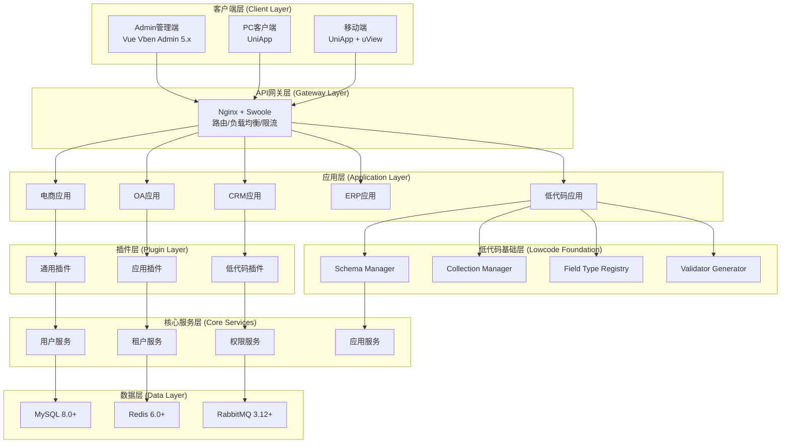
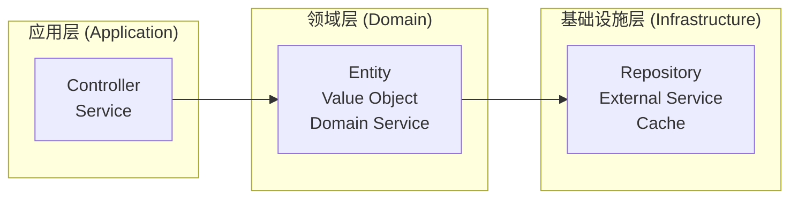

# AlkaidSYS（瑶光系统）AI 开发上下文

> **最后更新**: 2025-12-15 22:20:04
>
> 项目类型：企业级低代码 SAAS 系统框架（基于 ThinkPHP 8.0 + Vue 3.x）

---

## 📋 项目概览

**AlkaidSYS（瑶光系统）** 是一个强大、现代、低代码的企业级 SAAS 系统框架，融合了 ThinkPHP 8.0、Swoole 协程和 Vue Vben Admin 5.x 的优势，旨在为企业提供快速开发能力和高性能架构。

### 核心特性
- 🚀 **快速开发能力** - 低代码设计，提高开发效率 10 倍
- ⚡ **高性能架构** - 基于 Swoole 协程，支持 10K+ 并发
- 🔌 **灵活扩展性** - 插件化架构，易于添加新功能
- 🏢 **完善的多租户** - 支持共享数据库和独立数据库模式
- 💎 **现代化前端** - 直接使用 Vue Vben Admin 5.x
- 📱 **多端支持** - 覆盖 Admin、PC、小程序、App、H5 所有终端

---

## 🏗️ 系统架构

### 7层整体架构



### DDD 分层架构

项目采用**领域驱动设计（DDD）**架构模式：



---

## 📦 模块结构

### 核心模块

| 模块 | 路径 | 描述 | 状态 |
|------|------|------|------|
| **应用层** | `app/` | HTTP 请求处理、业务逻辑编排 | ✅ 活跃 |
| **领域层** | `domain/` | 领域模型、业务规则 | ✅ 活跃 |
| **基础设施层** | `infrastructure/` | 数据访问、外部服务集成 | ✅ 活跃 |
| **前端** | `frontend/` | Vue 3 + Vben Admin 管理端 | ✅ 活跃 |
| **配置** | `config/` | 应用配置、框架配置 | ✅ 活跃 |
| **数据库** | `database/` | 迁移文件、种子数据 | ✅ 活跃 |
| **路由** | `route/` | API 路由定义 | ✅ 活跃 |
| **测试** | `tests/` | 单元测试、集成测试 | ✅ 活跃 |
| **文档** | `docs/` | 项目文档、开发指南 | ✅ 活跃 |
| **设计** | `design/` | 架构设计文档 | ✅ 活跃 |

### 领域模块

| 模块 | 路径 | 功能 | 主要组件 |
|------|------|------|----------|
| **Auth** | `domain/Auth/` | 身份认证 | JWT、Token 管理 |
| **User** | `domain/User/` | 用户管理 | User Entity、Service |
| **Tenant** | `domain/Tenant/` | 租户管理 | Tenant Entity、隔离策略 |
| **Permission** | `domain/Permission/` | 权限控制 | Casbin RBAC |
| **Lowcode** | `domain/Lowcode/` | 低代码引擎 | Schema、Collection、Field |
| **Field** | `domain/Field/` | 字段类型 | Field Type Registry |
| **Schema** | `domain/Schema/` | 数据结构 | Form Schema、Table Schema |
| **Collection** | `domain/Collection/` | 集合管理 | 数据集合、关系管理 |
| **Application** | `domain/Application/` | 应用管理 | 应用实例、插件管理 |
| **DI** | `domain/DI/` | 依赖注入 | IoC 容器 |
| **I18n** | `domain/I18n/` | 国际化 | 多语言支持 |
| **RateLimit** | `domain/RateLimit/` | 限流控制 | 令牌桶、漏桶 |
| **Validator** | `domain/Validator/` | 数据验证 | 验证器生成 |
| **Lowcode Validator/Schema Parser** | `infrastructure/Lowcode/FormDesigner/Service` / `infrastructure/Lowcode/Schema/SchemaParser.php` | 表单校验生成、Schema 解析 | 前端获取表单详情时调用 `GET /v1/lowcode/forms/{name}?with_validator=1&with_parsed=1`，优先使用返回的 `validator.rules/messages` 与 `parsed.components/permissions`，本地 zod 规则仅作兜底 |

---

## 🛠️ 技术栈

### 后端技术
- **PHP 8.2+** - 开发语言
- **ThinkPHP 8.0+** - 核心框架
- **Swoole 5.0+** - 高性能引擎（协程支持）
- **MySQL 8.0+** - 主数据库
- **Redis 6.0+** - 缓存 + 队列
- **RabbitMQ 3.12+** - 消息队列
- **PHP-Casbin 3.x** - 权限管理

### 前端技术
- **Vue Vben Admin 5.x** - 管理后台框架
- **Vue 3.x** - 前端框架
- **TypeScript 5.x** - 开发语言
- **Vite 5.x** - 构建工具
- **Ant Design Vue 4.x** - UI 组件库
- **Pinia 2.x** - 状态管理

---

## 🔑 关键文件

### 根目录关键文件
- `composer.json` - PHP 依赖管理
- `package.json` - 前端依赖管理
- `phpunit.xml` - 测试配置
- `.env.example` - 环境变量模板
- `README.md` - 项目说明文档

### 核心配置文件
- `config/app.php` - 应用基础配置
- `config/database.php` - 数据库配置
- `config/cache.php` - 缓存配置
- `config/queue.php` - 队列配置
- `config/swoole.php` - Swoole 配置

### 主要入口文件
- `app/Request.php` - 请求处理基类
- `app/BaseController.php` - 控制器基类
- `app/ExceptionHandle.php` - 异常处理
- `app/middleware.php` - 中间件注册

---

## 🚀 开发规范

### 代码风格
- **PHP**: 使用 PHP-CS-Fixer 进行代码格式化
- **TypeScript**: 使用 ESLint + Prettier 进行代码检查
- **提交规范**: 使用 Commitlint 规范提交信息

### 目录规范
- **PSR-4**: 自动加载遵循 PSR-4 标准
- **命名空间**: `app\`、`Domain\`、`Infrastructure\`
- **目录命名**: 使用小写字母 + 下划线

### 测试规范
- **单元测试**: 使用 PHPUnit 11.5+
- **覆盖率要求**: 核心模块 > 80%
- **测试目录**: `tests/Feature/`（功能测试）、`tests/Unit/`（单元测试）

---

## 📚 相关资源

### 文档链接
- [架构设计文档](design/01-architecture-design/02-architecture-design.md)
- [多租户设计](design/04-multi-tenant/01-tenant-design.md)
- [低代码设计](design/05-lowcode/01-lowcode-design.md)
- [开发者指南](docs/developer-guides/)
- [API 文档](docs/api/)

### 外部资源
- [ThinkPHP 官方文档](https://www.thinkphp.cn/)
- [Vue Vben Admin 文档](https://vvbin.cn/doc/)
- [Swoole 文档](https://www.swoole.com/)
- [PHP-Casbin 文档](https://casbin.org/)

---

## 💡 快速开始

### 环境要求
- PHP 8.2+
- MySQL 8.0+
- Redis 6.0+
- Node.js 18+
- pnpm 9.x

### 安装步骤
```bash
# 1. 克隆项目
git clone <repository-url>
cd AlkaidSYS-tp

# 2. 安装 PHP 依赖
composer install

# 3. 安装前端依赖
cd frontend
pnpm install

# 4. 配置环境变量
cp .env.example .env
# 编辑 .env 文件，配置数据库等信息

# 5. 运行数据库迁移
php think migrate:run

# 6. 启动服务
# 后端（Swoole）
php think swoole:start

# 前端（开发模式）
pnpm dev
```

---

## 🐳 Docker 开发环境

### 容器命名规范

| 容器名称 | 用途 | 端口 |
|----------|------|------|
| `alkaid-backend` | PHP 后端服务 | 9501 |
| `alkaid-mysql` | MySQL 数据库 | 3306 |
| `alkaid-redis` | Redis 缓存 | 6379 |
| `alkaid-rabbitmq` | RabbitMQ 消息队列 | 5672, 15672 |

### 重要规则

**所有 PHP CLI 命令必须在 `alkaid-backend` 容器内执行，禁止在宿主机直接运行 `php think ...` 命令。**

### 常用命令

#### 测试命令
```bash
# 运行所有测试
docker exec -it alkaid-backend php think test

# 运行指定测试文件
docker exec -it alkaid-backend php think test tests/Unit/SomeTest.php

# 运行指定目录的测试
docker exec -it alkaid-backend php think test tests/Unit/Swoole/

# 运行带过滤器的测试
docker exec -it alkaid-backend php think test --filter=testMethodName

# 运行测试并生成覆盖率报告
docker exec -it alkaid-backend php think test --coverage-html=coverage/
```

#### 数据库迁移命令
```bash
# 运行迁移
docker exec -it alkaid-backend php think migrate:run

# 回滚迁移
docker exec -it alkaid-backend php think migrate:rollback

# 生成迁移文件
docker exec -it alkaid-backend php think migrate:create MigrationName

# 查看迁移状态
docker exec -it alkaid-backend php think migrate:status
```

#### 代码格式化命令
```bash
# 检查代码格式
docker exec -it alkaid-backend php vendor/bin/php-cs-fixer fix --dry-run --diff

# 自动修复代码格式
docker exec -it alkaid-backend php vendor/bin/php-cs-fixer fix
```

#### 其他常用命令
```bash
# 进入容器 Shell
docker exec -it alkaid-backend bash

# 查看容器日志
docker logs -f alkaid-backend

# 清除缓存
docker exec -it alkaid-backend php think clear

# 生成路由缓存
docker exec -it alkaid-backend php think route:cache
```

---

## 🤝 贡献指南

1. **Fork** 项目
2. 创建特性分支 (`git checkout -b feature/AmazingFeature`)
3. 提交更改 (`git commit -m 'feat: add some AmazingFeature'`)
4. 推送到分支 (`git push origin feature/AmazingFeature`)
5. 创建 **Pull Request**

---

## 📄 许可证

本项目采用 [MIT 许可证](LICENSE.txt)。

---

## 👥 团队

- **架构师**: 系统设计、核心模块开发
- **后端工程师**: ThinkPHP 开发、业务逻辑实现
- **前端工程师**: Vue 3 + Vben Admin 开发
- **测试工程师**: 自动化测试、质量保证

---

*本文档由 AI 自动生成和维护，最后更新时间：2025-12-15 22:20:04*
