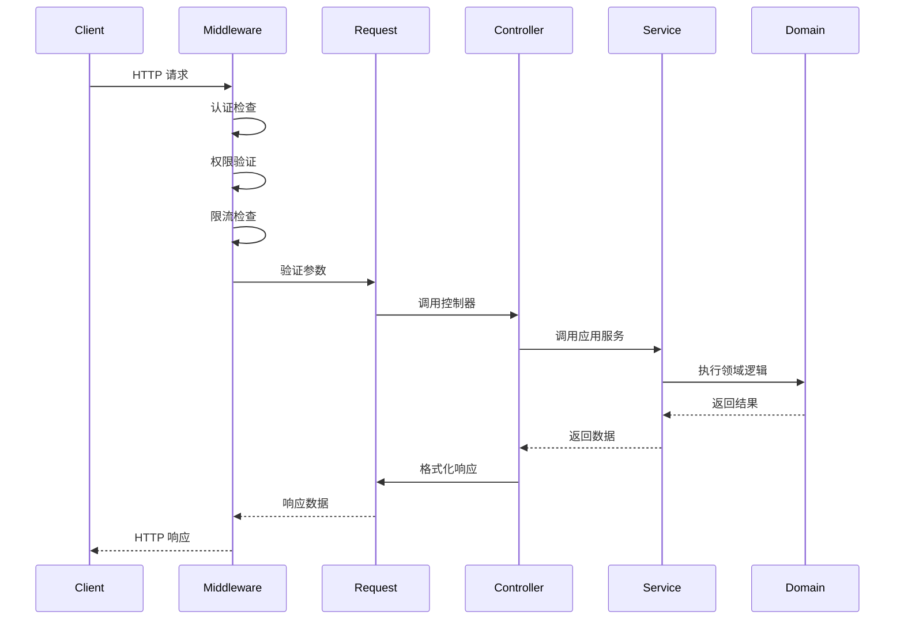

# 应用层 (Application Layer) - CLAUDE.md

> **导航**: [返回根目录](../CLAUDE.md) | 应用层概览
>
> **最后更新**: 2025-12-15 22:20:04
>
> **主要职责**: HTTP 请求处理、业务逻辑编排、请求验证与响应

---

## 📋 概述

应用层是系统的最上层，负责：
- 接收 HTTP 请求并返回响应
- 进行请求参数验证
- 协调领域层的业务逻辑
- 处理横切关注点（认证、权限、日志等）
- 异常处理与错误响应

---

## 📁 目录结构

```
app/
├── controller/          # 控制器层
│   ├── ApiController.php
│   ├── AuthController.php
│   ├── Index.php
│   ├── admin/           # 管理后台控制器
│   │   └── CasbinController.php
│   └── lowcode/         # 低代码模块控制器
│       ├── CollectionController.php
│       ├── FormSchemaController.php
│       ├── FormDataController.php
│       ├── FieldController.php
│       └── RelationshipController.php
├── middleware/          # 中间件
│   ├── Auth.php         # 身份认证中间件
│   ├── Permission.php   # 权限检查中间件
│   └── RateLimit.php    # 限流中间件
├── listener/            # 事件监听器
├── model/               # 数据模型
├── command/             # 命令行命令
├── lang/                # 语言包
├── constant/            # 常量定义
├── provider/            # 服务提供者
├── Request.php          # 请求基类
├── BaseController.php   # 控制器基类
├── ExceptionHandle.php  # 异常处理器
├── common.php           # 公共函数
├── event.php            # 事件定义
└── service.php          # 服务注册
```

---

## 🎯 核心组件

### 1. 控制器 (Controllers)

#### 基础控制器
- **`BaseController.php`** - 所有控制器的基类
  - 提供通用的响应格式
  - 封装常用方法
  - 统一的异常处理

- **`Request.php`** - 请求对象基类
  - 参数验证
  - 数据预处理
  - 扩展验证规则

#### 业务控制器

**认证模块**
- `AuthController.php` - 处理用户登录、注册、登出

**低代码模块**
- `lowcode/CollectionController.php` - 集合（数据表）管理
- `lowcode/FormSchemaController.php` - 表单Schema管理
- `lowcode/FormDataController.php` - 表单数据CRUD
- `lowcode/FieldController.php` - 字段类型管理
- `lowcode/RelationshipController.php` - 关系管理

**管理模块**
- `admin/CasbinController.php` - 权限管理（Casbin）

**调试模块**
- `DebugController.php` - 调试信息输出

### 2. 中间件 (Middleware)

#### 认证与权限
- `Auth.php` - JWT Token 验证
  - 解析 Authorization 头
  - 验证 Token 有效性
  - 注入当前用户信息

- `Permission.php` - 权限检查
  - 基于 Casbin 的 RBAC 权限控制
  - 动态权限验证
  - 租户隔离检查

- `RateLimit.php` - 限流控制
  - 令牌桶算法
  - 用户/租户维度限流
  - 防暴力破解

### 3. 异常处理

- `ExceptionHandle.php` - 全局异常处理器
  - 统一异常格式
  - 日志记录
  - 开发/生产环境区分

---

## 🔄 请求流程



---

## 🎨 设计模式

### 1. 控制器模式
- **单一职责**: 每个控制器只负责特定业务领域
- **薄控制器**: 业务逻辑下沉到 Service/Domain 层
- **RESTful**: 遵循 RESTful API 设计规范

### 2. 中间件模式
- **横切关注点**: 认证、权限、日志等
- **可组合**: 多个中间件可组合使用
- **顺序执行**: 按照注册顺序执行

### 3. 依赖注入
- **Service 注入**: 通过构造函数注入依赖
- **IoC 容器**: 使用 ThinkPHP 的容器管理

---

## 📊 关键文件说明

| 文件 | 作用 | 重要性 |
|------|------|--------|
| `BaseController.php` | 控制器基类，提供通用功能 | ⭐⭐⭐⭐⭐ |
| `Request.php` | 请求参数验证与处理 | ⭐⭐⭐⭐⭐ |
| `ExceptionHandle.php` | 异常处理与错误响应 | ⭐⭐⭐⭐ |
| `middleware/Auth.php` | JWT 认证中间件 | ⭐⭐⭐⭐⭐ |
| `middleware/Permission.php` | 权限检查中间件 | ⭐⭐⭐⭐ |
| `middleware/RateLimit.php` | 限流中间件 | ⭐⭐⭐ |

---

## 🚀 使用指南

### 创建新控制器

```php
<?php
namespace app\controller\your;

use app\BaseController;

class YourController extends BaseController
{
    public function index()
    {
        // 获取请求参数
        $data = $this->request->param();

        // 调用 Service
        // $result = app()->make(YourService::class)->handle($data);

        // 返回响应
        return $this->success($result);
    }
}
```

### 创建新中间件

```php
<?php
namespace app\middleware;

class YourMiddleware
{
    public function handle($request, \Closure $next)
    {
        // 前置处理
        $this->beforeHandle($request);

        // 执行后续逻辑
        $response = $next($request);

        // 后置处理
        $this->afterHandle($request, $response);

        return $response;
    }
}
```

---

## 🔍 最佳实践

1. **保持控制器薄** - 将业务逻辑下沉到 Service/Domain 层
2. **统一响应格式** - 使用 `success()` / `error()` 方法
3. **参数验证** - 在 Request 类中定义验证规则
4. **中间件复用** - 通用逻辑抽取为中间件
5. **异常处理** - 使用全局异常处理器

---

## 📚 相关资源

- [ThinkPHP 控制器文档](https://www.thinkphp.cn/document/3.2/283.html)
- [ThinkPHP 中间件文档](https://www.thinkphp.cn/document/8.0/9614.html)
- [JWT 认证最佳实践](../docs/developer-guides/auth.md)
- [权限管理设计](../docs/developer-guides/permission.md)

---

*本文档最后更新：2025-12-15 22:20:04*
