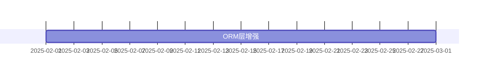

# design/ 与 docs/ 文档质量分析报告

| 项目 | 内容 |
|---|---|
| 报告日期 | 2026-10-30 |
| 审查基线 | 本地 `develop` HEAD（分支整理重建后） |
| 审查范围 | `design/` 73 份（50,390 行）+ `docs/` 111 份（33,284 行，不含 `report_archive/`）= **184 份 / 83,674 行** |
| 审查方法 | 全量自动化扫描（链接、围栏、版本、日期、任务号）+ 核心文档精读 + 与源码交叉验证 |
| 问题总数 | **20 项**（4 阻断 / 6 严重 / 5 中等 / 5 轻微） |
| 总体结论 | 文档体系**结构完整、覆盖面广**，但存在**系统性维护滞后**与**若干会误导开发的具体错误**，建议在重启开发前完成 P0 修复 |

---

## 一、审查方法

### 1.1 自动化全量扫描

| 扫描项 | 方法 |
|---|---|
| 相对链接有效性 | 逐文件解析 `](...md)`，按所在目录解析相对路径后 `-f` 判定 |
| 代码围栏配平 | 统计 `^``` ` 出现次数，奇数即不配平 |
| 技术栈版本一致性 | 正则提取 PHP/MySQL/Redis/Swoole/ThinkPHP/Vue 版本，与 `composer.json`、`docker-compose.yml`、容器实测对照 |
| 文档自述版本与日期 | 提取「文档版本 / 创建日期 / 最后更新」字段统计 |
| 任务号覆盖 | 统计 `T-xxx` 在设计文档与待办文档中的分布 |
| 进度标记 | 统计 `[ ]` / `[x]` 数量 |
| 失效类引用 | 对设计文档中 `use ...;` 语句与类名，到源码/历史中核实是否存在 |

### 1.2 精读与交叉验证

精读以下核心文档，并与源码逐项比对：
`01-MASTER-IMPLEMENTATION-PLAN.md`、`04-multi-tenant-design.md`、`08-low-code-design.md`、`10-api-design.md`、`11-database-evolution-and-migration-strategy.md`、`32-plugin-development-guide.md`、`30-project-summary.md`、`design/README.md`

### 1.3 声明

本报告不臆断。每条问题均附 `文件:行号` 与可复现命令。**已排除的误判见第七章**——自动扫描曾产生 2 个假警报，均已核实澄清，未计入问题。

---

## 二、总体评价：文档体系的优点

在列问题之前，需明确这套文档的**真实价值**，避免修复时误伤：

1. **覆盖面完整**：73 份设计文档覆盖 15 个目录，从总体计划、架构、数据层、安全、部署、前端到低代码与工作流，无明显主题空缺。
2. **关键设计有实施级细节**：如 `11-database-evolution-and-migration-strategy.md` §6/§7 对运行时 DDL 的环境闸门规定（默认 production 拦截、双开关、5003/403）与代码实现**完全一致**，且已实证生效。
3. **安全要求写得到位**：`04-multi-tenant-design.md:330` 明确规定「任何需要认证的接口必须经过 `Auth` 中间件，禁止仅依赖 `X-Tenant-ID` / `X-Site-ID` 头来识别用户租户」——这条要求是正确的、前瞻的（问题在于代码未遵守，见 B-1）。
4. **多份规格可直接指导编码**：`docs/technical-specs/code-style/general-guidelines.md` 等规格与 AGENTS.md 口径一致，PHP 8.2+ 等版本声明准确。
5. **任务完成报告可信度较高**：抽检 `task-completion-report-T064.md`（声称新增 2 份指南）与 `t118-lowcode-legacy-migration-audit`（声称 3 个 Legacy 类已删除），均与实际文件系统**完全吻合**。

---

## 三、问题清单

### A 类：结构性缺陷（阻断阅读，P0）

#### A-1 22 处相对链接失效

| 原因 | 数量 | 代表 |
|---|---|---|
| 路径多一层 `../` | **15** | `design/07-integration-ops/30-project-summary.md` → `../../09-lowcode-framework/...`（应为 `../`） |
| 同上 | — | `design/09-lowcode-framework/50-workflow-review-and-impact-analysis.md` → `../../09-lowcode-framework/...`（应为 `./`） |
| 同上 | — | `design/10-batch-summaries/BATCH-3-SUMMARY.md` → `../../06-frontend-design/...`（应为 `../`） |
| 引用不存在的目录 | **3** | `50-workflow-review-and-impact-analysis.md` → `../reference-project-analysis/{n8n,ingenious}/00-*SUMMARY.md`（该目录在 `design/` 下不存在） |
| 引用全库缺失的文件 | **2** | `01-MASTER-IMPLEMENTATION-PLAN.md` 与 `06-2-plugin-system-design.md` → `../IFRAME-VS-MICROAPP-ANALYSIS-2025-01-20.md`（全库 `find` 无结果） |
| 指向不存在的 design 子目录 | **2** | `docs/technical-specs/lowcode/lowcode-architecture-guidelines.md` → `../../design/04-multi-tenant/01-tenant-design.md`、`../../design/05-lowcode/01-lowcode-design.md`（实际为 `design/01-architecture-design/04-multi-tenant-design.md`、`design/09-lowcode-framework/`） |

失效分布：`50-workflow-review-and-impact-analysis.md`(10)、`30-project-summary.md`(7)、`BATCH-3-SUMMARY.md`(1)、`06-2-plugin-system-design.md`(1)、`01-MASTER-IMPLEMENTATION-PLAN.md`(1)、`lowcode-architecture-guidelines.md`(2)。

`[证据: 逐文件解析 markdown 相对链接 + [ -f ] 判定，共 20 条 design + 2 条 docs]`

**影响**：点击即 404；`01-MASTER-IMPLEMENTATION-PLAN.md` §1.4「计划制定依据」8 项中有 4 项指向不存在路径，削弱计划的可追溯性。

---

#### A-2 3 份文档代码围栏不配平（渲染断裂）

| 文件 | 围栏数 | 判定 |
|---|---|---|
| `design/04-security-performance/11-security-design.md` | 67（奇数） | 不配平 |
| `design/08-developer-guides/31-application-development-guide.md` | 47（奇数） | 不配平 |
| `design/08-developer-guides/32-plugin-development-guide.md` | 57（奇数） | 不配平 |

`[证据: grep -c '^```' <file> 为奇数]`

**影响**：Markdown 渲染器从失配点起会把后续正文吞进代码块，导致**该文件后半部分完全不可读**。这是阅读体验的硬性阻断。

---

#### A-3 `04-multi-tenant-design.md` 结构错乱：孤立代码残片

```
318:```php        ← 正常代码块开始
326:```           ← 正常结束
...
342:```           ← ✗ 孤立闭合围栏（无对应开始）
346:```php        ← 被当作 342 的闭合，导致 344「### 使用示例」起被吞入代码块
```

第 337-341 行还有一段游离的 `public function tenant() { return $this->belongsTo(...); }`，脱离任何上下文，明显是粘贴残片。

`[证据: grep -n '^```' design/01-architecture-design/04-multi-tenant-design.md | awk -F: '$1>300 && $1<360']`

**影响**：`§6 安全注意事项` 之后的内容（含「使用示例」「模式 2/3」等重要章节）渲染异常。

---

#### A-4 `design/README.md` 导航漏列 2 个目录

```
02-domain-layer          ✗ 漏列
06-ratelimit             ✗ 漏列
（其余 13 个目录均已列出）
```

`[证据: 遍历 design/*/ 逐个在 README.md 中 grep]`

**影响**：作为 `design/` 唯一入口，漏列使 `domain-model-unification-plan.md`（领域模型统一方案）与 `ratelimit-strategy.md`（限流策略）**无法从入口被发现**。

---

### B 类：设计-实现冲突（会误导开发，P0/P1）

#### B-1 【最高优先级】多租户设计明令禁止的行为，正是代码在做的

```markdown
design/01-architecture-design/04-multi-tenant-design.md:330
- 任何需要认证的接口必须经过 `Auth` 中间件，禁止仅依赖 `X-Tenant-ID` / `X-Site-ID` 头来识别用户租户。
design/01-architecture-design/04-multi-tenant-design.md:331
- 业务代码不应绕过 `Request` / `BaseModel` 直接根据 Header 决定租户 / 站点。
```

而实现：

```php
// route/auth.php:12 —— register 无 Auth 中间件
Route::post('register', '\\app\\controller\\AuthController@register');
// app/middleware/TenantIdentify.php:32 —— 直接读 Header
$tenantId = (int)$request->header('X-Tenant-ID', '1');
// app/controller/AuthController.php:137 —— 用 Header 决定落库租户
$tenantId = $request->tenantId();
```

`[证据: sed -n '328,332p' design/01-architecture-design/04-multi-tenant-design.md; sed -n '9,20p' route/auth.php]`

**定性**：这不是"缺设计"，而是**设计已明确禁止、代码仍然违反**。文档侧无需修改，需在代码侧修复（已在质量审查报告 C-4 记录）。**这条要求的正确性应被保留。**

---

#### B-2 宣称 3 种隔离模式，实际仅 1 种，且无状态标注

设计文档以「🔧 模式 2：独立数据库模式」「🔧 模式 3：混合模式」的正式章节呈现（各约 145 行），并在 `:909` 与竞品对比时作为优势：

| 特性 | AlkaidSYS | NIUCLOUD | 优势 |
|---|---|---|---|
| **隔离模式** | 3 种 | 1 种 | ✅ 更灵活 |

实际实现：27 个迁移全部操作同一 schema，无任何按租户建库/切库 DDL 或配置。

`[证据: grep -rl 'tenant_id' database/migrations | wc -l → 16，全部为同库列级隔离；find database/migrations -name '*.php' | wc -l → 27，无建库语句]`

**问题**：文档未标注模式 2/3 为「规划中/未实现」，读者会认为现有 3 种能力；竞品对比表更放大误解。

---

#### B-3 页面设计器有设计、无实现、无标注

`design/01-architecture-design/08-low-code-design.md` 详述 4 个组件，其中：

| 组件 | 章节 | 实现 |
|---|---|---|
| 代码生成器 | :55-518 | ✅ `infrastructure/Lowcode/Generator` |
| 表单设计器 | :519-598 | ✅ `infrastructure/Lowcode/FormDesigner` |
| **页面设计器** | **:599-714** | ❌ **无任何对应目录/类** |
| 流程设计器 | :715- | ✅ `plugins/workflow-engine/packages/workflow-ui` |

`[证据: [ -d infrastructure/Lowcode/PageDesigner ] → 不存在；全库 find -type d -iname '*page*' 仅命中 node_modules]`

---

#### B-4 开发指南教导使用**从未存在过**的类与命名空间

```php
// design/08-developer-guides/32-plugin-development-guide.md:938
use app\lowcode\datamodeling\registry\FieldTypeRegistry;
// :949
FieldTypeRegistry::register('color', ColorField::class);
// :958
FieldTypeRegistry::unregister('color');
```

核实：

```
git log --all -S 'app\lowcode\datamodeling\registry'  → 无任何提交（该命名空间从未存在）
历史上 FieldTypeRegistry 的真实命名空间             → Infrastructure\Field
当前状态                                            → 已于 e166c8b 删除
当前正确机制                                        → Infrastructure\Lowcode\Collection\Field\FieldFactory
```

`[证据: git log --all --oneline -S 'app\lowcode\datamodeling\registry' -- '*.php' → 空；git show b5a62d4:infrastructure/Field/FieldTypeRegistry.php | head -8 → namespace Infrastructure\Field]`

**影响**：按此指南开发插件，第一行 `use` 就会报类不存在。**这是最容易被直接踩中的文档错误。**

同一问题另见：
- `design/07-integration-ops/30-project-summary.md:554` — 将 Field Type Registry 列为已交付组件
- `design/02-domain-layer/domain-model-unification-plan.md:13` — 引用 `Domain\Model\Collection`、`Infrastructure\Collection\CollectionManager`、`Infrastructure\Field\FieldTypeRegistry`，**三个类全部已删除**

---

#### B-5 MASTER PLAN 的任务要求与已完成的架构决策相反

```markdown
design/00-core-planning/01-MASTER-IMPLEMENTATION-PLAN.md:142
- [ ] 实现 Field Type Registry
```

而项目的架构演进方向是**删除** FieldTypeRegistry，改用 `FieldFactory`（`e166c8b refactor(lowcode): 下线 Legacy Collection 实现并收敛字段类型注册`）。

`[证据: ls infrastructure/Field/FieldTypeRegistry.php → 不存在；提交 e166c8b 已删除]`

**影响**：若按计划执行「任务 1.1」，会使已统一到 FieldFactory 的字段类型注册机制**再次分裂**。

---

#### B-6 `domain-model-unification-plan.md` 描述的是已被推翻的方案

该文档（`design/02-domain-layer/`，唯一一份）通篇基于 `Domain\Model\Collection` + `Domain\Field\*` + `Infrastructure\Collection\CollectionManager` + `Infrastructure\Field\FieldTypeRegistry` 四个类型。这些类型已全部下线，且该文档**未被 README 索引**（见 A-4）。

**建议**：标记为「已被 T-118 Legacy 迁移取代，仅存档」，或移入归档目录。

---

### C 类：文档内部自相矛盾（P1）

#### C-1 `10-api-design.md` 同一文档内分页字段名前后不一致

```
:121   "page_size": 20,                                    ← snake_case
:173   `data` 结构固定为 `{ list, total, page, pageSize }`  ← camelCase
:304   'page_size' => $pageSize,                            ← snake_case
```

实现（`app/controller/ApiController.php:91`）为 `page_size` + 新增 `total_pages`。

`[证据: grep -n 'pageSize\|page_size' design/03-data-layer/10-api-design.md]`

**影响**：前端开发者按 `:173` 实现会取不到分页大小。

---

#### C-2 MASTER PLAN 范围排除的内容，却做了详细设计

```markdown
设计/00-core-planning/01-MASTER-IMPLEMENTATION-PLAN.md:50-53
**不包括**：
- ❌ 业务应用开发(电商、OA、CRM 等)
- ❌ 应用市场和插件市场开发
```

但存在：

| 文档 | 行数 |
|---|---|
| `design/02-app-plugin-ecosystem/06-3-application-market-design.md` | 1,375 |
| `design/02-app-plugin-ecosystem/06-4-plugin-market-design.md` | 999 |

**影响**：范围声明与文档资产不一致，读者无法判断市场是否在项目范围内。

---

### D 类：时效性与进度失真（P1，影响最大）

#### D-1 MASTER PLAN 的任务清单从未回填，造成"项目几乎未开工"的错觉

```
- [ ] 未勾选: 179
- [x] 已勾选: 5
```

而实际已完成：Schema Builder、Collection 抽象层、事件系统、依赖注入、验证器、数据建模、表单设计器、工作流引擎（276 PHP）、CLI 工具……**均已在代码中落地**。

`[证据: grep -c '\- \[ \]' / grep -c '\- \[x\]' design/00-core-planning/01-MASTER-IMPLEMENTATION-PLAN.md]`

**影响**：这是本仓库**危害最大的文档问题**——任何新加入者或 AI 助手读这份计划，都会得出"项目刚起步"的错误结论，而实际后端核心能力完成度约 85%。

同类问题：
- `docs/todo/plan/development-plan-2025-12-14.md`：`[ ]` 10 项，`[x]` 0 项，同样未回填。

---

#### D-2 计划时间线与实际执行相差约 9.5 个月



实际最早代码提交为 `2025-11-19`（首个迁移 `20251119000000`），`design/` 多数文档创建日期为 `2025-01-19`，比代码早 10 个月。

`[证据: git log --reverse --format=%ad --date=short | head -1；grep '创建日期' design/01-architecture-design/04-multi-tenant-design.md]`

---

#### D-3 73 份设计文档中仅 4 份有「最后更新」字段

```
创建日期：41 份（全部为 2025 年）
最后更新：仅 4 份声明
```

**含义**：37 份以上文档自创建起**从未修订**，但期间代码已发生 140+ 次提交、架构多次调整（Legacy 下线、FieldFactory 统一、多租户实现）。

`[证据: grep -rhoE '\|\s*\*\*最后更新\*\*' design/ | wc -l → 4]`

---

#### D-4 设计文档与任务追踪体系基本脱节

```
design/ 中出现的任务号：  1 个（仅 T-202）
docs/todo/ 中出现的任务号：114 个
```

`[证据: grep -rhoE 'T-[0-9]{3}' design/ | sort -u | wc -l → 1；同理 docs/todo/ → 114]`

**影响**：无法从设计文档追溯到任务，也无法从任务反查设计依据。`docs/todo/plan/` 有 10 份 T-xxx 完成报告，而 `design/` 几乎不提任务号。

---

### E 类：技术栈版本漂移（P2）

#### E-1 Redis 版本不一致

| 文档 | 声明 |
|---|---|
| `design/04-security-performance/12-performance-optimization.md:419` | Redis 6.0 |
| `design/10-batch-summaries/FINAL-SUMMARY.md:125` | Redis 6.0 |
| `design/10-batch-summaries/BATCH-2-SUMMARY.md:99` | Redis 6.0 |
| `design/05-deployment-testing/14-deployment-guide.md:104` | 安装 Redis 6.0 |
| `design/08-developer-guides/31-application-development-guide.md:47` | Redis 7.0 |
| `design/08-developer-guides/32-plugin-development-guide.md:41` | Redis 7.0 |
| **实际** | `docker-compose.yml` → `redis:7.2-alpine`；容器实测 `7.2.12` |

**影响**：部署指南要求装 6.0，与编排文件 7.2 冲突。

#### E-2 Swoole 版本标注滞后

```
文档中出现：Swoole 5.0（22 处）、Swoole 5.1（1 处）
实际：Dockerfile `FROM phpswoole/swoole:5.1-php8.2`，composer.lock `swoole/ide-helper 5.1.8`
```

`[证据: grep -rhoE 'Swoole[ ]?[0-9]+(\.[0-9]+)?' design/ | sort | uniq -c；grep 'FROM' Dockerfile]`

---

## 四、逐文档问题索引

| 文档 | 问题编号 |
|---|---|
| `00-core-planning/01-MASTER-IMPLEMENTATION-PLAN.md` | A-1、B-5、C-2、D-1、D-2 |
| `00-core-planning/03-PROJECT-DEPENDENCIES.md` | E-1（间接） |
| `01-architecture-design/04-multi-tenant-design.md` | **A-3**、B-1、B-2、E-1 |
| `01-architecture-design/08-low-code-design.md` | B-3 |
| `02-app-plugin-ecosystem/06-2-plugin-system-design.md` | A-1 |
| `02-domain-layer/domain-model-unification-plan.md` | A-4（未索引）、B-6 |
| `03-data-layer/10-api-design.md` | C-1 |
| `04-security-performance/11-security-design.md` | **A-2** |
| `04-security-performance/12-performance-optimization.md` | E-1 |
| `05-deployment-testing/14-deployment-guide.md` | E-1 |
| `06-ratelimit/ratelimit-strategy.md` | A-4（未索引） |
| `07-integration-ops/30-project-summary.md` | A-1、B-4 |
| `08-developer-guides/31-application-development-guide.md` | **A-2**、E-1 |
| `08-developer-guides/32-plugin-development-guide.md` | **A-2**、**B-4**、E-1 |
| `09-lowcode-framework/50-workflow-review-and-impact-analysis.md` | A-1 |
| `10-batch-summaries/BATCH-2/3-SUMMARY.md`、`FINAL-SUMMARY.md` | A-1、E-1 |
| `design/README.md` | A-4 |
| `docs/technical-specs/lowcode/lowcode-architecture-guidelines.md` | A-1 |

**无问题的文档**：其余约 55 份设计文档未发现结构性问题（不代表内容全部正确，仅表示本次扫描未命中）。

---

## 五、修复建议

### P0（重启开发前必做，均为机械性修改）

| # | 动作 | 工作量 |
|---|---|---|
| 1 | 修复 22 处失效链接（15 处删一层 `../`；3 处 `reference-project-analysis` 改为「详见归档」或删除；2 处 `IFRAME` 引用改为「已归档，全库未保留」；2 处 docs 侧路径改指正确 design 路径） | ~30 分钟 |
| 2 | 修复 3 份文档的代码围栏（补齐缺失围栏） | ~20 分钟 |
| 3 | 修复 `04-multi-tenant-design.md:342` 孤立围栏，并删除 337-341 游离代码残片 | ~10 分钟 |
| 4 | `design/README.md` 补列 `02-domain-layer`、`06-ratelimit` | ~5 分钟 |
| 5 | **修正 `32-plugin-development-guide.md` 的 FieldTypeRegistry 示例**：改为 `FieldFactory` 的真实用法，或删除该示例 | ~30 分钟 |

### P1（1 周内）

| # | 动作 |
|---|---|
| 6 | **为所有设计文档加「实现状态」标记**：`已实现` / `部分实现` / `未实现` / `已废弃`。至少覆盖 B-2（模式 2/3）、B-3（页面设计器）、B-6（domain 统一方案）、B-5（Field Type Registry） |
| 7 | **回填 MASTER PLAN 进度**：179 项未勾选任务中，已完成者勾选；或明确标注「本计划为初始规划，实际进度见 `docs/todo/plan/`」 |
| 8 | 统一分页字段名（建议以实现的 `page_size` + `total_pages` 为准，修正 `10-api-design.md:173`） |
| 9 | 修正 Redis 版本（6.0 → 7.2）与 Swoole 版本（5.0 → 5.1） |
| 10 | 明确市场设计文档的定位（在范围内 / 仅远期参考 / 归档） |

### P2（技术债）

| # | 动作 |
|---|---|
| 11 | 建立文档修订机制：新增/修改代码时同步更新对应设计文档的「最后更新」 |
| 12 | 建立设计↔任务的双向引用（设计文档标注实现它的 T-xxx；任务报告链接对应设计章节） |
| 13 | 在 CI 中加文档检查：链接有效性、围栏配平（可用 markdownlint） |

---

## 六、建议的 CI 文档门禁

```yaml
- name: Markdown Lint
  run: npx markdownlint-cli2 "design/**/*.md" "docs/**/*.md" --ignore "docs/report_archive/**"
  # 至少启用 MD040（围栏语言）、MD051（链接有效性）
```

---

## 七、已核实为正确的事项（避免误伤）

自动扫描曾产生 2 个假警报，核实后排除，**不计入问题**：

| 疑似问题 | 核实结论 |
|---|---|
| 「Vue 4」出现 9 次（Vue 4 尚不存在） | **误判**。原文为「**Ant Design Vue 4.x**」，指 UI 组件库版本，真实存在且与 `frontend/package.json` 的 `ant-design-vue@4.2.6` 一致 |
| 「PHP 8.0」出现 47 次（与 composer `>=8.2` 冲突） | **误判**。正则把「Think**PHP 8.0**」误匹配。真实 PHP 版本声明为 `PHP 8.2`（13 处）与 `PHP 8.2+`（3 处），与 `composer.json` 的 `"php": ">=8.2.0"` 一致 |

同时确认以下**无问题**：

- MySQL 版本：设计 21 处均为 8.0，与 `mysql:8.0` 及容器实测 8.0.46 一致
- ThinkPHP 版本：46 处均为 8.0，与 `topthink/framework ^8.0` 一致
- Vben Admin 版本：28 处均为 5，与前端脚手架一致
- 统一响应五字段（`code/message/data/timestamp/trace_id`）在 `10-api-design.md` 与 `ApiController.php` 之间一致
- 运行时 DDL 防护设计（`11-database-evolution-and-migration-strategy.md` §6/§7）与 `SchemaBuilder::assertCanRunDDL()` 实现一致
- T-064、T-118 等任务完成报告声称的产物均实际存在

---

## 八、未覆盖与未验证

1. **55 份未精读文档的内容正确性**：本次为全量结构扫描 + 核心文档精读，未逐字读完 84k 行。未命中不代表内容无误。
2. **设计文档中示例代码的可运行性**：除 B-4 的 FieldTypeRegistry 外，未逐段验证其余示例代码（如 `32-plugin-development-guide.md` 有 57 个围栏，仅抽查）。
3. **业务合理性的判断**：如 06-3 市场设计的商业逻辑是否成立，属产品判断，不在技术审查范围。
4. **`docs/Example/` 内嵌的两个 git 仓库快照**（`ingenious/`、`demo/`）未审阅——它们被 `.gitignore` 排除，不属项目文档。
5. **`docs/report_archive/` 60 份归档文档**未纳入本次审查范围。
6. **中英文双语文档一致性**：`docs/technical-specs/` 有 12 份 `.zh-CN.md`，未逐份比对与英文版内容是否同步。

---

**报告生成时间**：2026-10-30
**审查对象**：AlkaidSYS-tp `design/`（73 份）+ `docs/`（111 份）
**配套报告**：`quality-review-superpowers-2026-10-30.md`（代码质量审查，4 Critical / 9 Important / 17 Minor）
