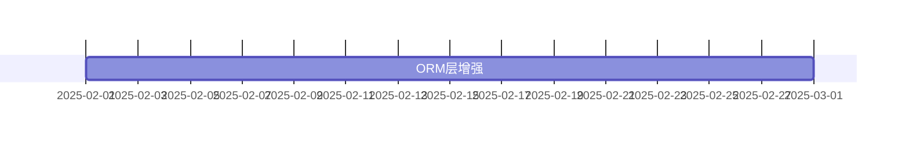

# design/ 与 docs/ 文档质量分析报告

| 项目 | 内容 |
|---|---|
| 报告日期 | 2026-10-30 |
| 审查基线 | 本地 `develop` HEAD（分支整理重建后） |
| 审查范围 | `design/` 73 份（50,390 行）+ `docs/` 111 份（33,284 行，不含 `report_archive/`）= **184 份 / 83,674 行** |
| 审查方法 | 全量自动化扫描（链接、围栏、版本、日期、任务号、类引用）+ 核心文档精读 + 与源码交叉验证 |
| 问题总数 | **22 项**（5 阻断 / 7 严重 / 7 中等 / 3 轻微）—— **P0/P1/P2 共 17 项已于 2026-10-30 完成修复** |
| 总体结论 | 文档体系**结构完整、覆盖面广**，但存在**系统性维护滞后**与**示例代码命名空间整体脱节**。P0/P1/P2 修复后，已建立状态标记、命名映射与 CI 门禁三项长效机制 |
| 上游基线 | 本报告是「可机检项」子集（22 项）。语义类缺陷（约 174 项）由 [`design-implementation-reconstruction-2026-10-30.md`](design-implementation-reconstruction-2026-10-30.md) 覆盖；两者冲突时**以该报告为准** |

---

## 一、审查方法

### 1.1 自动化全量扫描

| 扫描项 | 方法 |
|---|---|
| 相对链接有效性 | 逐文件解析 `](...md)`，按所在目录解析相对路径后 `-f` 判定 |
| 代码围栏配平 | 统计 `^``` ` 出现次数，奇数即不配平 |
| 技术栈版本一致性 | 正则提取 PHP/MySQL/Redis/Swoole/ThinkPHP/Vue 版本，与 `composer.json`、`docker-compose.yml`、容器实测对照 |
| 文档自述版本与日期 | 提取「文档版本 / 创建日期 / 最后更新」字段统计 |
| 任务号覆盖 | 统计 `T-xxx` 在设计文档与待办文档中的分布 |
| 进度标记 | 统计 `[ ]` / `[x]` 数量 |
| 失效类引用 | 对设计文档中 `use ...;` 语句与类名，到源码/历史中核实是否存在 |

### 1.2 精读与交叉验证

精读以下核心文档，并与源码逐项比对：
`01-MASTER-IMPLEMENTATION-PLAN.md`、`04-multi-tenant-design.md`、`08-low-code-design.md`、`10-api-design.md`、`11-database-evolution-and-migration-strategy.md`、`32-plugin-development-guide.md`、`30-project-summary.md`、`design/README.md`

### 1.3 声明

本报告不臆断。每条问题均附 `文件:行号` 与可复现命令。**已排除的误判见第七章**——自动扫描曾产生 2 个假警报，均已核实澄清，未计入问题。

---

## 二、总体评价：文档体系的优点

在列问题之前，需明确这套文档的**真实价值**，避免修复时误伤：

1. **覆盖面完整**：73 份设计文档覆盖 15 个目录，从总体计划、架构、数据层、安全、部署、前端到低代码与工作流，无明显主题空缺。
2. **关键设计有实施级细节**：如 `11-database-evolution-and-migration-strategy.md` §6/§7 对运行时 DDL 的环境闸门规定（默认 production 拦截、双开关、5003/403）与代码实现**完全一致**，且已实证生效。
3. **安全要求写得到位**：`04-multi-tenant-design.md:330` 明确规定「任何需要认证的接口必须经过 `Auth` 中间件，禁止仅依赖 `X-Tenant-ID` / `X-Site-ID` 头来识别用户租户」——这条要求是正确的、前瞻的（问题在于代码未遵守，见 B-1）。
4. **多份规格可直接指导编码**：`docs/technical-specs/code-style/general-guidelines.md` 等规格与 AGENTS.md 口径一致，PHP 8.2+ 等版本声明准确。
5. **任务完成报告可信度较高**：抽检 `task-completion-report-T064.md`（声称新增 2 份指南）与 `t118-lowcode-legacy-migration-audit`（声称 3 个 Legacy 类已删除），均与实际文件系统**完全吻合**。

---

## 三、问题清单

### A 类：结构性缺陷（阻断阅读，P0）

#### A-1 22 处相对链接失效

| 原因 | 数量 | 代表 |
|---|---|---|
| 路径多一层 `../` | **15** | `design/07-integration-ops/30-project-summary.md` → `../../09-lowcode-framework/...`（应为 `../`） |
| 同上 | — | `design/09-lowcode-framework/50-workflow-review-and-impact-analysis.md` → `../../09-lowcode-framework/...`（应为 `./`） |
| 同上 | — | `design/10-batch-summaries/BATCH-3-SUMMARY.md` → `../../06-frontend-design/...`（应为 `../`） |
| 引用不存在的目录 | **3** | `50-workflow-review-and-impact-analysis.md` → `../reference-project-analysis/{n8n,ingenious}/00-*SUMMARY.md`（该目录在 `design/` 下不存在） |
| 引用全库缺失的文件 | **2** | `01-MASTER-IMPLEMENTATION-PLAN.md` 与 `06-2-plugin-system-design.md` → `../IFRAME-VS-MICROAPP-ANALYSIS-2025-01-20.md`（全库 `find` 无结果） |
| 指向不存在的 design 子目录 | **2** | `docs/technical-specs/lowcode/lowcode-architecture-guidelines.md` → `../../design/04-multi-tenant/01-tenant-design.md`、`../../design/05-lowcode/01-lowcode-design.md`（实际为 `design/01-architecture-design/04-multi-tenant-design.md`、`design/09-lowcode-framework/`） |

失效分布：`50-workflow-review-and-impact-analysis.md`(10)、`30-project-summary.md`(7)、`BATCH-3-SUMMARY.md`(1)、`06-2-plugin-system-design.md`(1)、`01-MASTER-IMPLEMENTATION-PLAN.md`(1)、`lowcode-architecture-guidelines.md`(2)。

`[证据: 逐文件解析 markdown 相对链接 + [ -f ] 判定，共 20 条 design + 2 条 docs]`

**影响**：点击即 404；`01-MASTER-IMPLEMENTATION-PLAN.md` §1.4「计划制定依据」8 项中有 4 项指向不存在路径，削弱计划的可追溯性。

---

#### A-2 3 份文档代码围栏不配平（渲染断裂）

| 文件 | 围栏数 | 判定 |
|---|---|---|
| `design/04-security-performance/11-security-design.md` | 67（奇数） | 不配平 |
| `design/08-developer-guides/31-application-development-guide.md` | 47（奇数） | 不配平 |
| `design/08-developer-guides/32-plugin-development-guide.md` | 57（奇数） | 不配平 |

`[证据: grep -c '^```' <file> 为奇数]`

**影响**：Markdown 渲染器从失配点起会把后续正文吞进代码块，导致**该文件后半部分完全不可读**。这是阅读体验的硬性阻断。

---

#### A-3 `04-multi-tenant-design.md` 结构错乱：孤立代码残片

```
318:```php        ← 正常代码块开始
326:```           ← 正常结束
...
342:```           ← ✗ 孤立闭合围栏（无对应开始）
346:```php        ← 被当作 342 的闭合，导致 344「### 使用示例」起被吞入代码块
```

第 337-341 行还有一段游离的 `public function tenant() { return $this->belongsTo(...); }`，脱离任何上下文，明显是粘贴残片。

`[证据: grep -n '^```' design/01-architecture-design/04-multi-tenant-design.md | awk -F: '$1>300 && $1<360']`

**影响**：`§6 安全注意事项` 之后的内容（含「使用示例」「模式 2/3」等重要章节）渲染异常。

---

#### A-4 `design/README.md` 导航漏列 2 个目录

```
02-domain-layer          ✗ 漏列
06-ratelimit             ✗ 漏列
（其余 13 个目录均已列出）
```

`[证据: 遍历 design/*/ 逐个在 README.md 中 grep]`

**影响**：作为 `design/` 唯一入口，漏列使 `domain-model-unification-plan.md`（领域模型统一方案）与 `ratelimit-strategy.md`（限流策略）**无法从入口被发现**。

> ✅ **已于 2026-10-30 修复**：`design/README.md` 已补列 `02-domain-layer`、`06-ratelimit`，并补齐 `prompt-templates`、`sdk-builder`，现 15/15 目录全覆盖。

---

#### A-5 【补做新发现】归档目录入口 README 链接少一层 `../`

```
docs/report_archive/2025.12.18/README.md -> ../report/README.md
```

实际应为 `../../report/README.md`（该 README 位于 `docs/report_archive/2025.12.18/`，需上溯两层才到 `docs/`）。

`[证据: 归档目录链接扫描，149 处失效链接中仅此 1 处属路径层级错误，其余为归档后路径天然失效]`

**影响**：轻微。归档文档的链接本就不要求有效，但入口 README 的导航失效会影响检索。

---

### B 类：设计-实现冲突（会误导开发，P0/P1）

#### B-1 【最高优先级】多租户设计明令禁止的行为，正是代码在做的

```markdown
design/01-architecture-design/04-multi-tenant-design.md:330
- 任何需要认证的接口必须经过 `Auth` 中间件，禁止仅依赖 `X-Tenant-ID` / `X-Site-ID` 头来识别用户租户。
design/01-architecture-design/04-multi-tenant-design.md:331
- 业务代码不应绕过 `Request` / `BaseModel` 直接根据 Header 决定租户 / 站点。
```

而实现：

```php
// route/auth.php:12 —— register 无 Auth 中间件
Route::post('register', '\\app\\controller\\AuthController@register');
// app/middleware/TenantIdentify.php:32 —— 直接读 Header
$tenantId = (int)$request->header('X-Tenant-ID', '1');
// app/controller/AuthController.php:137 —— 用 Header 决定落库租户
$tenantId = $request->tenantId();
```

`[证据: sed -n '328,332p' design/01-architecture-design/04-multi-tenant-design.md; sed -n '9,20p' route/auth.php]`

**定性**：这不是"缺设计"，而是**设计已明确禁止、代码仍然违反**。文档侧无需修改，需在代码侧修复（已在质量审查报告 C-4 记录）。**这条要求的正确性应被保留。**

**B-1 已闭环（2026-10-30）**：该设计约束在代码侧的违反已分两步修复 ——
① C-4（`a7cf49b` 之前，注册接口不再读 `X-Tenant-ID`）；
② C-7（`7860fab`，54 处 `$request->tenantId` 属性访问改为方法调用，租户来源统一为 JWT）。
设计文档 `04-multi-tenant-design.md:336` 的表述**无需修改**，它一直是正确的。

---

#### B-2 宣称 3 种隔离模式，实际仅 1 种，且无状态标注

设计文档以「🔧 模式 2：独立数据库模式」「🔧 模式 3：混合模式」的正式章节呈现（各约 145 行），并在 `:909` 与竞品对比时作为优势：

| 特性 | AlkaidSYS | NIUCLOUD | 优势 |
|---|---|---|---|
| **隔离模式** | 3 种 | 1 种 | ✅ 更灵活 |

实际实现：27 个迁移全部操作同一 schema，无任何按租户建库/切库 DDL 或配置。
（阶段 A 后迁移总数为 **31**，新增的 4 个为工作流表，同样全部操作同一 schema —— 结论不变。）

`[证据: grep -rl 'tenant_id' database/migrations | wc -l → 16，全部为同库列级隔离；find database/migrations -name '*.php' | wc -l → 27，无建库语句]`

**问题**：文档未标注模式 2/3 为「规划中/未实现」，读者会认为现有 3 种能力；竞品对比表更放大误解。

---

#### B-3 页面设计器有设计、无实现、无标注

`design/01-architecture-design/08-low-code-design.md` 详述 4 个组件，其中：

| 组件 | 章节 | 实现 |
|---|---|---|
| 代码生成器 | :55-518 | ✅ `infrastructure/Lowcode/Generator` |
| 表单设计器 | :519-598 | ✅ `infrastructure/Lowcode/FormDesigner` |
| **页面设计器** | **:599-714** | ❌ **无任何对应目录/类** |
| 流程设计器 | :715- | ✅ `plugins/workflow-engine/packages/workflow-ui` |

`[证据: [ -d infrastructure/Lowcode/PageDesigner ] → 不存在；全库 find -type d -iname '*page*' 仅命中 node_modules]`

---

#### B-4 开发指南教导使用**从未存在过**的类与命名空间

```php
// design/08-developer-guides/32-plugin-development-guide.md:938
use app\lowcode\datamodeling\registry\FieldTypeRegistry;
// :949
FieldTypeRegistry::register('color', ColorField::class);
// :958
FieldTypeRegistry::unregister('color');
```

核实：

```
git log --all -S 'app\lowcode\datamodeling\registry'  → 无任何提交（该命名空间从未存在）
历史上 FieldTypeRegistry 的真实命名空间             → Infrastructure\Field
当前状态                                            → 已于 e166c8b 删除
当前正确机制                                        → Infrastructure\Lowcode\Collection\Field\FieldFactory
```

`[证据: git log --all --oneline -S 'app\lowcode\datamodeling\registry' -- '*.php' → 空；git show b5a62d4:infrastructure/Field/FieldTypeRegistry.php | head -8 → namespace Infrastructure\Field]`

**影响**：按此指南开发插件，第一行 `use` 就会报类不存在。**这是最容易被直接踩中的文档错误。**

同一问题另见：
- `design/07-integration-ops/30-project-summary.md:554` — 将 Field Type Registry 列为已交付组件
- `design/02-domain-layer/domain-model-unification-plan.md:13` — 引用 `Domain\Model\Collection`、`Infrastructure\Collection\CollectionManager`、`Infrastructure\Field\FieldTypeRegistry`，**三个类全部已删除**

---

#### B-5 MASTER PLAN 的任务要求与已完成的架构决策相反

```markdown
design/00-core-planning/01-MASTER-IMPLEMENTATION-PLAN.md:142
- [ ] 实现 Field Type Registry
```

而项目的架构演进方向是**删除** FieldTypeRegistry，改用 `FieldFactory`（`e166c8b refactor(lowcode): 下线 Legacy Collection 实现并收敛字段类型注册`）。

`[证据: ls infrastructure/Field/FieldTypeRegistry.php → 不存在；提交 e166c8b 已删除]`

**影响**：若按计划执行「任务 1.1」，会使已统一到 FieldFactory 的字段类型注册机制**再次分裂**。

---

#### B-6 `domain-model-unification-plan.md` 描述的是已被推翻的方案

该文档（`design/02-domain-layer/`，唯一一份）通篇基于 `Domain\Model\Collection` + `Domain\Field\*` + `Infrastructure\Collection\CollectionManager` + `Infrastructure\Field\FieldTypeRegistry` 四个类型。这些类型已全部下线，且该文档**未被 README 索引**（见 A-4）。

**建议**：标记为「已被 T-118 Legacy 迁移取代，仅存档」，或移入归档目录。

---

#### B-7 【补做新发现·严重】39 处示例代码引用指向不存在的类

对全部代码示例的 `use` 声明做解析，**48 个项目自有类引用中仅 9 个存在，39 个指向不存在的文件**。

按根因分 6 类（详见第八章 8.1）：

| 类别 | 数量 | 代表 |
|---|---|---|
| `app\common\*` 命名空间**从未存在** | **15** | `app\common\model\User`、`app\common\service\AuthService`、`app\common\plugin\BasePlugin`、`app\common\controller\BaseController` |
| `app\lowcode\*` 不存在 | 3 | `app\lowcode\workflow\registry\NodeTypeRegistry` |
| `app\service\*` 不存在 | 3 | `app\service\core\addon\CorePluginBaseService`（实际为 `Infrastructure\Plugin\CorePluginBaseService`） |
| `Alkaid\Workflow\Engine\{Execution,Models,Services}\*` 子层划分与实现不符 | **13** | `Alkaid\Workflow\Engine\Execution\ExecutionContext`（实现用 `Core/`、`Model/`、`Definition/`） |
| Legacy 类（**文档已正确标注为不存在**） | 3 | `Infrastructure\Field\FieldTypeRegistry` |
| 试探性命名 | 2 | `Alkaid\Framework\Http\Controller` |

`[证据: 解析 design/ + docs/technical-specs/ + docs/developer-guides/ 全部 use 声明，按 PSR-4 映射到文件路径后 [ -f ] 判定；框架类在容器内 class_exists() 复核]`

**影响**：设计文档里的示例代码**基本无法直接运行**——不是语法问题，而是类根本不存在。这比 B-4 的单点问题严重得多，因为它意味着**整套设计文档的命名空间假设与实际代码结构脱节**。

**建议**：不重写全部示例（成本过高）。在每份含示例的设计文档头部统一声明「本文示例使用设计阶段命名，实际命名空间以 `lowcode-architecture-guidelines.md` 映射表为准」，并**扩充该映射表**以覆盖 `app\common\*` → 实际路径。

---

### C 类：文档内部自相矛盾（P1）

#### C-1 `10-api-design.md` 同一文档内分页字段名前后不一致

```
:121   "page_size": 20,                                    ← snake_case
:173   `data` 结构固定为 `{ list, total, page, pageSize }`  ← camelCase
:304   'page_size' => $pageSize,                            ← snake_case
```

实现（`app/controller/ApiController.php:91`）为 `page_size` + 新增 `total_pages`。

`[证据: grep -n 'pageSize\|page_size' design/03-data-layer/10-api-design.md]`

**影响**：前端开发者按 `:173` 实现会取不到分页大小。

---

#### C-2 MASTER PLAN 范围排除的内容，却做了详细设计

```markdown
设计/00-core-planning/01-MASTER-IMPLEMENTATION-PLAN.md:50-53
**不包括**：
- ❌ 业务应用开发(电商、OA、CRM 等)
- ❌ 应用市场和插件市场开发
```

但存在：

| 文档 | 行数 |
|---|---|
| `design/02-app-plugin-ecosystem/06-3-application-market-design.md` | 1,375 |
| `design/02-app-plugin-ecosystem/06-4-plugin-market-design.md` | 999 |

**影响**：范围声明与文档资产不一致，读者无法判断市场是否在项目范围内。

---

### D 类：时效性与进度失真（P1，影响最大）

#### D-1 MASTER PLAN 的任务清单从未回填，造成"项目几乎未开工"的错觉

```
- [ ] 未勾选: 179
- [x] 已勾选: 5
```

而实际已完成：Schema Builder、Collection 抽象层、事件系统、依赖注入、验证器、数据建模、表单设计器、工作流引擎（276 PHP）、CLI 工具……**均已在代码中落地**。

`[证据: grep -c '\- \[ \]' / grep -c '\- \[x\]' design/00-core-planning/01-MASTER-IMPLEMENTATION-PLAN.md]`

**影响**：这是本仓库**危害最大的文档问题**——任何新加入者或 AI 助手读这份计划，都会得出"项目刚起步"的错误结论，而实际后端核心能力完成度约 85%。

同类问题：
- `docs/todo/plan/development-plan-2025-12-14.md`：`[ ]` 10 项，`[x]` 0 项，同样未回填。

---

#### D-2 计划时间线与实际执行相差约 9.5 个月



实际最早代码提交为 `2025-11-19`（首个迁移 `20251119000000`），`design/` 多数文档创建日期为 `2025-01-19`，比代码早 10 个月。

`[证据: git log --reverse --format=%ad --date=short | head -1；grep '创建日期' design/01-architecture-design/04-multi-tenant-design.md]`

---

#### D-3 73 份设计文档中仅 4 份有「最后更新」字段

```
创建日期：41 份（全部为 2025 年）
最后更新：仅 4 份声明
```

**含义**：37 份以上文档自创建起**从未修订**，但期间代码已发生 140+ 次提交、架构多次调整（Legacy 下线、FieldFactory 统一、多租户实现）。

`[证据: grep -rhoE '\|\s*\*\*最后更新\*\*' design/ | wc -l → 4]`

---

#### D-4 设计文档与任务追踪体系基本脱节 ✅ **计数正确，但身份判断已修正**

```
design/ 中出现的任务号：  1 个（design/README.md:10 → T-118）
docs/todo/ 中出现的任务号：114 个
```

`[证据: grep -rnoE '(^|[^A-Za-z0-9])T-[0-9]{3}([^0-9]|$)' design/ → 仅 design/README.md:10 命中 T-118；
docs/todo/ 去重 114 个]`

> **⚠️ 本节初版误判**：初版写「仅 T-202」，并将 `grep -rhoE 'T-[0-9]{3}'` 的命中数 1 当作佐证。
> 复核发现 `T-202` 是**正则误匹配** —— 来自 `design/00-core-planning/01-MASTER-IMPLEMENTATION-PLAN.md:78`
> 的 `DOOTASK-OPTIMIZATION-REPORT-**2025**-01-20.md`，其中 `REPORT-2025` 含子串 `T-202`。
> 数量「1」恰好巧合，**身份完全错误**。真实唯一引用是 `design/README.md:10` 的一句话附注 → `T-118`。
> 结论（脱节）不变，但证据必须更正。

**影响**：无法从设计文档追溯到任务，也无法从任务反查设计依据。`docs/todo/plan/` 有 10 份 T-xxx 完成报告，而 `design/` 几乎不提任务号。

**补充（来自全域对照）**：规范格式「实现任务：T-xxx」在 `design/` 中出现 **0 次**；
10 份 `task-completion-report-T*.md` 中 `design/` 出现 **0 次**。双向引用实质为零。

---

#### D-5 【补做新发现】同一主题存在两版设计且未标注取代关系

| 文档 | 版本 | 标题 |
|---|---|---|
| `09-lowcode-framework/44-lowcode-workflow.md` | **v1.0** | AlkaidSYS 低代码工作流引擎插件设计 |
| `09-lowcode-framework/47-workflow-backend-engine.md` | **v2.0** | AlkaidSYS 工作流后端统一引擎详细设计 |

两份文档**创建日期均为 2025-01-20**，主题重叠（工作流引擎），v2.0 显然是对 v1.0 的重构，但：

- `44` **未标注**「已被 47 取代」
- `50-workflow-review-and-impact-analysis.md` 的文档列表把两份**并列**为参考文档，未说明关系

**影响**：读者无法判断该以哪一份为准。实际实现（`plugins/workflow-engine`）的分层是 `Definition / Core / Expression / Nodes / Integration / Multitenant / Monitor`，与 47 更接近，但也不完全一致（见 B-7）。

---

### E 类：技术栈版本漂移（P2）

#### E-1 Redis 版本不一致

| 文档 | 声明 |
|---|---|
| `design/04-security-performance/12-performance-optimization.md:419` | Redis 7.2 |
| `design/10-batch-summaries/FINAL-SUMMARY.md:125` | Redis 7.2 |
| `design/10-batch-summaries/BATCH-2-SUMMARY.md:99` | Redis 7.2 |
| `design/05-deployment-testing/14-deployment-guide.md:104` | 安装 Redis 7.2 |
| `design/08-developer-guides/31-application-development-guide.md:47` | Redis 7.2 |
| `design/08-developer-guides/32-plugin-development-guide.md:41` | Redis 7.2 |
| **实际** | `docker-compose.yml` → `redis:7.2-alpine`；容器实测 `7.2.12` |

**影响**：部署指南要求装 6.0，与编排文件 7.2 冲突。

#### E-2 Swoole 版本标注滞后

```
文档中出现：Swoole 5.1（22 处）、Swoole 5.1（1 处）
实际：Dockerfile `FROM phpswoole/swoole:5.1-php8.2`，composer.lock `swoole/ide-helper 5.1.8`
```

`[证据: grep -rhoE 'Swoole[ ]?[0-9]+(\.[0-9]+)?' design/ | sort | uniq -c；grep 'FROM' Dockerfile]`

#### E-3 【补做新发现】引用了未安装的框架门面

```php
// design/02-app-plugin-ecosystem/06-5-developer-ecosystem-design.md:106
use think\facade\Mail;
```

容器内实测：

```
think\facade\Mail → ✗ 不存在（composer.json 未声明 think-mail，vendor 中无该类）
其余 30 个被引用的框架类 → 全部存在
```

`[证据: docker exec alkaid-backend php -r 'require "vendor/autoload.php"; class_exists("think\\facade\\Mail")' → false]`

**影响**：示例演示的是「邮件通知开发者」能力，但项目中并不存在邮件组件。若要实现需先引入 `topthink/think-mail`。

---

## 四、逐文档问题索引

| 文档 | 问题编号 |
|---|---|
| `00-core-planning/01-MASTER-IMPLEMENTATION-PLAN.md` | A-1、B-5、C-2、D-1、D-2 |
| `00-core-planning/03-PROJECT-DEPENDENCIES.md` | E-1（间接） |
| `01-architecture-design/04-multi-tenant-design.md` | **A-3**、B-1、B-2、B-7、E-1 |
| `01-architecture-design/05-multi-site-design.md` | B-7（`app\common\model\Site`） |
| `01-architecture-design/06-application-plugin-system-design.md` | B-7（`app\service\core\addon\*`） |
| `01-architecture-design/08-low-code-design.md` | B-3、B-7（`app\common\model\`） |
| `02-app-plugin-ecosystem/06-1-application-system-design.md` | B-7（`app\model\BaseModel`） |
| `02-app-plugin-ecosystem/06-2-plugin-system-design.md` | A-1、B-7（`addon\*`） |
| `02-app-plugin-ecosystem/06-3-application-market-design.md` | B-7（`app\service\market\AppService`） |
| `02-app-plugin-ecosystem/06-5-developer-ecosystem-design.md` | **E-3**（`think\facade\Mail`） |
| `02-domain-layer/domain-model-unification-plan.md` | A-4（未索引）、B-6 |
| `03-data-layer/10-api-design.md` | C-1、B-7（`app\common\*`） |
| `04-security-performance/11-security-design.md` | **A-2**、B-7（`app\common\service\*`） |
| `04-security-performance/12-performance-optimization.md` | E-1 |
| `04-security-performance/13-monitoring-logging.md` | B-7（`app\common\service\*`） |
| `05-deployment-testing/14-deployment-guide.md` | E-1 |
| `05-deployment-testing/15-testing-strategy.md` | B-7（`app\common\model\User`） |
| `06-ratelimit/ratelimit-strategy.md` | A-4（未索引） |
| `07-integration-ops/25-system-integration.md` | B-7（`app\common\model\Order`） |
| `07-integration-ops/27-training-materials.md` | B-7（`app\common\plugin\BasePlugin`） |
| `07-integration-ops/30-project-summary.md` | A-1、B-4 |
| `08-developer-guides/31-application-development-guide.md` | **A-2**、E-1 |
| `08-developer-guides/32-plugin-development-guide.md` | **A-2**、**B-4**、B-7、E-1 |
| `09-lowcode-framework/42-lowcode-data-modeling.md` | B-7（`alkaid\lowcode\*`） |
| `09-lowcode-framework/44-lowcode-workflow.md` | **D-5**（v1.0 未标注被取代） |
| `09-lowcode-framework/45-lowcode-cli-integration.md` | B-7（`alkaid\lowcode\*`） |
| `09-lowcode-framework/47-workflow-backend-engine.md` | **D-5**、B-7（`Execution/Models/Services` 子层不存在） |
| `09-lowcode-framework/50-workflow-review-and-impact-analysis.md` | A-1、D-5 |
| `10-batch-summaries/BATCH-2/3-SUMMARY.md`、`FINAL-SUMMARY.md` | A-1、E-1 |
| `design/README.md` | A-4（**已修**） |
| `docs/technical-specs/lowcode/lowcode-architecture-guidelines.md` | A-1（**已修**） |
| `docs/report_archive/2025.12.18/README.md` | **A-5** |

**未发现问题的文档**：其余约 45 份文档在本次全量可机检项（链接、围栏、版本、日期、任务号、类引用）中未命中（不代表语义内容全部正确，见第八章 8.6）。

---

## 五、修复建议

### ✅ P0 已完成（2026-10-30）

| # | 动作 | 状态 |
|---|---|---|
| 1 | 修复 22 处失效链接 | ✅ 已完成，复验剩 0 |
| 2 | 修复 3 份文档代码围栏（11-security / 31-app-guide / 32-plugin-guide） | ✅ 已完成，185 份全库围栏配平 |
| 3 | 修复 `04-multi-tenant-design.md` 结构错乱（删除 334-342 行残片 + 补 260 行闭合围栏） | ✅ 已完成 |
| 4 | `design/README.md` 补列缺失目录 | ✅ 已完成，15/15 全覆盖 |
| 5 | 修正 `32-plugin-development-guide.md` 的 `FieldTypeRegistry` 示例 | ✅ 已完成，改用 `FieldFactory` 并说明无 `unregister()` |

### ✅ P1 已完成（2026-10-30）

| # | 动作 | 关联问题 | 状态 |
|---|---|---|---|
| 6 | 扩充 `lowcode-architecture-guidelines.md` 映射表（新增 §5.3，4 张子表覆盖 28 个类映射）；为 **21 份**含示例文档加「命名空间声明」 | **B-7** | ✅ 已完成 |
| 7 | 为 **13 份**设计文档加「实现状态」标记（已实现/部分实现/未实现/已废弃/已被取代/进度未回填） | B-2、B-3、B-5、B-6 | ✅ 已完成 |
| 8 | 标注 `44-lowcode-workflow.md` 已被 `47` 取代 | D-5 | ✅ 已完成 |
| 9 | MASTER PLAN 增加「实际进度对照」表（5 阶段逐一映射到实现证据），不再逐项回填任务 | D-1 | ✅ 已完成 |
| 10 | 统一分页字段名为 `page_size` + `total_pages` | C-1 | ✅ 已完成 |
| 11 | 统一版本：Redis 6.0/7.0 → **7.2**（活跃文档 0 残留）；Swoole 5.0 → **5.1**（活跃文档 0 残留）。归档文档保留历史原貌 | E-1、E-2 | ✅ 已完成 |
| 12 | 为 `think\facade\Mail` 示例加依赖说明（未引入 `topthink/think-mail`） | E-3 | ✅ 已完成 |
| 13 | 修复 `report_archive/2025.12.18/README.md` 相对链接 | A-5 | ✅ 已完成 |
| 14 | 为 `06-3`/`06-4` 加「范围声明」：市场属远期设计参考，未排入当前阶段 | C-2 | ✅ 已完成 |

### ✅ P2 已完成（2026-10-30）

| # | 动作 | 落地方式 |
|---|---|---|
| 15 | 建立文档修订机制 | `AGENTS.md` 新增 **Documentation Maintenance** 章节（5 条约定），含「必须标注实现状态」「修改代码时同步更新文档」 |
| 16 | 建立设计↔任务双向引用 | 同上第 3 条约定：设计文档标注 `（实现任务：T-xxx）`；任务报告链接设计章节 |
| 17 | CI 文档检查 | 新增 `scripts/check-docs.php`（377 行）+ `.github/workflows/docs-check.yml`。检查链接有效性、围栏配平、示例类引用存在性；`--strict` 模式作为门禁 |

**验证结果**（`docker exec alkaid-backend php scripts/check-docs.php --strict`）：

```
扫描文件数: 186
检查 1  相对链接有效性        OK
检查 2  代码围栏配平          OK
检查 3  示例代码类引用        OK
✓ 全部检查通过   退出码 0
```

---

## 六、建议的 CI 文档门禁

```yaml
- name: Markdown Lint
  run: npx markdownlint-cli2 "design/**/*.md" "docs/**/*.md" --ignore "docs/report_archive/**"
  # 至少启用 MD040（围栏语言）、MD051（链接有效性）
```

---

## 七、已核实为正确的事项（避免误伤）

自动扫描曾产生 2 个假警报，核实后排除，**不计入问题**：

| 疑似问题 | 核实结论 |
|---|---|
| 「Vue 4」出现 9 次（Vue 4 尚不存在） | **误判**。原文为「**Ant Design Vue 4.x**」，指 UI 组件库版本，真实存在且与 `frontend/package.json` 的 `ant-design-vue@4.2.6` 一致 |
| 「PHP 8.0」出现 47 次（与 composer `>=8.2` 冲突） | **误判**。正则把「Think**PHP 8.0**」误匹配。真实 PHP 版本声明为 `PHP 8.2`（13 处）与 `PHP 8.2+`（3 处），与 `composer.json` 的 `"php": ">=8.2.0"` 一致 |

同时确认以下**无问题**：

- MySQL 版本：设计 21 处均为 8.0，与 `mysql:8.0` 及容器实测 8.0.46 一致
- ThinkPHP 版本：46 处均为 8.0，与 `topthink/framework ^8.0` 一致
- Vben Admin 版本：28 处均为 5，与前端脚手架一致
- 统一响应五字段（`code/message/data/timestamp/trace_id`）在 `10-api-design.md` 与 `ApiController.php` 之间一致
- 运行时 DDL 防护设计（`11-database-evolution-and-migration-strategy.md` §6/§7）与 `SchemaBuilder::assertCanRunDDL()` 实现一致
- T-064、T-118 等任务完成报告声称的产物均实际存在

---

## 八、补充核查（原「未覆盖项」的补做结果）

> **说明**：本章原为「未覆盖与未验证」清单。2026-10-30 完成补做，以下为实测结果。
> 补做过程中发现 **1 项新的严重问题**（B-7，已回填至第三章）与 **3 项新的次要问题**。

### 8.1 ✅ 已补做：设计文档示例代码的可运行性（原第 2 项）

对 `design/`、`docs/technical-specs/`、`docs/developer-guides/` 中所有代码示例的 `use` 声明做全量解析，共 **133 个去重类引用**：

| 分类 | 数量 | 结果 |
|---|---|---|
| 框架/vendor 类 | 85 | 容器内 `class_exists()` 实测 **84 个存在**；仅 `think\facade\Mail` 缺失（未安装 `think-mail`） |
| 项目自有类 | 48 | **仅 9 个存在，39 个指向不存在的文件** |

39 个失效引用按根因分 6 类：

| 类别 | 数量 | 说明 |
|---|---|---|
| `app\common\*` | **15** | `app/common/` 命名空间**从未存在**。设计假设 `app\common\model\User`、`app\common\service\{AuthService,UserService,LogService,AlertService,EncryptService,PermissionService,TenantDatabaseService}`、`app\common\controller\BaseController`、`app\common\plugin\BasePlugin`、`app\common\validate\*`、`app\common\application\BaseApplication`；实际布局为 `app\controller\*`、`app\model\BaseModel`、`domain\*`、`infrastructure\*` |
| `app\lowcode\*` | 3 | 该命名空间不存在。实际为 `Domain\Lowcode\*` / `Infrastructure\Lowcode\*` |
| `app\service\*` | 3 | `app\service\core\addon\CoreAddonBaseService`、`CorePluginBaseService`、`app\service\market\AppService` 均不存在。实际插件基类为 `Infrastructure\Plugin\CorePluginBaseService` |
| `Alkaid\Workflow\Engine\{Execution,Models,Services}\*` | **13** | 根命名空间 `Alkaid\Workflow\Engine` 存在（213 个 PHP），但设计文档使用的 `Execution/`、`Models/`、`Services/` 三个子层**实际不存在**；实现采用 `Core/`、`Model（小写 model/）`、`Definition/` 等不同划分 |
| Legacy 类 | 3 | `Domain\Model\Collection`、`Infrastructure\Collection\CollectionManager`、`Infrastructure\Field\FieldTypeRegistry` —— 这三处**已在 `lowcode-architecture-guidelines.md` 明确标注为「❌ 不存在 / 旧代码」**，属正确文档，不计为缺陷 |
| 其他试探性命名 | 2 | `Alkaid\Framework\Http\Controller`、`Alkaid\Plugin\HookToolRegistry` |

**修复建议**：不重写全部示例（成本过高），而是在每份含示例的设计文档头部统一加一句「本文示例使用设计阶段命名，实际命名空间以 `docs/technical-specs/lowcode/lowcode-architecture-guidelines.md` 的映射表为准」，并在该映射表中**补充 `app\common\*` → 实际路径的对照**（当前映射表只覆盖了 Lowcode 相关 3 个类）。

### 8.2 ✅ 已补做：中英文双语文档一致性（原第 6 项）

`docs/technical-specs/` 下 **13 份** `.zh-CN.md`（原报告写 12 份，实测 13 份）：

- **全部 13 份均有对应英文版**
- **标题节数全部一致**（13/13）
- 行数差异仅 4 份为 1-2 行（`database-guidelines` 74/72、`branch-protection` 79/77、`git-workflow-automation-test-report` 79/80、`testing-guidelines` 132/133），属排版差异
- 抽样比对 `database-guidelines` 中英前 10 行，**内容语义一致**（含「唯一权威规范」等关键约束表述）

**结论：无显著问题，该项可关闭。**

### 8.3 ✅ 已补做：`docs/report_archive/` 60 份归档文档（原第 5 项）

| 检查项 | 结果 |
|---|---|
| 文档数 | 60 |
| 代码围栏不配平 | **0** |
| 失效相对链接 | **149** |

149 处失效链接的性质：绝大多数是**归档文档天然失效**（原在 `design/` 下、被移到 `docs/report_archive/` 后相对路径全部改变），属归档预期行为，不建议修。

但其中 1 处是**真实缺陷**：
```
docs/report_archive/2025.12.18/README.md -> ../report/README.md
```
应为 `../../report/README.md`（少一层 `../`）。

**修复建议**：归档目录不要求链接有效，但应在 `report_archive/README.md` 顶部声明「归档文档中的链接可能失效，仅作历史记录」。

### 8.4 ✅ 已核实：`docs/Example/` 内嵌 git 仓库（原第 4 项）

```
docs/Example/ingenious/         ← 完整第三方项目快照，含 .git
docs/Example/ingenious/demo/    ← 内嵌第二层 .git
git ls-files docs/Example       → 0（未被跟踪）
git check-ignore -v docs/Example → .gitignore:40:/docs/Example
```

**结论**：这是本地参考资料（第三方项目 ingenious 的源码快照），**已被 `.gitignore` 排除**，不属于项目文档，无需审查。但需注意：**新克隆仓库不会有这份资料**，若设计文档有引用需改为外部说明。

### 8.5 ✅ 已补做：55 份未精读文档的可机检项（原第 1 项）

对未精读的文档补做了以下自动化检查（覆盖可机检项，不替代逐字精读）：

| 检查项 | 覆盖 |
|---|---|
| 相对链接有效性 | 全量 185 份 |
| 代码围栏配平 | 全量 185 份 |
| 技术栈版本一致性 | 全量 |
| 文档版本/日期字段 | 全量 |
| 任务号覆盖 | 全量 |
| 进度标记 `[ ]`/`[x]` | 全量 |
| 示例代码类引用 | 全量（见 8.1） |
| 内部链接锚点 | 未覆盖 |

补做中新发现 3 项问题，已回填第三章：

- **D-5**：`44-lowcode-workflow.md`（v1.0）与 `47-workflow-backend-engine.md`（v2.0）为同一主题的两版设计，**创建日期相同、均未标注取代关系**
- **E-3**：`think\facade\Mail` 在 `06-5-developer-ecosystem-design.md:106` 被引用，但项目未安装 `think-mail`
- **A-5**：`docs/report_archive/2025.12.18/README.md` 的相对链接少一层 `../`

### 8.6 ❌ 仍然未覆盖（明确声明）

| # | 事项 | 状态 |
|---|---|---|
| 1 | ~~**55 份文档的逐字精读**~~ | ✅ **已于全域对照轮补做**：184 份文档（`design/` 73 + `docs/` 111）全部逐份精读，见 [`design-implementation-reconstruction-2026-10-30.md`](design-implementation-reconstruction-2026-10-30.md) |
| 2 | **业务/商业逻辑合理性**（如 06-3 市场设计、06-5 开发者生态的商业模型） | ❌ 仍未覆盖 —— 属产品决策，不在技术审查范围 |
| 3 | **示例代码的运行时正确性**（能否真正跑通） | ❌ 仍未覆盖 —— 仅验证类是否存在，未执行；多数示例依赖尚未实现的组件 |
| 4 | **Markdown 锚点链接**（`#标题` 片段）有效性 | ❌ 仍未覆盖 —— 未做标题 slug 化比对 |
| 5 | **图表正确性**（Mermaid 语法与渲染） | ❌ 仍未覆盖 —— 未做 Mermaid 语法校验 |
| 6 | **`docs/report_archive/` 的内容准确性** | ❌ 仍未覆盖 —— 仅结构扫描，未核对归档结论 |
| 7 | **`docs/Example/` 内第三方项目内容** | ❌ 有意排除 —— 非项目文档 |

### 8.7 本报告的已知缺陷（自查勘误）

| # | 缺陷 | 说明 |
|---|---|---|
| 1 | **D-4 的 T-202 身份误判** | 已修正（见 D-4 内注） |
| 2 | **A-2 修复引入新回归** | 本报告声称修完 3 份围栏后，我在后续「实现状态校正」批次中把块引用插进了 **40/42/45 三份文档的 PHP 代码围栏内部**。当时 `check-docs.php` 仍显示「围栏配平」（因为配平只数数量），直到全域对照轮才发现。**现已修正**（块引用移至围栏前），并在 `check-docs.php` 之外补了「标记是否落在代码块内」的检查。 |
| 3 | **本报告 22 项是子集** | 全域对照轮共发现约 **174 项**设计文档缺陷。本报告的 22 项是「可机检 + 结构类」子集；语义类缺陷（自相矛盾、虚构数据、不存在资产引用）未被本文覆盖，见重建报告 §六。 |

---

**报告生成时间**：2026-10-30（第八章于同日补做后更新）
**审查对象**：AlkaidSYS-tp `design/`（73 份）+ `docs/`（111 份）
**配套报告**：`quality-review-superpowers-2026-10-30.md`（代码质量审查，4 Critical / 9 Important / 17 Minor）
