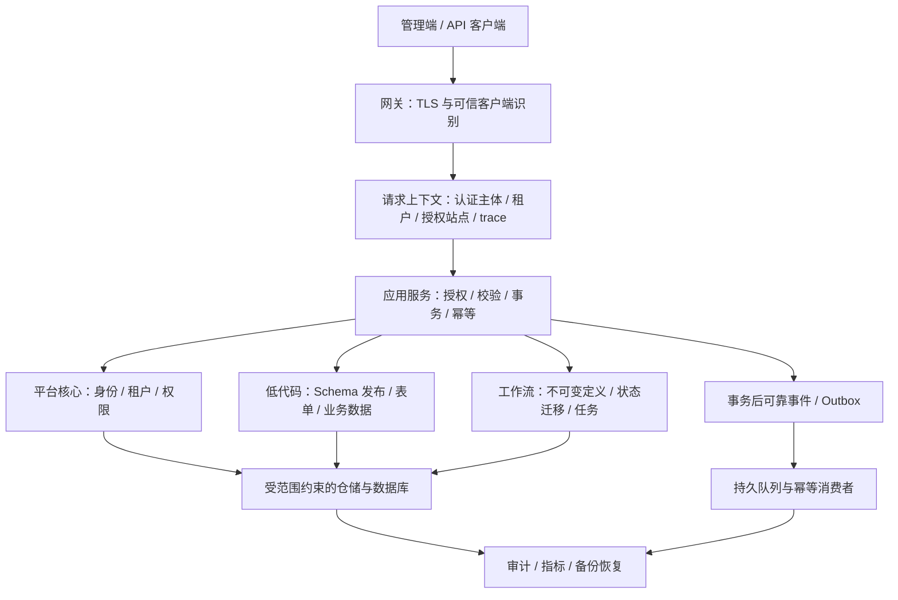

# AlkaidSYS 企业生产级重启审计与重建路线报告

| 项目 | 内容 |
| --- | --- |
| 审计日期 | 2026-10-31（北京时间） |
| 源码基线 | `develop`，`914f2b4fb2d410476b2035d77c1af636b39b1e0c`；开始审计时工作区无未提交变更 |
| 报告性质 | 接手评估、设计复核、生产差距审计与重启决策建议；不构成上线认证 |
| 审计方法 | 规则与设计核对、关键路径源码追踪、只读命令实测、安全专项交叉复核、历史报告反证 |
| 变更范围 | 本报告、报告索引及项目概览中的历史状态提示；未修改业务实现、配置、依赖、迁移或数据库数据 |
| 核心结论 | **可以立即启动有边界的整顿开发；尚不具备企业生产上线条件，也不宜直接恢复原计划的全面功能开发。** |

> **证据使用约定**：`[实测]` 表示本次实际执行并观察到的结果；`[源码]` 表示已追踪控制流、但未进行攻击或故障注入复现；`[建议]` 表示待评审的目标方案；`[待验证]` 表示本次没有足够证据。下文建议不自动修改现行 Always Rules 或已接受的 ADR。

## 1. 给接手者的判断

### 1.1 项目值得保留，但应按“待重建的框架原型”管理

项目具有可复用资产：ThinkPHP 主应用、统一响应与错误处理、显式租户过滤的仓储、低代码集合与表单后端、权限服务、Vben 系统管理页面，以及最近补上的配置与迁移守卫。它并非只有设计和空目录，也没有证据支持为了“企业级”而整体更换 PHP、ThinkPHP 或 Vue 技术栈。

但是，**现有资产不能组合成一个已经过验证的企业 SaaS 产品底座**。主要问题不是功能数量少，而是若干关键边界仍未成立：

1. 身份声明与账号、租户、站点的当前有效状态没有闭环；权限授予、缓存撤销和平台管理边界不完整。
2. 低代码允许租户各自定义 Schema，却默认共享同名物理表；表所有权、Schema 兼容性和删除语义没有一起解决。
3. 工作流 HTTP 接口、数据库表和插件执行内核是三套未形成闭环的实现，不能凭路由数、表数或节点类数量认定可用。
4. 测试环境和 CI 不能提供可信的发布证明；迁移守卫通过也未发现当前数据库中的历史 `MISSING` 记录。
5. 部署示例、日志、告警、备份和恢复尚缺少可重复执行、可验证结果的交付链。

**建议采用保留底座、收缩承诺、重建关键链路的方式。** 保留已证实有用的实现；将演示能力与生产能力隔离；对身份、Schema 发布、工作流持久化和交付验证作集中修复。不要把所有历史设计逐条“补齐”作为重启目标。

### 1.2 区分三种准入，避免陷入“永远无法重启”

| 准入 | 当前判断 | 允许开展的工作 | 必须满足的退出条件 |
| --- | --- | --- | --- |
| G0：整顿开发 | **可以开始** | 建立安全测试环境、核实缺陷、补边界设计、修复验证与交付链 | 独立测试资源、可复现检查、迁移账本核对、基线证据归档 |
| G1：恢复业务功能开发 | **暂未达到** | G0 期间只推进不依赖未决架构的任务 | 安全边界关闭；低代码表策略与发布契约确定；一个真实业务闭环通过 |
| G2：企业生产上线 | **不准入** | 在隔离预发验证候选版本 | 本文第 7 节的安全、数据、恢复、容量、运维与发布门槛全部有证据 |

“企业生产级”在本报告中指：**在明确业务范围和容量范围内，系统正确隔离和授权、可靠保存数据、可重复交付、可观测、可恢复，且团队能证明并持续维持这些性质。** 它不等同于微服务、市场生态、多数据库模式或一个笼统的完成百分比。

### 1.3 最先做的五件事

1. 隔离测试数据库、缓存、队列、文件目录和凭据，并在测试启动时验证其确实隔离，停止对开发库运行默认全套测试。
2. 收紧低代码 SQL 标识符和物理表所有权；在设计裁决前限制 Schema 变更和物理删除入口。
3. 建立统一的会话有效性、站点授权、可授予权限上限和撤权机制，覆盖前后端真实路径。
4. 核对旧库迁移账本，修复 CI 的执行链，让安全、测试、迁移与构建失败确实阻止发布。
5. 选择一个最小业务场景，完成“建模—发布—渲染—校验—持久化—授权—审计—恢复”的闭环；工作流若纳入首期，必须包含真实持久化审批。

## 2. 审计范围、依据和证据边界

### 2.1 本次实际覆盖

本次读取仓库 Always Rules、Auto Guidelines、开发工作流、2025-12-14 设计契合度基线，以及用户指出的四份近期报告。重点核对总体定位、架构、低代码、多租户、API、非功能要求、部署与测试相关设计和技术规范，并追踪对应的关键实现。

源码覆盖主应用路由与中间件、认证与权限、租户和站点上下文、集合建表和删除、表单数据访问、Schema 版本、工作流控制器与集成仓储、事件派发、前端认证适配、CI 和部署文件。采用风险驱动抽样和关键路径追踪，**不是逐行审计全仓，也不声称精读了所有设计段落**。

基线资产计数仅用于说明范围，不代表质量或完成度：`design/` 73 份 Markdown，`docs/technical-specs/` 39 份，迁移 35 个 PHP 文件，主前端 `web-antd/src` 81 个 TS/Vue 文件，工作流插件 `src/` 213 个 PHP 文件。Git 跟踪了 4,270 个嵌套 `vendor/` 文件。[实测]

### 2.2 规则与现实冲突的处理

- Always Rules 是本次判断合规性的最高仓库依据；本报告不因实现方便而降低租户、安全、低代码和迁移约束。
- 源码用于判断“现在实际如何工作”；设计用于判断“应当如何工作”。二者不一致要登记偏差，不能把任一方当成天然正确。
- 相互冲突的设计应形成新的 ADR，经评审后明确取代关系，再实现；旧报告本身没有修改架构约束的权力。
- 后端命令全部通过 `docker exec alkaid-backend ...` 执行。当前容器挂载的正是本仓库，PHP 版本为 8.2.29。

### 2.3 本次未执行的验证

没有运行会写开发库的完整 PHPUnit、迁移执行、种子、回滚、并发攻击、压力测试、容器重启或恢复演练。没有读取或更改线上环境，也没有获取 GitHub Actions 历史运行记录、分支保护和 Rulesets 的实际配置。前端的本次检查结果见第 9 节。

因此，本文不会把历史报告中的“536 个测试”“所有失败均为污染”“业务缺陷为零”“CI 从未执行过”等说法当成本次结论；也不会把源码发现直接改写成“攻击已成功”。

## 3. 设计本身需要先裁决的问题

### 3.1 产品边界和交付边界混在一起

[系统概述](../../design/00-core-planning/01-alkaid-system-overview.md)描述开发者框架、可选低代码插件、六类业务应用、多端和市场生态；[主实施计划](../../design/00-core-planning/01-MASTER-IMPLEMENTATION-PLAN.md)第 1.2 节又明确不包含业务应用和市场。两者可以作为远近规划共存，但不能共享一个“完成度”分母。

**建议首期定义为：可用于交付一个企业 SaaS 应用的模块化单体底座。** 只承诺共享数据库内明确的租户隔离、已支持的管理端、受控 Schema 发布与一个业务场景。市场、分成、多端、混合数据库隔离、通用任意工作流和微服务拆分作为后续能力，分别立项、分别验收。具体首个业务场景仍需产品负责人确定。

### 3.2 “所有动态实体走低代码”需要补上领域边界

低代码适合动态字段、表单和用户配置的数据模型；账号、租户、授权、会话、审计和迁移账本属于平台控制数据，不应让普通 Schema 管理能力任意绑定或改写。复杂业务不变量、事务和授权也不能只依靠生成 CRUD。

现行“低代码优先”原则应保留，同时补充三个清晰边界：平台核心模型、可配置业务模型、业务领域服务。即便动态实体经由低代码存储，审批、支付等领域规则仍应通过服务和明确状态迁移执行。

### 3.3 共享物理表与租户自主 Schema 是两个不同承诺

[ADR-001](../technical-specs/adr/ADR-001-multi-tenant-table-naming-strategy.md)把租户表策略留待 Phase 2；当前配置仍默认 `shared`。行级 `tenant_id` 能隔离数据行，不能隔离表结构变更，更不能隔离整表删除。

必须二选一并给出容量依据：

- **平台统一模型、租户共享物理表**：Schema 由平台统一发布，租户不能独立改变共享表结构，删除租户集合只删除其元数据或数据范围。
- **租户可自主建模**：物理资源必须具有不可伪造的租户所有权，可以评估租户前缀表或其他隔离存储；同时承担表数量、索引、备份、迁移和资源配额成本。

不建议仅把配置改为 `tenant_prefixed` 就宣告完成。领域模型已生成的 `table_name`、自定义表名优先级、历史数据映射和迁移生成必须同时对齐。

### 3.4 Schema 应有发布状态，而不仅是版本号

现状同时存在“接口直接创建物理表”“生产禁运行时 DDL”“记录版本失败可继续成功”“生成迁移草稿”等路径。缺少的不是另一个工具类，而是一个发布协议：草稿、验证、生成变更计划、评审、迁移应用、发布生效、失败恢复。

必须区分期望 Schema、已批准 Schema 和已应用数据库结构；版本哈希只说明输入相同与否，不能证明结构已经正确应用。删除字段等破坏性操作还需要保留期、数据迁移和兼容窗口。

### 3.5 工作流必须先决定执行语义和权威表示

数据库中的 `nodes_config/bpmn_xml`、接口中的 `nodes/connections`、旧解析器中的 `nodes/edges` 尚未构成统一表示。是否支持 BPMN，还是只支持自有有向图，需要明确。没有必要为了修复连线而强制增加名为 `edges` 的列；完整、可版本化、可校验的 JSON 快照也可以满足需求。

已发布定义应不可变，实例应绑定具体版本。任务领取、审批、取消、重试和超时必须定义合法状态迁移、并发控制和审计。若首期需要审批，仅保存定义和实例、冻结全部执行内核，不能算作完成审批能力。

### 3.6 非功能目标缺少统一的测量口径

[非功能总览](../../design/04-security-performance/10-non-functional-overview.md)写网关读为主的 10K QPS；[性能设计](../../design/04-security-performance/12-performance-optimization.md)写 1,000 QPS；系统概述还包含“单租户 10,000 并发用户”。请求速率、在线用户、并发请求不是同一指标。可用性也有年度和月度两种表述。

“有备份，所以数据丢失为 0”不成立。必须明确故障范围、已确认写入的持久性、RPO、RTO、备份频率及恢复方式。首期应根据实际客户数量、数据规模、请求分布和硬件制定容量基线；不能沿用营销数字作验收。

## 4. 当前能力地图与资产去留

| 能力域 | 当前证据判断 | 去留建议 | 达到可依赖状态需要补充什么 |
| --- | --- | --- | --- |
| ThinkPHP 主应用和分层目录 | 有真实入口和较完整基础设施，部分业务仍在控制器或 Infrastructure | **保留，逐路径收敛** | 应用服务统一事务、授权和调用边界；不为目录纯洁度全仓重写 |
| JWT / Permission / Casbin | 基础认证和权限能力存在；近期修复有效；生命周期和平台边界不足 | **优先修复** | 停用、撤权、轮换并发、可授予权限、站点校验和跨实例一致性 |
| 租户数据访问 | 多处显式范围过滤是有效资产；并非全仓无隔离 | **保留并收紧上下文契约** | 缺上下文时拒绝租户访问；显式平台作用域；后台任务与缓存同样隔离 |
| 集合/字段/表单后端 | 已有 CRUD、校验、解析和数据持久化路径 | **保留服务，重建资源和发布边界** | 标识符、表所有权、Schema 兼容、发布、字段授权、事务和版本一致性 |
| Schema 版本与 diff | 有基础工具；存在吞错与未覆盖全部集合等风险 | **作为辅助工具保留** | 全量分页、并发版本、应用状态、失败阻断、生成物通过门禁 |
| 工作流 API | 真实路由对应演示内存存储 | **从生产能力中移除或关闭入口，另行重建** | 数据库仓储、状态机、版本快照、幂等与真实执行闭环 |
| 工作流插件 | 有可复用定义/节点等代码，也存在残留命名空间和依赖断链 | **按子模块评估，不整体认定可用或全部删除** | 明确唯一执行内核、依赖、许可证、接线和契约；用真实任务验证 |
| 事件/队列 | 有上下文、重试和死信相关代码；默认队列仍为 sync | **保留抽象，补可靠性** | 异常传播、事务后投递、持久消费、幂等、重放与故障演练 |
| 前端系统管理 | 有页面和后端适配，仍有会话及权限词表冲突 | **聚焦 web-antd 修复** | 刷新/注销闭环、权限码路由、租户入口和契约测试 |
| 低代码/工作流前端 | 有表单请求封装和独立组件资产，主应用未形成完整集成 | **做一个闭环后再扩展设计器** | 后端规则驱动渲染和校验；定义保存、发布、恢复与真实审批 |
| 应用/插件生态 | 有管理和加载基础，但远未构成可信分发平台 | **首期仅允许受信代码** | 安装升级卸载事务、版本依赖、包校验、权限和供应链治理 |
| 运维与交付 | 有 Docker/Nginx/CI 文件，未形成生产交付证明 | **需要建设** | 不可变产物、健康检查、迁移门禁、备份恢复、指标告警与值班手册 |

独立数据库、市场和移动端没有实现，不天然构成首期缺陷；**已暴露并宣称支持的租户隔离、数据持久性和安全能力不可靠，才是必须关闭的生产缺陷。**

## 5. 已确认的主要问题与修复验收

以下编号 `ER-01` 至 `ER-20` 用于重启工作跟踪，与历史报告的 R/C/N 编号相互独立。优先级定义：P0 为立即处理的高风险入口或验证安全阻断；P1 为所选首期范围内的上线阻断；P2 为应排期的治理问题。条件性风险保留触发前提，不等同于已发生事故。

### ER-01：低代码输入可进入未受约束的 SQL 拼接（P0）

**证据与条件 [源码]**：`POST /v1/lowcode/collections` 需要认证和 `lowcode.write`。其后，[CollectionController](../../app/controller/lowcode/CollectionController.php)第 120–138 行接收 `table_name` 和字段名，[Collection](../../domain/Lowcode/Collection/Model/Collection.php)第 54–55 行直接赋值，[CollectionManager](../../infrastructure/Lowcode/Collection/Service/CollectionManager.php)第 84 行调用存在性检查，[SchemaBuilder](../../infrastructure/Schema/SchemaBuilder.php)第 148 行直接拼接 `SHOW TABLES LIKE`，第 260 行同样拼接列检查。生产 DDL 守卫不覆盖前面的读查询。

**影响**：有建模权限的调用者可控制 SQL 组成部分；禁止生产 DDL 并未消除输入注入面。本次没有执行注入载荷，不能据此断言堆叠 `DROP` 已可利用。

**验收**：模型名、表名、列名、索引名和可选 SQL 属性在单一边界验证；查询中的数据值参数化；标识符按数据库规则安全构造；拒绝核心表和越权物理资源。直接调用 SchemaBuilder、HTTP 调用和生成迁移都验证，含引号、反引号、通配符、控制字符、超长名和保留字段。

### ER-02：共享表缺少 Schema 兼容和删除所有权（P1，允许 DDL 的环境风险尤其高）

**证据 [源码]**：[TableNameGenerator](../../infrastructure/Lowcode/Collection/Service/TableNameGenerator.php)第 20–28 行默认按名称共享表；CollectionManager 第 63–88 行对已有表直接复用，未比较字段兼容性；第 251–253 行删除集合时可直接删除整张物理表。[删除接口](../../app/controller/lowcode/CollectionController.php)第 189 行把 `drop_table` 默认为 true。

**影响**：不同租户同名但不同结构的模型可能映射同一张表；在允许 DDL 时，一方删除集合可能影响另一方。生产 DDL guard 会阻断 `DROP`，因此不能表述成“当前 production 模式已确认能跨租户删表”；但核心资源模型仍然不成立。任意自定义表名还会放大所有权问题。

**验收**：完成第 3.3 节的 ADR；建立物理表所有权和引用关系；同名异构、同名同构、删除一方、并发建模和历史映射迁移全部通过。租户删除默认只处理其授权范围，物理销毁是受控发布操作。

### ER-03：当前库存在历史 MISSING 迁移，而全量守卫仍返回成功（P1）

**证据 [实测]**：35 个迁移文件，A–E 检查全部成功；但 `php think migrate:status` 同时显示新版本 `20251126000001` 为 up、旧版本 `20251125` 为 `MISSING`。该命令退出码仍为 0。

**原因与影响 [源码]**：[重命名后的迁移](../../database/migrations/20251126000001_add_casbin_manage_permission.php)第 15–33 行解释了冷启动排序修复，但幂等重跑不等于旧账本已协调。[RollbackCommand](../../app/command/migrate/RollbackCommand.php)第 146–152 行对找不到文件的版本警告后跳过。当前守卫不验证“每条 applied 记录都存在对应文件”，也不证明所有回滚可执行。

**验收**：在旧库副本核对 applied 集合、批次、映射和结构；明确历史版本协调方案并备份、审阅；对空库安装、旧库升级、升级重入及指定批次回退分别验证。不能直接删除开发库或生产库的迁移记录来“消红”，也不能仅以 `status` 退出码判断无缺失。

### ER-04：账号或租户停用未与旧会话有效性闭环（P1）

**证据 [源码]**：[TenantIdentify](../../app/middleware/TenantIdentify.php)第 54–61 行在无租户头时只设置默认租户；第 98 行检查的是请求头指向的租户。[Auth](../../app/middleware/Auth.php)第 150–167 行验 Token 后直接覆盖用户、租户和站点上下文，没有校验它们的当前状态。[refresh](../../app/controller/AuthController.php)第 235–257 行按旧声明继续签发，无用户/租户状态重查。

**影响**：已有 Token 的主体被停用后，省略租户头或提供另一可用租户头，仍可能沿普通鉴权链使用旧会话；Refresh 白名单有效时也可能续期。本次未对停用场景进行 HTTP 复现。

**验收**：统一解析已认证主体并检查当前有效性，明确会话版本或吊销传播时限。锁定、停用、删除、改密码和变更租户归属后，旧 Access/Refresh 在无头、正确头、错误头三种条件下行为一致；头与 Token 冲突应按明确策略拒绝，不能检查一个租户、访问另一个租户。

### ER-05：平台权限与租户权限缺少不可跨越的授予边界（P1，条件性权限提升）

**证据 [源码]**：[admin 路由](../../route/admin.php)用普通 `tenant.*` 权限保护全局租户操作；[TenantController](../../app/controller/admin/TenantController.php)第 68、88 行执行全局查询。[RoleController](../../app/controller/admin/RoleController.php)第 358–393 行只验证角色归属与非系统角色，随后把任意提交权限 ID 交给 [RoleRepository](../../infrastructure/Permission/Repository/RoleRepository.php)第 219–235 行写入，未验证操作者的可授予权限上限。

**触发前提**：某租户管理员获得 `role.write`，且能修改自身所属的非系统角色或随后获得该角色。此时平台权限可能经租户角色授予。不能把这个条件改写成“任意普通注册用户已可跨租户接管”。另，[PermissionRepository](../../infrastructure/Permission/Repository/PermissionRepository.php)第 230–234 行按权限返回全局角色 ID；允许租户读取该接口时存在其他租户角色关联泄漏。

**验收**：定义独立平台主体或等价的不可授予平台能力；所有授权操作验证 grant ceiling；越权权限 ID、角色自授权、批量导入和间接角色关联均拒绝。允许租户查看的权限元数据必须裁剪其角色关联范围。

### ER-06：撤权没有接入权限缓存失效链（P1）

**证据 [源码]**：[UserRepository](../../infrastructure/User/Repository/UserRepository.php)第 271–320 行改用户角色后只提交事务；RoleRepository 第 219–236 行改角色权限后也未失效缓存。[配置](../../config/permission.php)默认启用 L1 60 秒、L2 300 秒缓存；配置中有事件名称不等于修改流程已发布和订阅这些事件。

**影响**：数据库已撤权，缓存鉴权仍可使用旧权限；L2 命中再进入 L1 还可能延续旧值。新授权也可能延迟生效。权限撤销不能只靠“过几分钟自然恢复”。

**验收**：预热缓存后撤权，在多个 worker、多个应用实例立即重查；事务失败不能提前发布成功失效事件；Redis 故障时必须有明确安全策略。优先采用权限版本或可靠的失效机制，并定义高风险操作的撤权时限。

### ER-07：站点信任边界未建立，基础模型还有失去上下文后放行的隐患（P1）

**证据 [源码]**：[SiteIdentify](../../app/middleware/SiteIdentify.php)第 29–39 行直接读取站点头，归属检查明确留空；AuthController 第 102–110 行把该站点用于 Token 签发；后续 Auth 恢复签名声明。租户条件能防止一部分跨租户读，但不能替代同租户内的站点授权。

[BaseModel](../../app/model/BaseModel.php)第 148–158 行在 CLI 默认关闭租户作用域，Swoole HTTP worker 同样由 CLI 启动；第 87–95 行在无有效上下文时不加过滤。当前未发现真实业务模型继承该基类，**这是危险的待复用抽象，不是现有全部仓储都已越租户的证据**。

**验收**：在签 Token 前校验站点存在、归属、状态及用户权限；验证他站点、他租户站点、负数、未知站点和默认站点语义。租户模型与任务缺上下文时拒绝执行；跨租户系统任务使用显式受审计作用域；增加 Swoole 请求交错和队列上下文清理测试。

### ER-08：Refresh Token 轮换不具备原子单次消费语义（P1）

**证据 [源码]**：[JwtService](../../infrastructure/Auth/JwtService.php)第 364–384 行先查询旧 Token 状态；AuthController 第 243–257 行先签发新 Token，再作废旧 Token；JwtService 第 436–457 行使用分离的 cache 读写，没有原子消费或 CAS。

**影响**：并发请求可同时通过旧 Token 的有效性检查，并各自产生有效后继。现有实现可阻断顺序重放，不能据此证明并发下单次使用。未进行并发攻击实测。

**验收**：同一 Refresh 同步并发请求只有一个成功；原子消费、后继登记和失败恢复有一致策略；定义 Token family、重用检测及吊销机制。测试覆盖多个进程和 Redis 中断。

### ER-09：限流使用未经可信代理校验的 XFF，用户限流执行早于认证（P1）

**证据 [源码]**：[RateLimit](../../app/middleware/RateLimit.php)第 258–265 行无条件使用 `X-Forwarded-For` 第一项；[Nginx](../../deploy/nginx/alkaid.api.conf)使用追加式 XFF。全局 [middleware](../../app/middleware.php)中限流早于路由 Auth，而第 317–325 行用户/租户标识依赖当前 Request；此时用户尚未认证，租户来自头或默认值。总开关默认关闭，见 [ratelimit 配置](../../config/ratelimit.php)第 26 行。

**影响**：伪造 XFF 可以影响应用 IP 计数与白名单；“用户限流”并未按实际认证用户执行；伪造租户头会干扰租户配额。若真实网关还有独立限制，应分别评估，不能说所有限流完全失效。

**验收**：受信代理列表与覆盖规则明确；认证前按可信 IP 和登录账号限制，认证后再按用户及租户限制；经实际 Nginx 路径测试伪造 XFF、直连后端、代理链和阈值；生产 preflight 验证开关与存储。

### ER-10：Schema 记录、物理结构、缓存与事件不能保证一致（P1）

**证据 [源码]**：CollectionManager 第 58–115 行把 MySQL DDL、元数据写入、缓存和事件放在同一普通事务中，且缓存与事件发生于 commit 前。MySQL DDL 隐式提交，普通业务事务不能提供预想的整体回滚。第 173–209 行更新字段元数据未同步对应物理字段变更。[SchemaVersionService](../../infrastructure/Lowcode/Schema/SchemaVersionService.php)第 55–100 行以“查最大版本再加一”记录，所有异常被吞并返回版本 0，第 189–198 行同步当前版本失败也继续。

**影响**：接口成功不意味着 Schema 历史、元数据和数据库结构一致；失败也可能留下物理对象或缓存状态。并发版本分配存在竞态，单纯添加唯一索引只会把问题变成被吞掉的写失败。

**验收**：按发布状态分离 DDL 与业务事务；变更有计划、应用记录、幂等与补偿；发布关键元数据失败必须阻止生效。故障注入覆盖 DDL 后失败、版本冲突、缓存失败和事件失败，证明不会把未发布结构交给在线读写。

**相关工具限制 [源码]**：[MigrationDiffCommand](../../app/command/lowcode/MigrationDiffCommand.php)第 83 行只读取 `list()` 默认第一页，`--all` 不等于已覆盖超过 20 个集合；[备用 MigrationManager](../../infrastructure/Lowcode/Collection/Service/MigrationManager.php)第 78 行生成 `change()`，未强制生成租户列，与当前新增迁移规则不符，而且未发现生产调用方。不能把这些工具的存在当作生产发布链已完成。

### ER-11：字段权限目前是 UI 元数据，没有对应的数据读写授权（P1，若首期承诺字段权限）

**证据 [源码]**：[SchemaParser](../../infrastructure/Lowcode/Schema/SchemaParser.php)第 85–101 行提取 `x-permissions`；[技术规格](../technical-specs/lowcode/schema-parser.md)说明其用于前端可见/禁用。[FormDataManager](../../infrastructure/Lowcode/FormDesigner/Service/FormDataManager.php)第 98–105 行按集合字段筛选写入，第 139–145 行及列表路径未按调用者字段权限裁剪返回值；控制器路由仅检查通用 `lowcode.read/write/delete`。

**影响**：前端隐藏或禁用字段不能阻止直接 HTTP 读写。此项不是声称所有表单现已泄漏，而是当前实现不能支持企业字段级授权承诺；具备敏感字段的业务不能依赖这套 UI 标记保护数据。

**验收**：定义模型、记录、字段三层授权；在服务端执行可读/可写/只读/不可见策略，直接请求同样受约束；批量接口、导出、流程和后台任务走同一规则。校验继续复用后端 `validator.rules/messages`，解析继续复用 `parsed.components/permissions`，本地规则只兜底。

### ER-12：工作流仍是演示链，表和插件代码没有构成执行系统（P1，纳入首期则必须关闭）

**证据 [源码]**：[WorkflowDefinitionController](../../app/controller/workflow/WorkflowDefinitionController.php)第 43 行使用 static 数组；[WorkflowInstanceController](../../app/controller/workflow/WorkflowInstanceController.php)第 48、55 行保存实例与历史，第 202–228 行生成 `inst_` 字符串 ID 并写内存。[ProcessDefineRepository](../../plugins/workflow-engine/src/Integration/ProcessDefineRepository.php)第 22–63 行仍为返回 null/空数组/false 的桩；其他集成仓储同类。

**执行断链 [实测/源码]**：根 Composer loader 找不到 `madong\ingenious\libs\traits\DynamicPropsTrait` 的映射；插件 [BaseModel](../../plugins/workflow-engine/src/model/BaseModel.php)第 16–23 行实际依赖该 trait。[Core/ProcessEngines](../../plugins/workflow-engine/src/Core/ProcessEngines.php)第 14 行命名空间大小写与目录不一致；[WorkflowBootstrap](../../plugins/workflow-engine/src/Integration/WorkflowBootstrap.php)第 88 行指向 `app/config/workflow.php`，未发现主应用接线调用。

**影响**：进程重启会失去内存状态，多 worker 也不共享这些数组；任务和审批没有可靠恢复基础。持久化不能只把数组换成 SQL：ID、字段映射、定义表示、版本、事务和状态机都需对齐。原迁移中的部分类型后来已修正，不能只读最早迁移就判断最终结构。

**验收**：先统一定义/API/数据库契约及唯一执行内核；建立仓储、状态机和不可变发布版本。创建实例后重启、切 worker、重复投递、并发审批、超时和人工重放均保持正确；未接通的入口返回明确不可用状态。只有确实需要外部创建任务时才增加创建端点，任务通常由引擎内部产生。

### ER-13：异步事件的失败可能被吞掉后确认成功（P1）

**证据 [源码]**：[EventService](../../domain/Event/EventService.php)第 141–149 行捕获普通 Event 监听器异常后只标记失败并返回；[AsyncEventJob](../../domain/Event/AsyncEventJob.php)第 60–61 行只要调用返回就删除任务，因此该分支的监听器失败不会进入其重试/DLQ catch。[queue 配置](../../config/queue.php)默认 sync，Redis 地址写死，不能由“RabbitMQ 容器已启动”推断持久异步已接通。

**影响**：监控记录失败与可靠交付重试是不同事情；关键业务事件可能只执行部分副作用后被确认。CollectionManager 在提交前触发事件也缺少事务后可靠投递保证。

**验收**：区分尽力通知和关键业务消息；后者异常必须向消费确认层传播，使用事务后可靠投递或 Outbox；至少一次投递配合消费者幂等，明确重试/死信/重放策略。测试数据库提交与投递之间崩溃、监听器部分成功、重复消息及消费者重启。

### ER-14：主前端会话协议和权限来源仍不一致（P1）

**证据 [源码]**：[前端 auth API](../../frontend/apps/web-antd/src/api/core/auth.ts)第 37–44 行丢弃 Refresh Token；第 51、60 行调用 `/auth/refresh` 和 `/auth/logout`，而实际 [路由](../../route/auth.php)为 `/v1/auth/refresh`，且没有注销路由。其第二个 POST 参数被当作请求体，`withCredentials` 并未按请求配置传入，见 [RequestClient](../../frontend/packages/effects/request/src/request-client/request-client.ts)第 123–128 行。后端刷新要求 Authorization 中的 Refresh Token，前端未发送；[请求拦截器](../../frontend/apps/web-antd/src/api/request.ts)第 65–70 行还把返回值视作单个 Token。

自动刷新默认关闭，见 [preferences](../../frontend/packages/@core/preferences/src/config.ts)第 24 行；所以应表述为“会话续期闭环缺失、启用刷新也不能正确工作”，不能说每次登录立即失败。当前 [logout](../../frontend/apps/web-antd/src/store/auth.ts)第 98–104 行吞掉注销请求错误并清本地状态，不能提供服务端吊销保证。

[admin 前端路由](../../frontend/apps/web-antd/src/router/routes/modules/admin.ts)第 25 行及子路由仍硬编码 `admin/test_admin`，与 Always Rules 要求依赖权限码冲突；此前 role ID→slug 的修复解决菜单显示问题，没有完成权限模型统一。

**验收**：登录、刷新、注销使用统一且明确的 Token 传输与响应契约；轮换后两个 Token 都更新，注销有服务端效果；过期、并发 401、账号停用和断网重试通过浏览器 E2E。菜单与按钮使用后端权限码，服务端继续独立授权。低代码请求封装已带两个规定参数，应保留并真正接到渲染器。

### ER-15：默认测试可能写入开发资源，现有失败基线不可直接采信（P0，验证环境阻断）

**证据 [源码]**：[phpunit.xml](../../phpunit.xml)默认 `DB_NAME=alkaid_sys` 并强制允许运行时 DDL；[ThinkPHPTestCase](../../tests/ThinkPHPTestCase.php)第 50–60 行又逐行加载本地 `.env` 并执行 `putenv()`，第 71–75 行据此构造连接。仅使用 `docker exec -e DB_NAME=...` 并不能证明测试不会回到开发库。

**影响**：测试可改变开发数据库；测试结论还可能受静态 App、缓存、全局状态和顺序影响。缓存独立前缀是有效改进，但不能替代数据库凭据与资源隔离。本次因此没有运行默认整套测试，也不引用旧报告中的失败数量为新基线。

**验收**：测试启动先验证数据库名称、专用用户权限、缓存/队列命名空间及文件路径；测试用户从权限上无法写开发/生产库；不加载开发 `.env`；无隔离时直接拒绝。空库装配、固定种子、单测/集成分域、多次和随机顺序运行建立可复现基线。遗留失败逐项判断原因，不能一概归为“污染所以无业务缺陷”。

### ER-16：CI 的检查存在，但尚不是可信发布门禁（P1）

**已存在的正确资产 [源码/实测]**：Docs、PHPUnit 配置、Env Example、Migration 静态检查均已接入独立工作流；相关四份工作流不再有有效 `paths:` 过滤。最新旧报告说“四个都没接 CI”与当前源码不符。

**剩余问题 [源码]**：[Backend CI](../../.github/workflows/backend-php-cs-fixer.yml)第 59、90 行让语言与测试依赖风格检查；第 161 行允许迁移失败后继续；第 164 行主要只跑 Unit。不能据此声称覆盖 Feature/Integration/E2E 或 Swoole 并发。语言 job 在独立 runner checkout 后启动 bind mount 的 backend，没有独立安装宿主挂载目录的依赖步骤；干净检出时镜像内 vendor 会被根挂载遮盖，需实跑验证。

[Frontend CI](../../.github/workflows/frontend-ci.yml)使用 Node 18，低于 frontend/package.json 要求的 Node 20.10；第 90 行运行不存在的根脚本 `pnpm typecheck`，实际脚本叫 `check:type`；构建产物按 `frontend/dist/` 上传，而当前应用由各自 Vite 构建。部署步骤第 226–231 行只有输出文本，不能算实际部署。上游 setup-node 的 npm 缓存配置还应与 pnpm 锁文件位置对齐。

**验收**：把风格、安全、测试和构建尽量独立运行，汇总 required job 要求每项给出真实结果；安装、迁移、测试、构建任一步失败必须阻断发布；保留完整测试报告与构建产物。原仓库和外部 fork 的行为分别验证，`github.repository` 条件不意味着“原仓库接收的 fork PR 必定跳过”。分支保护实际设置仍需管理端核实。

### ER-17：锁文件、依赖公告和双依赖树阻碍可重复交付（P1）

**证据 [实测]**：`composer validate --no-check-publish` 返回 2，提示 lock 与 JSON 不同步。`composer audit --locked --no-dev --format=json` 返回 1，命中 **9 个生产依赖包、24 条公告：Critical 1、High 3、Medium 16、Low 3、未给 severity 1**。公告库随时间变化，本数字仅代表本次结果。

关键例子：Predis `CVE-2026-84372` 为 Critical，涉及聚合连接中流水线命令的 CRLF；Guzzle `CVE-2026-69246` 为 High；phpseclib 有 High 公告；ExpressionLanguage `CVE-2026-109449` 为无界嵌套导致进程崩溃。本次没有证明每个组件的利用条件在当前部署成立，尤其不能把“存在表达式库”直接当成匿名远程利用已达成。

根应用与插件的 Composer 清单还存在表达式组件版本约束及工具版本差异；插件 vendor 被 Git 跟踪，却不是根 autoload 可见的完整执行依赖来源。旧代码带有 Ingenious 来源和版权声明，保留或分发前需要核实许可证和来源，不能单凭项目顶层许可证推定所有引入代码可任意重发布。

**验收**：建立受支持版本矩阵；修复 lock 漂移并在干净环境只从 lock 安装；逐公告记录版本、实际调用条件、升级/缓解与复验。可达 Critical/High 不得留待上线后；不可达项也需有复核和到期管理。统一依赖管理后再从跟踪中移除 vendor，先证明根安装和插件测试可恢复，避免盲删。

### ER-18：当前镜像和 compose 不能直接作为生产发布产物（P1）

**证据 [源码/实测]**：[Dockerfile](../../Dockerfile)第 13 行从 `composer:latest` 复制工具，第 16 行 `COPY . .`，第 19 行忽略全部平台要求；根构建上下文没有 `.dockerignore` 或 Dockerfile 专属 ignore，本地 `.env` 实际存在。Git ignore 不约束 Docker build context，因此本地配置、运行目录和开发内容可能进入镜像。本次未构建并提取镜像，不声称密钥已经外泄。

[compose](../../docker-compose.yml)是明确的 dev 配置：源码 bind mount、开发凭据、数据库/Redis/RabbitMQ 管理端和 backend 端口暴露、仅启动顺序依赖。[Swoole 配置](../../config/swoole.php)监听 8080，而 Dockerfile EXPOSE 与 compose 后端映射使用 9501。内网 Nginx 配置指向 8080并不消除宿主直连契约不一致，当前容器可用也可能依赖本地 override。

**验收**：生产镜像显式纳入源文件和依赖，排除 secrets、Git、测试运行数据与宿主 vendor；固定工具/镜像版本并验证实际 PHP 扩展，不以 `--ignore-platform-reqs` 掩盖缺失。生产单独部署描述，最小网络暴露、非 root/最小权限、readiness、优雅退出和回滚；在干净环境从同一产物部署并验证端口。

### ER-19：可观测、备份恢复和故障处理缺少生产证明（P1）

**证据 [源码]**：[log 配置](../../config/log.php)默认普通 File、`json=false`、无全局 processor；已有 event_alert 通道和 trace/access log 是基础资产，不能说完全没有监控。但 [Auth 日志注释](../../app/middleware/Auth.php)第 95–103 行已指出普通 context 可能不会被持久写出；必须验证真正落盘/上报内容，不能只看调用处传了数组。

仓库有 Nginx 示例、事件监控和 Redis 检查，但本次没有找到可据以证明生产已具备自动备份、异地保留、恢复演练、SLO 看板、告警送达和事故响应的记录。单纯没有仓库文件不能证明外部平台一定没有这些配置，故生产实际状态为待验证。

**验收**：结构化审计带可信 tenant/site/user/trace、结果和变更信息，完成脱敏、保留及访问控制；指标覆盖错误率、时延、数据库连接、队列积压和业务失败；故障发生能送达负责人。对数据库、附件、Schema、定义版本和必要密钥分别制定恢复方案，按批准的 RPO/RTO 实际恢复并验证业务一致性。

### ER-20：文档缺少统一的“承诺—实现—证据”台账（P2，但影响所有设计决策）

**证据 [源码/实测]**：设计状态声明覆盖 14/73；项目概览仍描述“工作流写完”“业务缺陷 0”和旧迁移数；主计划的进度表仍把没有形成闭环的核心插件写成“基本完成”。本次 docs strict 能通过，但 route strict 显示当前 119 条、文档 29 条，差 90 条。结构一致性与语义、接口一致性显然不是同一门禁。

**验收**：维护一个当前能力台账，每项包含承诺范围、状态、入口、实现证据、验证结果、负责人和版本。旧报告保留为历史快照并有勘误/取代关系；每个重要能力仅有一个现行设计。禁止仅凭代码数量或任务打勾提升为“已实现”“生产可用”。

## 6. 推荐目标架构与必须形成的决策

### 6.1 采用现有技术栈的模块化单体

以下是推荐目标，不是当前已实现状态：

Swoole 可以继续保留，但企业可用性不能依赖进程内业务状态。请求、协程与队列必须各自拥有明确上下文，可靠处理进程退出和资源清理。是否在具体场景开启并发，应由隔离正确性和容量实测决定。

### 6.2 建议补齐的 ADR

这些是后续设计交付物，本文不替代其审批：

| 决策 | 建议方向 | 必须解决的问题 | 主要对应 |
| --- | --- | --- | --- |
| 首期范围与支持矩阵 | 一个 SaaS 场景、web-antd、共享数据库；其余显式延期 | 用户、业务不变量、部署规模、版本兼容 | ER-12/14/20 |
| 平台和租户控制面 | 平台能力不可经租户角色授予 | 主体、路由、权限目录、grant ceiling、系统模板 | ER-04/05/06 |
| 租户和站点上下文 | 已认证主体为权威，站点经授权；缺失时拒绝 | 头与 Token 冲突、系统任务、缓存与协程生命周期 | ER-07/09 |
| 动态模型与物理表所有权 | 按实际产品选择统一模型共享或租户独立建模 | 名称、所有者、历史映射、配额和销毁 | ER-01/02 |
| Schema 发布协议 | 草稿到已应用状态、受控迁移、兼容窗口 | DDL 非事务、失败恢复、版本冲突和回滚 | ER-03/10/11 |
| 工作流执行内核与版本 | 选择一条可维护内核，发布快照不可变 | 图格式、人工任务、状态机、并发、重试、恢复 | ER-12/13 |
| 会话、事件及审计可靠性 | 原子轮换、版本化撤权、可靠投递 | 故障语义、幂等、重放、保留和脱敏 | ER-04/06/08/13/19 |
| 发布及生产 SLO | 同一不可变产物晋级、明确容量和恢复指标 | 安全扫描、测试资源、required checks、RPO/RTO | ER-15/16/17/18/19 |

## 7. 重启路线和可执行验收门槛

### 7.1 按依赖推进，不按历史缺陷编号逐个补丁

| 阶段 | 交付物 | 依赖 | 完成依据 |
| --- | --- | --- | --- |
| A：保护现场、建立验证基线 | 资源快照、隔离测试环境、依赖清单、当前能力台账、迁移缺失清单 | 无 | 测试账号不能写开发资源；干净检出能装配；检查日志可复现 |
| B：关闭安全与资源边界 | ER-01/02/04–09/17 的修复及必要 ADR；演示入口隔离 | A，表策略与平台边界裁决 | 真实 HTTP 反向用例和跨实例撤权通过；无可达未处理高危 |
| C：修复数据演进和交付链 | 新库/旧库迁移方案、Schema 发布、CI 与产物修复 | A；与 B 部分并行 | 不跳过迁移失败；生成物符合门禁；旧库无未解释 MISSING；失败升级可恢复 |
| D：完成首个业务闭环 | 一个模型、表单、角色矩阵、真实数据和审计；如需审批则完整工作流 | B+C | 浏览器 E2E、服务重启、跨租户/站点和异常恢复全部通过 |
| E：生产预演 | 同产物部署、压测、故障演练、备份恢复、值班与回滚手册 | D | 明确容量下 SLO 达标；告警送达；恢复满足批准指标 |
| F：小范围生产验证 | 有限租户、明确放量阈值、回退条件和负责人 | E，正式上线评审 | 观察窗口覆盖关键业务周期；再逐步放量 |

在 A、B、C 期间可以开发修复，也可以细化不依赖未决边界的业务设计。G1 达成后恢复功能迭代；无需等市场、多端和所有旧设计完成。没有团队规模、首期需求和测试恢复结果前，不给“数天企业上线”的工期承诺；A 后再按工作包估算。

### 7.2 首个业务闭环应至少证明什么

建议使用“租户内申请单及一级审批”作为验收样例，具体业务名称可替换；若首期不需要审批，可先验收表单 CRUD，但必须明确不承诺工作流。

1. 平台创建租户和受授权站点，租户管理员只能管理本租户可授予权限。
2. 通过低代码定义包含必填、枚举、唯一性与敏感字段的模型，经批准迁移发布。
3. 主前端通过规定的 `with_validator=1&with_parsed=1` 读取 Schema；前端渲染和校验与后端一致，直接 API 不能绕过。
4. 用户提交数据后能查询；提交两次不产生重复业务动作；其他租户和未授权站点不可读写。
5. 如启用审批，实例绑定定义版本，人工任务只能由允许主体处理，并发批准仅一次生效。
6. 进程重启、消息重投、短时 Redis/数据库故障后，数据、任务和审计保持可解释、可恢复。
7. 从备份恢复到隔离环境后，表单、数据、定义、实例和附件引用一致，能够继续办理。

### 7.3 企业生产发布门槛

| 领域 | 必须提交的证据 | 不可接受的替代说法 |
| --- | --- | --- |
| 身份与授权 | 停用/删除/改密吊销、并发轮换、grant ceiling、撤权时限测试 | “JWT 验签通过”“前端隐藏了按钮” |
| 租户与站点 | 双租户、双站点的正反向矩阵；后台任务、缓存和导出同样验证 | “表有 tenant_id”“BaseModel 会自动过滤” |
| 动态模型 | 标识符和物理资源所有权、Schema 应用记录、破坏性变更策略 | “生产禁止 DDL，所以安全” |
| 事务与消息 | 崩溃点注入、重复消费、部分失败、死信及重放证据 | “有 try/catch”“RabbitMQ 正在运行” |
| 迁移 | 空库安装、旧库升级、重入、回退/前向恢复、账本无未解释缺失 | “35 条都是 up”“静态门禁是绿的” |
| 工作流（若启用） | 持久化、不可变版本、并发审批、重启恢复及历史追溯 | “有 5 张表”“有 22 种节点类” |
| 依赖与供应链 | lock 一致、干净安装、公告处置、镜像扫描、第三方来源 | “以前装得上”“vendor 在仓库里” |
| 自动化验证 | 独立测试资源；关键 Feature/Integration/E2E；随机顺序与多次可复现 | “有 500 多个测试”“失败都是历史污染” |
| CI 与发布 | 必需检查实际启用，所有相关 job 给出结果，同产物部署与回退 | “YAML 写了 required 名称”“echo 部署完成” |
| 可观测与响应 | 可信身份审计、指标看板、告警送达、事故升级和演练记录 | “传了 trace_id”“有日志目录” |
| 恢复 | 包括附件/定义/密钥的恢复清单、异地保留、实测 RPO/RTO | “有数据库备份”“数据丢失为零” |
| 容量与稳定性 | 明确硬件、数据量、租户分布、混合读写负载的压测及稳定性运行 | “Swoole 理论高并发”“单接口空载 QPS” |

可用性建议先按**月度用户可用性 99.9%**制定内部 SLO，关键 API 的 P95<500ms 可以作为待压测确认的初值；不能把未验证目标写进对客户 SLA。RPO/RTO 必须由业务损失预算确定，例如普通非交易场景可讨论分钟级 RPO 和小时级 RTO，但本文不替业务方批准这些数值。安全隔离和授权正确性不能以性能或上线时间为由豁免。

涉及个人信息时，还应有数据分类、最小采集、访问审计、保留删除和导出流程；是否适用等保、特定地域隐私法规或行业要求，需要按实际部署地、客户和数据类型另行评估，不能由通用技术报告声称已合规。

## 8. 对近期报告的核实与纠偏

历史报告保留重要调查价值，但其结论不能作为未经复验的当前事实。特别是最新的 [production-readiness-analysis](production-readiness-analysis-2026-10-31.md)，同时存在正确线索、已过时状态和过度推断。

| 历史结论 | 本次判断 | 本次依据或限制 |
| --- | --- | --- |
| 四个 check 脚本一个也未接 CI | **与当前源码不符** | 四份独立工作流已存在且有严格执行步骤 |
| 风格失败所以 CI 测试从未运行 | **只能确认当前依赖链会阻断，不足以证明全部历史** | 未读取 Actions 历史；不能由一次本地结果推导“从未” |
| fork PR 因 repository 条件全部 skip | **过于笼统** | 原仓库接收 PR 的 repository 上下文与 fork 自身运行需区分 |
| 新库仍因 8 位迁移首条失败 | **修复已进入代码；旧库还残留新问题** | 版本已改；本次未重跑空库；当前实测存在旧版本 MISSING |
| JWT 公开占位密钥和 Refresh 当 Access | **近期已修复的风险不可重复列为现存** | 生产密钥检查及 validateAccessToken 已存在；启动 preflight 和生命周期仍需补 |
| 工作流 API 内存态、仓储桩、执行依赖断链 | **仍成立** | 关键控制器、集成仓储和根 autoload 复核；不代表所有插件子模块都无价值 |
| 缺 edges 专列，所以必须加列 | **错误地限定了解法** | 核心是图的权威表示、连线保存与版本一致，不要求特定列名 |
| 空接口导致仓储无法实现 | **技术表述不准确** | 空接口可以实现；问题是没有定义持久化与执行所需的语义契约 |
| 没有 POST tasks，所以任务 API 是死代码 | **论据不足** | 任务通常由引擎产生；当前真实缺陷是生成/执行/持久化未接通 |
| 25 条依赖公告、10 包、2 High | **数字不能沿用** | 本次仅生产 lock：24 条、9 包，含 1 Critical 和 3 High；范围与公告库时间不同 |
| 嵌套 vendor 可直接删、几乎不影响任何东西 | **不能直接接受** | 需先统一根/插件安装与测试，并核实依赖和许可证；不加载不等于可无条件删除 |
| 种子权限 slug 断言问题为 P0 | **不宜与已证实高风险入口等量排序** | 权限词表需统一；应通过“授予权限—实际路由授权”闭环验证，不能只查 DB 有字符串 |
| 42 个失败全部是污染，业务缺陷 0 | **无本次证据，拒绝采信** | 未在隔离干净环境复跑；源码已存在独立业务与安全缺口 |
| 文档 strict 全绿说明设计已可靠 | **不成立** | 结构检查通过，路由 strict 仍差 90 条，设计状态与进度仍有冲突 |
| 根据文件与图谱边数给出生产就绪百分比 | **不采用** | 没有统一权重、范围与通过门槛；本文按能力链与准入证据判断 |

2025-12-14 报告作为规则要求的偏差基线仍应参考，但不能冻结为永远正确的实现状态。近期已修的类型、外键、注册租户解析和上下文 getter 等，应保留回归验证，避免重复返工。

## 9. 本次检查记录与复现说明

### 9.1 已执行命令

所有后端命令均在 `alkaid-backend` 容器内。这里记录完整语义、退出码和实际结论；“通过”仅限对应覆盖范围。

| 编号 | 命令 | 本次结果 | 能证明的边界 |
| --- | --- | --- | --- |
| V01 | `docker exec alkaid-backend php scripts/check-docs.php --strict` | **0；加入本报告后复核 204 个文件，三项检查通过** | 链接、代码围栏、被检查的示例类引用；不证明设计语义 |
| V02 | `docker exec alkaid-backend php scripts/check-phpunit-config.php --strict` | **0；通过，含明确豁免** | XML 配置约束；不证明测试资源隔离或测试通过 |
| V03 | `docker exec alkaid-backend php scripts/check-env-example.php --strict` | **0；13 个键，检查通过** | 示例可解析及声明规则；不证明生产配置完整有效 |
| V04 | `docker exec alkaid-backend php scripts/check-migrations.php --strict` | **0；35 个文件，A–E 通过** | 当前脚本覆盖的版本和声明约束；不检查所有账本缺失或真实升级 |
| V05 | `docker exec alkaid-backend php think migrate:status` | **0；35 个文件对应版本 up，另有旧 20251125 MISSING** | 当前本地账本存在不一致；退出 0 不能当无漂移 |
| V06 | `docker exec alkaid-backend php think lang:check` | **0；en-us / zh-cn 一致** | 当前语言包一致性 |
| V07 | `docker exec alkaid-backend php think route:verify --strict` | **1；119 条现有路由，文档 29 条，90 条缺文档** | 当前 API 路由文档落后 |
| V08 | `docker exec alkaid-backend composer validate --no-check-publish` | **2；lock 过时，另有空 PSR-0 前缀警告** | 清单合法不等于依赖锁一致 |
| V09 | `docker exec alkaid-backend composer audit --locked --no-dev --format=json` | **1；9 包、24 条生产依赖公告** | 受影响版本命中；利用可达性需逐条复核 |
| V10 | 根 Composer loader 的 `findFile()` 只读探针 | `madong\ingenious` 所需 trait：`NO_AUTOLOAD_FILE` | 不实例化执行器；证实根 autoload 缺映射 |
| V11 | `docker exec alkaid-backend ./vendor/bin/php-cs-fixer fix --dry-run --format=json --using-cache=no` | **运行超过 13 分钟后主动终止，进程退出 143，未生成完整结果** | 不认定通过，也不沿用历史 492/922 计数；本次未修改代码 |
| V12 | 在 `frontend/` 执行 `pnpm --filter @vben/web-antd typecheck` | **240 秒超时，没有获得类型检查结论** | 超时不等于 TS 编译失败或通过；不能充当前端构建证明 |
| V13 | 在 `frontend/apps/web-antd/` 直接调用 `../../node_modules/.bin/vue-tsc --noEmit --skipLibCheck` | **120 秒超时，无输出，已终止进程组** | 绕过 pnpm 后仍未取得结果；原因未定位，类型检查保持待验证 |

依赖公告原始 JSON 与较长检查输出在本次会话临时目录 `/tmp/alkaid-enterprise-audit-2026-10-31/` 留存，临时目录不是长期交付证据库。报告已记录影响决策的结果；正式修复应把脱敏日志、JUnit、构建清单和恢复演练作为版本证据归档。

### 9.2 必须在隔离环境补跑的测试矩阵

| 场景组 | 最低覆盖 |
| --- | --- |
| 身份 | Token 类型、issuer、有效期、吊销、用户/租户停用、并发刷新、注销 |
| 授权 | 平台/租户管理员、普通用户、角色自授权、跨租户角色、权限缓存预热后撤权 |
| 站点 | 双租户双站点，未知/负数站点，登录签发与后台任务携带站点 |
| 低代码 | 恶意标识符、保留表、同名异构、共享资源删除、Schema 并发与版本失败 |
| 表单 | 后端校验为主、绕过 UI 提交、字段读写权限、唯一性租户范围、批量/导出 |
| 工作流 | 发布快照、重启恢复、重复投递、并发领取/审批、取消/超时与历史追溯 |
| 事务与消息 | 数据提交前后各故障点、监听器异常、幂等、死信与人工重放 |
| 数据演进 | 空库、旧库副本、版本缺失、重复升级、批次回退/前向恢复 |
| 交付 | 干净安装、前端构建、容器端口、配置缺失、健康检查、同产物回退 |
| 运维 | 真正日志字段、脱敏、告警送达、容量、持续运行、备份恢复和业务核对 |

本矩阵是后续验收要求，不表示这些测试已存在或本次已经通过。

## 10. 接手后的工作组织方式

### 10.1 建议划分的首批工作包

| 工作包 | 输入 | 交付责任 | 合并条件 |
| --- | --- | --- | --- |
| W1 验证与资源隔离 | ER-15/16，现有 PHPUnit 和 CI | 后端负责人 + 质量负责人 | 测试资源权限隔离、干净环境可复现、失败不被吞 |
| W2 身份和授权边界 | ER-04–09/14，平台与租户 ADR | 安全/后端负责人，前端共同配合 | 真实 HTTP 与浏览器契约用例通过，跨实例撤权成立 |
| W3 低代码资源与发布 | ER-01/02/10/11，表策略 ADR | 架构/数据负责人 | 安全输入、表所有权、版本/DDL失败恢复及生成物门禁 |
| W4 历史库和依赖治理 | ER-03/17/18 | 后端 + 运维负责人 | 空库与旧库路径、锁文件、供应链和镜像可重复 |
| W5 首期业务和可运维交付 | ER-12/13/19/20，首期需求 | 业务负责人 + 前后端 + 运维 | 完整闭环、恢复演练、生产预演和发布准入 |

小团队可以由同一人兼任，但需求裁决、实现、验证和放行的责任需要明确；关键安全和数据变更需要独立复核。可以并行处理独立工作包，不能在表策略或工作流契约尚未确定时并行生成多套相互冲突的实现。

### 10.2 文档与进度管理的最小规则

1. 当前能力台账作为接手入口；设计文档写目标和状态，报告写审计快照，测试产物写证据，各自职责明确。
2. 一个能力只有在入口接通、主流程和异常流程通过、持久与恢复可证明后，才升级为“可用于生产候选”。
3. 每项修复回链 `ER-*`、相关设计章节和验证命令；未完成项不得因创建了类、表或 UI 而打勾。
4. 先处理会放大后续返工的边界和验证环境，再扩展功能；全仓格式清理单独提交，不与安全和数据迁移修复混杂。
5. 本报告不要求本轮立即修改全部历史文档。进入对应工作包时，把现行设计、能力台账和任务一起更新，并明确旧方案被取代的范围。

### 10.3 尚需业务或环境证据才能关闭的事项

- 首个交付场景、工作流是否为必需、平台管理员与租户管理员的职责范围。
- 预计租户数、单租户数据量、动态模型数量、并发读写和数据敏感等级。
- 是否已经存在真实客户数据、外部部署、特定许可证授权或历史发布版本。
- GitHub 实际 required checks、Code Owners、受保护分支和最近真实 Actions 运行。
- 外部基础设施是否已有备份、日志平台、告警、密钥管理与恢复记录。

这些信息影响目标范围和具体方案，不影响本文已经由源码或只读检查确认的缺陷。**接手的下一步应当是按 A→B/C→D→E 的顺序建立可验证能力，而不是把旧报告中的百分比和完成标记当作新的开发起点。**
