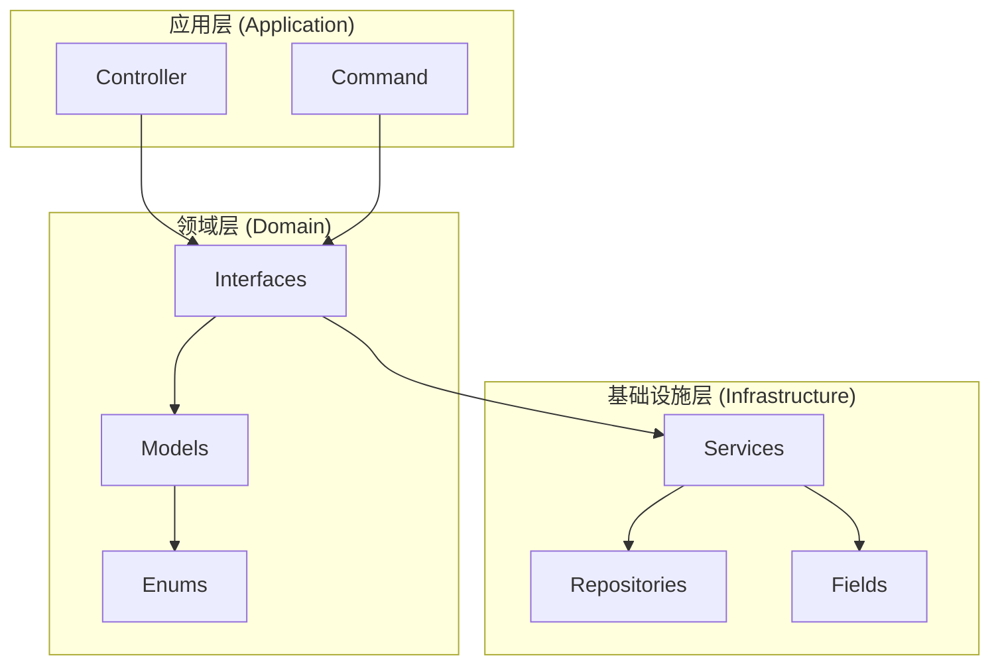

# 低代码系统架构使用规范

> **版本**: v2.0
>
> **创建日期**: 2025-12-18
>
> **状态**: 正式规范
>
> **适用范围**: 所有低代码相关开发

---

## 一、概述

### 1.1 文档目的

本文档定义了 AlkaidSYS 低代码系统的**新架构规范**，明确开发者必须使用的组件、接口和最佳实践，确保代码质量和系统性能。

### 1.2 重要说明

**⚠️ 严格禁止使用 Legacy 低代码栈**

Legacy 组件（`Infrastructure\Collection\CollectionManager`、`Domain\Model\Collection`、`Infrastructure\Field\FieldTypeRegistry`）已完全删除，任何引用将导致 CI 失败。

**✅ 必须使用新低代码栈**（`Infrastructure\Lowcode\*`、`Domain\Lowcode\*`）

---

## 二、架构总览

### 2.1 分层架构



### 2.2 目录结构

```
domain/Lowcode/
├── Collection/
│   ├── Interfaces/           # 领域接口
│   │   ├── CollectionInterface.php
│   │   ├── FieldInterface.php
│   │   └── RelationshipInterface.php
│   ├── Model/                # 领域模型
│   │   ├── Collection.php
│   │   └── Relationship.php
│   └── Enum/
│       └── RelationType.php

infrastructure/Lowcode/
├── Collection/
│   ├── Field/                # 字段实现
│   │   ├── FieldFactory.php
│   │   ├── AbstractField.php
│   │   └── [17种字段类型]
│   ├── Repository/           # 仓储实现
│   │   ├── CollectionRepository.php
│   │   ├── FieldRepository.php
│   │   └── RelationshipRepository.php
│   └── Service/              # 服务实现
│       ├── CollectionManager.php
│       ├── FieldManager.php
│       ├── RelationshipManager.php
│       └── MigrationManager.php
├── FormDesigner/
│   ├── Service/
│   └── Repository/
├── Generator/
│   └── [代码生成器]
└── Schema/
    └── SchemaVersionService.php
```

---

## 三、核心组件使用指南

### 3.1 Collection 系统

#### 3.1.1 接口定义

**CollectionInterface** - 集合领域接口

```php
<?php
use Domain\Lowcode\Collection\Interfaces\CollectionInterface;
use Domain\Lowcode\Collection\Interfaces\FieldInterface;
use Domain\Lowcode\Collection\Interfaces\RelationshipInterface;

// 获取集合信息
$collection = $this->collectionManager->get('collection_name', $tenantId);

// 创建新集合
$collection = $this->collectionManager->create([
    'name' => 'products',
    'title' => '产品管理',
    'description' => '产品信息管理',
    'fields' => [
        [
            'name' => 'id',
            'type' => 'integer',
            'nullable' => false,
            'primary' => true
        ],
        [
            'name' => 'name',
            'type' => 'string',
            'nullable' => false,
            'length' => 255
        ]
    ]
], $tenantId);

// 更新集合
$this->collectionManager->update($collection, $tenantId);

// 删除集合
$this->collectionManager->delete('products', true, $tenantId);

// 列表查询
$list = $this->collectionManager->list($tenantId, ['search' => 'keyword'], 1, 20);
```

#### 3.1.2 CollectionManager 使用示例

**正确示例**：

```php
<?php
namespace app\controller\lowcode;

use Domain\Lowcode\Collection\Interfaces\CollectionInterface;
use Infrastructure\Lowcode\Collection\Service\CollectionManager;
use think\App;
use think\Request;

class ProductController extends ApiController
{
    protected CollectionManager $collectionManager;

    public function __construct(App $app, CollectionManager $collectionManager)
    {
        parent::__construct($app);
        $this->collectionManager = $collectionManager;
    }

    public function createProduct(Request $request)
    {
        $tenantId = $this->getTenantId();
        $data = $request->param();

        try {
            $product = $this->collectionManager->create([
                'name' => 'products',
                'title' => '产品',
                'description' => '产品信息',
                'fields' => [
                    [
                        'name' => 'name',
                        'type' => 'string',
                        'nullable' => false,
                        'length' => 255
                    ],
                    [
                        'name' => 'price',
                        'type' => 'decimal',
                        'nullable' => false,
                        'precision' => 10,
                        'scale' => 2
                    ]
                ]
            ], $tenantId);

            return $this->success('创建成功', $product->toArray());
        } catch (\Exception $e) {
            return $this->error('创建失败: ' . $e->getMessage());
        }
    }

    public function getProduct($name)
    {
        $tenantId = $this->getTenantId();
        $product = $this->collectionManager->get($name, $tenantId);

        if (!$product) {
            return $this->error('产品不存在');
        }

        return $this->success($product->toArray());
    }
}
```

**❌ 错误示例**（Legacy 代码，已不可用）：

```php
// 错误：使用 Legacy CollectionManager
use Infrastructure\Collection\CollectionManager;  // ❌ 不存在
use Domain\Model\Collection;                       // ❌ 不存在

// 错误：使用旧字段注册表
use Infrastructure\Field\FieldTypeRegistry;        // ❌ 不存在
```

### 3.2 字段系统

#### 3.2.1 字段工厂使用

**FieldFactory** - 字段类型工厂

```php
<?php
use Infrastructure\Lowcode\Collection\Field\FieldFactory;
use Domain\Lowcode\Collection\Interfaces\FieldInterface;

// 创建字符串字段
$stringField = FieldFactory::create('string', 'username', [
    'nullable' => false,
    'length' => 255,
    'default' => 'guest'
]);

// 创建整数字段
$intField = FieldFactory::create('integer', 'age', [
    'nullable' => false,
    'default' => 0
]);

// 创建布尔字段
$boolField = FieldFactory::create('boolean', 'is_active', [
    'nullable' => false,
    'default' => true
]);

// 创建日期字段
$dateField = FieldFactory::create('date', 'birth_date');

// 创建 JSON 字段
$jsonField = FieldFactory::create('json', 'metadata');

// 验证字段值
if ($stringField->validate('test_value')) {
    echo 'Validation passed';
}

// 转换为数组
$fieldConfig = $stringField->toArray();
```

#### 3.2.2 内置字段类型

| 类型 | 类名 | 数据库类型 | 验证规则 | 适用场景 |
|------|------|-----------|----------|----------|
| `string` | StringField | VARCHAR | 字符串类型、长度限制 | 短文本 |
| `text` | TextField | TEXT | 字符串类型 | 长文本 |
| `integer` | IntegerField | INT | 整数类型 | 数量、ID |
| `bigint` | BigintField | BIGINT | 长整数 | 大数量 |
| `decimal` | DecimalField | DECIMAL | 小数类型，精度控制 | 价格、金额 |
| `boolean` | BooleanField | TINYINT | 布尔类型 | 状态开关 |
| `date` | DateField | DATE | 日期格式 Y-m-d | 日期 |
| `datetime` | DatetimeField | DATETIME | 日期时间格式 | 创建/更新时间 |
| `timestamp` | TimestampField | TIMESTAMP | 时间戳 | 追踪 |
| `json` | JsonField | JSON | JSON 格式 | 复杂数据 |
| `file` | FileField | VARCHAR | 文件路径 | 文件上传 |
| `image` | ImageField | VARCHAR | 图片路径 | 图片上传 |
| `select` | SelectField | VARCHAR | 枚举值 | 下拉选择 |
| `radio` | RadioField | VARCHAR | 枚举值 | 单选 |
| `checkbox` | CheckboxField | VARCHAR | 枚举值数组 | 多选 |
| `cascader` | CascaderField | JSON | 级联数据 | 地区选择 |
| `treeSelect` | TreeSelectField | JSON | 树形数据 | 分类选择 |

#### 3.2.3 自定义字段类型

**注册自定义字段**：

```php
<?php
use Infrastructure\Lowcode\Collection\Field\AbstractField;

// 创建自定义字段类
class CustomField extends AbstractField
{
    public function getType(): string
    {
        return 'custom_type';
    }

    public function getDbType(): string
    {
        return 'VARCHAR(255)';
    }

    public function validate($value): bool
    {
        // 自定义验证逻辑
        return !empty($value);
    }

    public function getDbColumn(): array
    {
        return [
            'type' => $this->getDbType(),
            'nullable' => $this->isNullable(),
            'default' => $this->getDefault(),
            'comment' => $this->getTitle()
        ];
    }
}

// 注册自定义字段
FieldFactory::register('custom_type', CustomField::class);

// 使用自定义字段
$customField = FieldFactory::create('custom_type', 'custom_field');
```

### 3.3 关系系统

#### 3.3.1 关系定义

```php
<?php
use Domain\Lowcode\Collection\Interfaces\RelationshipInterface;
use Domain\Lowcode\Collection\Enum\RelationType;

// 创建一对多关系
$oneToMany = new Relationship(
    name: 'products',
    type: RelationType::ONE_TO_MANY,
    targetCollection: 'categories',
    foreignKey: 'category_id',
    localKey: 'id'
);

// 创建多对一关系
$manyToOne = new Relationship(
    name: 'category',
    type: RelationType::MANY_TO_ONE,
    targetCollection: 'categories',
    foreignKey: 'category_id',
    localKey: 'id'
);

// 创建多对多关系
$manyToMany = new Relationship(
    name: 'tags',
    type: RelationType::MANY_TO_MANY,
    targetCollection: 'tags',
    pivotTable: 'product_tags',
    foreignKey: 'product_id',
    relatedKey: 'tag_id'
);

// 添加关系到集合
$collection->addRelationship('products', $oneToMany);
```

### 3.4 多租户支持

#### 3.4.1 租户隔离要求

**所有集合操作必须包含租户 ID**：

```php
// ✅ 正确：包含租户 ID
$collection = $this->collectionManager->get('products', $tenantId);
$this->collectionManager->create($data, $tenantId);
$this->collectionManager->list($tenantId, $filters, $page, $pageSize);

// ❌ 错误：缺少租户 ID
$collection = $this->collectionManager->get('products');  // 缺少租户 ID
```

#### 3.4.2 缓存隔离

**缓存键格式**：`lowcode:collection:{tenant_id}:{collection_name}`

```php
// ✅ 正确：租户隔离缓存
$cacheKey = $this->buildCacheKey('products', $tenantId);
$cached = Cache::get($cacheKey);

// ✅ 正确：清除特定租户缓存
$this->clearCache('products', $tenantId);

// ❌ 错误：无租户隔离的缓存
Cache::set('products', $data);  // 无租户标识
```

#### 3.4.3 数据库隔离

**所有集合表自动包含**：

```php
// ✅ 自动添加租户字段
$columns = $this->buildColumns($fields);
// 结果包含：tenant_id, site_id

// ✅ 自动添加索引
$indexes = $this->buildIndexes();
// 结果包含：idx_tenant_id_id, idx_tenant_site
```

---

## 四、最佳实践

### 4.1 控制器层最佳实践

```php
class CollectionController extends ApiController
{
    // 1. 依赖注入 CollectionManager
    protected CollectionManager $collectionManager;

    // 2. 统一获取租户 ID
    protected function getTenantId(): int
    {
        return (int) $this->request->param('tenant_id', 1);
    }

    // 3. 统一错误处理
    public function save()
    {
        try {
            $tenantId = $this->getTenantId();
            $data = $this->request->param();

            // 验证必填字段
            $this->validate($data, [
                'name' => 'require|alphaDash',
                'title' => 'require|length:1,100'
            ]);

            $collection = $this->collectionManager->create($data, $tenantId);

            return $this->success('创建成功', $collection->toArray());
        } catch (\Exception $e) {
            return $this->error('操作失败: ' . $e->getMessage());
        }
    }
}
```

### 4.2 服务层最佳实践

```php
class ProductService
{
    protected CollectionManager $collectionManager;
    protected FieldManager $fieldManager;
    protected RelationshipManager $relationshipManager;

    // 1. 组合使用多个服务
    public function createProductWithFields(array $productData, array $fields, int $tenantId): CollectionInterface
    {
        // 创建集合
        $collection = $this->collectionManager->create($productData, $tenantId);

        // 添加字段
        foreach ($fields as $fieldData) {
            $field = FieldFactory::create(
                $fieldData['type'],
                $fieldData['name'],
                $fieldData['options'] ?? []
            );
            $this->fieldManager->create($collection->getId(), $field, $tenantId);
        }

        return $collection;
    }

    // 2. 缓存管理
    public function getProductWithCache(string $name, int $tenantId): ?CollectionInterface
    {
        $cacheKey = "products:{$tenantId}:{$name}";

        return Cache::remember($cacheKey, 3600, function () use ($name, $tenantId) {
            return $this->collectionManager->get($name, $tenantId);
        });
    }
}
```

### 4.3 测试最佳实践

```php
class CollectionManagerTest extends ThinkPHPTestCase
{
    public function testCreateCollectionWithTenantIsolation(): void
    {
        $tenantId = 1;

        $collection = $this->collectionManager->create([
            'name' => 'test_products',
            'title' => '测试产品',
            'fields' => $this->getTestFields()
        ], $tenantId);

        // 验证租户 ID
        $this->assertEquals($tenantId, $collection->getTenantId());

        // 验证缓存隔离
        $cached = Cache::get("lowcode:collection:{$tenantId}:test_products");
        $this->assertNotNull($cached);

        // 验证不同租户使用不同缓存
        $tenant2Collection = $this->collectionManager->get('test_products', 2);
        $this->assertNotSame($collection, $tenant2Collection);
    }

    private function getTestFields(): array
    {
        return [
            [
                'name' => 'id',
                'type' => 'integer',
                'nullable' => false,
                'primary' => true
            ],
            [
                'name' => 'name',
                'type' => 'string',
                'nullable' => false,
                'length' => 255
            ]
        ];
    }
}
```

---

## 五、禁令和限制

### 5.1 严格禁止

| 类别 | 禁止内容 | 替代方案 |
|------|---------|----------|
| **Legacy 组件** | `Infrastructure\Collection\CollectionManager` | `Infrastructure\Lowcode\Collection\Service\CollectionManager` |
| **Legacy 模型** | `Domain\Model\Collection` | `Domain\Lowcode\Collection\Model\Collection` |
| **Legacy 字段** | `Infrastructure\Field\FieldTypeRegistry` | `Infrastructure\Lowcode\Collection\Field\FieldFactory` |
| **无租户操作** | 不传 tenant_id 的操作 | 所有操作必须包含 tenant_id |
| **非隔离缓存** | 不含租户标识的缓存键 | 使用 `buildCacheKey()` 方法 |
| **直接 DDL** | 直接使用 DB::query() 修改表结构 | 使用 `SchemaBuilder` 或 `MigrationManager` |

### 5.2 强制要求

| 要求 | 说明 | 验证方式 |
|------|------|----------|
| **接口优先** | 使用接口而非具体实现 | 代码审查 |
| **多租户** | 所有数据操作必须包含租户 ID | 测试 + CI |
| **缓存隔离** | 缓存键必须包含租户标识 | 代码审查 |
| **字段验证** | 所有字段必须验证 | 单元测试 |
| **异常处理** | 必须捕获并处理异常 | 代码审查 |
| **日志记录** | 关键操作必须记录日志 | 代码审查 |

---

## 六、常见问题

### Q1: 如何创建自定义字段类型？

**A**: 继承 `AbstractField` 并注册到 `FieldFactory`。

```php
// 1. 创建字段类
class EmailField extends AbstractField { ... }

// 2. 注册字段
FieldFactory::register('email', EmailField::class);

// 3. 使用字段
$emailField = FieldFactory::create('email', 'user_email');
```

### Q2: 如何处理集合之间的复杂关系？

**A**: 使用 `RelationshipManager` 定义关系类型。

```php
// 定义多对多关系
$relation = new Relationship(
    name: 'product_tags',
    type: RelationType::MANY_TO_MANY,
    targetCollection: 'tags',
    pivotTable: 'product_tag_relations'
);

$this->relationshipManager->create($collection->getId(), $relation, $tenantId);
```

### Q3: 如何优化集合查询性能？

**A**: 使用缓存和索引。

```php
// 1. 启用缓存
$collection = $this->collectionManager->get($name, $tenantId);

// 2. 预加载关联数据
$collection->loadRelationships();

// 3. 使用索引字段查询
$list = $this->collectionManager->list($tenantId, [
    'index_field' => 'value'  // 使用索引字段
], 1, 20);
```

### Q4: 如何处理集合迁移？

**A**: 使用 `MigrationManager`。

```php
// 创建迁移
$migration = $this->migrationManager->create([
    'name' => 'add_product_category',
    'actions' => [
        [
            'type' => 'add_field',
            'collection' => 'products',
            'field' => [
                'name' => 'category_id',
                'type' => 'integer'
            ]
        ]
    ]
], $tenantId);

// 执行迁移
$this->migrationManager->execute($migration->getId(), $tenantId);
```

---

## 七、升级指南

### 从 Legacy 迁移

如果你还在使用 Legacy 代码，需要立即迁移：

#### 步骤 1: 替换命名空间

```php
// 旧代码 (不可用)
use Infrastructure\Collection\CollectionManager;
use Domain\Model\Collection;

// 新代码
use Infrastructure\Lowcode\Collection\Service\CollectionManager;
use Domain\Lowcode\Collection\Model\Collection;
```

#### 步骤 2: 更新方法调用

```php
// 旧代码 (不可用)
$collection = CollectionManager::getInstance()->findByName($name);

// 新代码
$collection = $this->collectionManager->get($name, $tenantId);
```

#### 步骤 3: 更新字段创建

```php
// 旧代码 (不可用)
$field = FieldTypeRegistry::create('string', 'name');

// 新代码
$field = FieldFactory::create('string', 'name', [
    'nullable' => false,
    'length' => 255
]);
```

---

## 八、相关文档

- [低代码架构设计文档](../../design/05-lowcode/01-lowcode-design.md)
- [多租户设计文档](../../design/04-multi-tenant/01-tenant-design.md)
- [性能基准测试计划](./performance-benchmark-plan.md)
- [Legacy 迁移报告](../../report/arch-01-legacy-migration-plan-2025-12-18.md)
- [T-118 任务审查报告](../../report/t118-lowcode-legacy-migration-audit-2025-12-18.md)

---

## 九、联系方式

**架构组**: architecture@alkaidsys.com
**技术支持**: support@alkaidsys.com
**文档反馈**: docs@alkaidsys.com

---

*文档版本: v2.0*
*最后更新: 2025-12-18*
*审核人: 系统架构组*
*状态: 正式规范*
