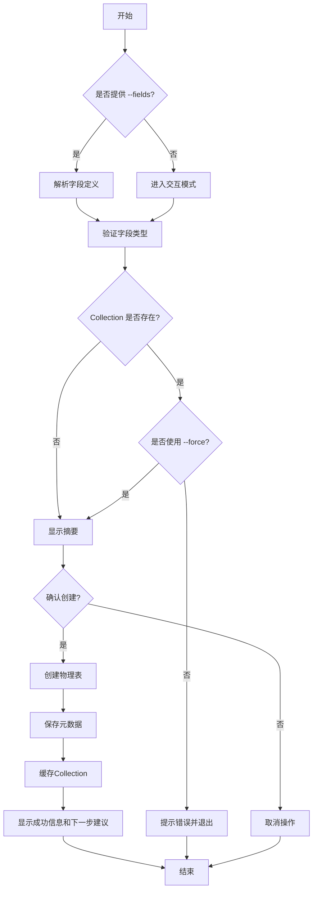

# AlkaidSYS 低代码 CLI 使用指南

## 概述

AlkaidSYS 提供了一套强大的命令行工具（CLI），用于快速创建和管理低代码数据模型、表单和代码生成。本指南详细说明每个命令的使用方法、参数选项和最佳实践。

## 环境要求

### 执行环境

⚠️ **重要**：所有 CLI 命令必须在 `alkaid-backend` 容器内执行：

```bash
docker exec -it alkaid-backend php think lowcode:命令名 [参数] [选项]
```

### 权限要求

- 数据库读写权限
- 文件系统写入权限（用于生成代码文件）
- 足够的数据库连接池配额

---

## 命令索引

1. [lowcode:create-model](#lowcodecreate-model) - 创建数据模型（Collection）
2. [lowcode:create-form](#lowcodecreate-form) - 创建表单 Schema
3. [lowcode:generate](#lowcodegenerate) - 生成 CRUD 代码
4. [lowcode:migration:diff](#lowcodemigrationdiff) - 检查 Schema 差异和生成迁移
5. [结构化输出协议](#结构化输出协议)

---

## lowcode:create-model

### 功能说明

创建新的数据模型（Collection）并自动生成对应的数据库表。

### 语法

```bash
php think lowcode:create-model <名称> [选项]
```

### 参数

| 参数 | 必需 | 说明 | 示例 |
|------|------|------|------|
| `name` | ✅ | Collection 名称（使用 PascalCase） | `Product`, `BlogPost`, `UserProfile` |

### 选项

| 选项 | 简写 | 类型 | 默认值 | 说明 |
|------|------|------|--------|------|
| `--fields` | `-f` | string | - | 字段定义，格式：`name:type,name:type,...` |
| `--title` | `-t` | string | 同名称 | Collection 的显示标题 |
| `--description` | `-d` | string | 空 | Collection 的描述 |
| `--table-name` | - | string | 自动生成 | 自定义数据库表名 |
| `--tenant-id` | - | int | 0 | 租户 ID（0 = 系统模板） |
| `--site-id` | - | int | 0 | 站点 ID（0 = 默认站点) |
| `--force` | - | flag | false | 强制覆盖已存在的 Collection |
| `--format` | - | string | `text` | 输出格式：`text`（默认，人类可读）或 `json`（结构化输出） |
| `--audit-out` | - | string | - | 将与 `--format=json` 相同的 JSON envelope 额外写入到指定文件，用于审计/CI |

### 支持的字段类型

| 类型 | 说明 | MySQL 类型 | 示例 |
|------|------|-----------|------|
| `string` | 短文本 | VARCHAR(255) | 用户名、标题 |
| `text` | 长文本 | TEXT | 文章内容、描述 |
| `integer` | 整数 | INT | 年龄、数量 |
| `bigint` | 大整数 | BIGINT | ID、时间戳 |
| `decimal` | 小数 | DECIMAL(10,2) | 价格、金额 |
| `boolean` | 布尔值 | TINYINT(1) | 是否启用 |
| `date` | 日期 | DATE | 生日、发布日期 |
| `datetime` | 日期时间 | DATETIME | 创建时间 |
| `timestamp` | 时间戳 | TIMESTAMP | 最后登录时间 |
| `json` | JSON 数据 | JSON | 配置、元数据 |
| `select` | 下拉选择 | VARCHAR | 状态、分类 |
| `radio` | 单选 | VARCHAR | 性别 |
| `checkbox` | 复选框 | VARCHAR | 标签、权限 |
| `file` | 文件 | VARCHAR | 文件路径 |
| `image` | 图片 | VARCHAR | 图片路径 |

### 使用示例

#### 示例 1：创建产品模型（基础用法）

```bash
docker exec -it alkaid-backend php think lowcode:create-model Product \
  --fields="name:string,price:decimal,stock:integer,description:text" \
  --title="产品管理" \
  --description="电商产品信息管理"
```

#### 示例 2：交互式创建博客文章模型

```bash
docker exec -it alkaid-backend php think lowcode:create-model BlogPost
# 命令会提示输入每个字段的信息
```

#### 示例 3：为特定租户创建模型

```bash
docker exec -it alkaid-backend php think lowcode:create-model CustomerOrder \
  --fields="order_no:string,total_amount:decimal,status:select" \
  --tenant-id=1 \
  --site-id=1
```

#### 示例 4：强制覆盖已存在的模型

```bash
docker exec -it alkaid-backend php think lowcode:create-model Product \
  --fields="name:string,updated_price:decimal" \
  --force
```

### 命令执行流程



### 常见问题

**Q: 字段名称有什么限制？**  
A: 必须以字母或下划线开头，只能包含字母、数字和下划线。推荐使用 snake_case 命名。

**Q: 如何添加字段的约束（如必填、唯一）？**  
A: 当前版本通过交互模式或后续通过 API 修改。未来版本将支持在命令中直接指定。

**Q: 创建失败如何回滚？**  
A: 命令使用事务机制，失败会自动回滚数据库更改。

---

## lowcode:create-form

### 功能说明

基于已存在的 Collection 创建表单 Schema，用于前端表单渲染。

### 语法

```bash
php think lowcode:create-form <表单名称> [选项]
```

### 参数

| 参数 | 必需 | 说明 | 示例 |
|------|------|------|------|
| `name` | ✅ | 表单名称 | `product_create_form`, `user_profile_edit` |

### 选项

| 选项 | 类型 | 默认值 | 说明 |
|------|------|--------|------|
| `--collection` | string | - | 基于哪个 Collection 创建表单 |
| `--fields` | string | 全部 | 仅包含指定字段（逗号分隔），例如 `"name,price,stock"`；未指定时包含 Collection 的全部字段 |
| `--title` | string | 同名称 | 表单标题 |
| `--description` | string | 空 | 表单描述 |
| `--tenant-id` | int | 1 | 租户 ID，**必须是已存在的真实租户**（默认 1）；`0` 是系统模板空间、不存在的正数同样会被拒绝，本命令不接受 |
| `--site-id` | int | 0 | 站点 ID（0 = 默认站点） |
| `--force` | flag | false | 如表单已存在则强制覆盖 |
| `--format` | string | `text` | 输出格式：`text` 或 `json` |
| `--audit-out` | string | - | 将 JSON envelope 写入指定文件 |

> ⚠️ **`--tenant-id` 不能是 0**：`lowcode_forms.tenant_id` 是「真实租户引用」
> （`NOT NULL`、无默认值，且带外键 `fk_lowcode_forms_tenant_id → tenants.id`），
> 而 `tenants` 表没有 `id=0`（0 是「系统模板空间」，仅供 `lowcode_collections` 等模板表使用）。
> 显式传 `--tenant-id=0` 会在写库前直接返回业务错误并以退出码 1 结束（不会写出脏数据，也不会撞外键报 1452）：

```text
✗ Invalid --tenant-id: 0 是系统模板空间（tenants 表没有 id=0），而 lowcode_forms.tenant_id
  要求真实租户（外键 fk_lowcode_forms_tenant_id → tenants.id）。请指定一个已存在的租户ID（≥ 1，默认为 1）。
```

> ⚠️ **`--tenant-id` 也不能是「不存在的正数」**：正数只过了「`> 0`」这一层，
> 但 `tenants` 表里可能根本没有这条租户记录。命令会在**任何写库动作之前**先查 `tenants`，
> 命中不存在即返回可读业务错误并以**退出码 1** 结束
> （不会写出脏数据，也不会把外键 1452 的裸 SQL 错误抛给使用者）：

```text
$ php think lowcode:create-form product_create_form --tenant-id=99998 --force
✗ Invalid --tenant-id: 租户 ID 99998 不存在（tenants 表中没有该记录）。请先创建该租户，或改传一个已存在的租户ID（例如默认为 1）。 Tenant 99998 does not exist; create it first or pass an existing tenant ID.

$ echo $?
1
```

### 使用示例

#### 示例 1：基于 Collection 创建完整表单

```bash
docker exec -it alkaid-backend php think lowcode:create-form product_create_form \
  --collection=Product
```

#### 示例 2：创建部分字段的表单（如编辑表单）

```bash
docker exec -it alkaid-backend php think lowcode:create-form product_edit_form \
  --collection=Product \
  --fields="name,price,stock"
```

### 生成的表单 Schema 结构

```json
{
  "name": "product_create_form",
  "collection": "Product",
  "fields": [
    {
      "name": "name",
      "label": "产品名称",
      "type": "input",
      "component": "VbenInput",
      "rules": [{"required": true, "message": "请输入产品名称"}]
    },
    {
      "name": "price",
      "label": "价格",
      "type": "number",
      "component": "VbenInputNumber",
      "componentProps": {"precision": 2}
    }
  ]
}
```

---

## lowcode:generate

### 功能说明

基于已创建的 Collection 生成 CRUD 代码，包括 Controller、Routes 和 Tests。

### 语法

```bash
php think lowcode:generate <类型> <Collection名称> [选项]
```

### 生成类型

| 类型 | 说明 | 生成内容 |
|------|------|---------|
| `crud` | 完整 CRUD | Controller + Routes + Tests |
| `controller` | 仅控制器 | Controller 文件 |
| `routes` | 仅路由 | Route 配置 |
| `tests` | 仅测试 | Feature Tests |

### 选项

| 选项 | 类型 | 默认值 | 说明 |
|------|------|--------|------|
| `--tenant-id` | int | 0 | 从哪个租户上下文中读取 Collection 元数据 |
| `--force`, `-f` | flag | false | 强制覆盖已存在的文件 |
| `--no-tests` | flag | false | 跳过测试代码生成 |
| `--no-routes` | flag | false | 跳过路由文件生成 |
| `--append-routes` | flag | false | 将生成的路由追加到现有路由文件中 |
| `--format` | string | `text` | 输出格式：`text` 或 `json` |
| `--audit-out` | string | - | 将 JSON envelope 写入指定文件 |

### 使用示例

#### 示例 1：生成完整 CRUD

```bash
docker exec -it alkaid-backend php think lowcode:generate crud Product
```

生成的文件：
- `app/controller/lowcode/ProductController.php`
- `route/lowcode/product.php`
- `tests/Feature/Lowcode/ProductControllerTest.php`

#### 示例 2：仅生成控制器

```bash
docker exec -it alkaid-backend php think lowcode:generate controller Product
```

#### 示例 3：仅生成路由并追加到现有路由文件

```bash
docker exec -it alkaid-backend php think lowcode:generate crud Product \
  --no-tests \
  --append-routes
```

> 注：命名空间与路由前缀等高级定制能力目前在低代码 CLI 设计文档中规划为 Phase 2 功能，当前版本可通过调整生成文件或自定义代码生成器配置实现，CLI 尚未提供 `--namespace` / `--route-prefix` 选项。

### 生成的 Controller 包含的方法

| 方法 | HTTP Method | 路由 | 功能 |
|------|-------------|------|------|
| `index()` | GET | `/products` | 列表（分页） |
| `read()` | GET | `/products/:id` | 详情 |
| `create()` | POST | `/products` | 创建 |
| `update()` | PUT | `/products/:id` | 更新 |
| `delete()` | DELETE | `/products/:id` | 删除 |

---

## lowcode:migration:diff

### 功能说明

比较 Collection Schema 与数据库实际结构，检测差异并生成迁移脚本。

### 语法

```bash
php think lowcode:migration:diff [Collection名称] [选项]
```

### 选项

| 选项 | 简写 | 类型 | 默认值 | 说明 |
|------|------|------|--------|------|
| `--all` | `-a` | flag | false | 检查所有 Collection |
| `--check` | `-c` | flag | false | 仅检查，不生成迁移；存在差异时返回非 0 退出码 |
| `--out` | `-o` | string | - | 将差异写入 SQL 占位文件（仅包含注释和 TODO 提示） |
| `--report` | `-r` | string | - | 将完整 diff 信息以 JSON 报告形式输出到指定文件 |
| `--tenant-id` | - | int | 0 | 指定租户 ID（0 = 系统模板） |
| `--format` | - | string | `text` | 输出格式：`text` 或 `json` |
| `--audit-out` | - | string | - | 将 JSON envelope 写入指定文件 |

### 使用示例

#### 示例 1：检查单个 Collection 的差异

```bash
docker exec -it alkaid-backend php think lowcode:migration:diff Product
```

#### 示例 2：检查所有 Collection

```bash
docker exec -it alkaid-backend php think lowcode:migration:diff --all
```

#### 示例 3：仅检查不生成迁移

```bash
docker exec -it alkaid-backend php think lowcode:migration:diff --all --check
```

#### 示例 4：在 CI 中生成 JSON 报告并作为审计输入

```bash
docker exec -it alkaid-backend php think lowcode:migration:diff --all --check \
  --report=/tmp/lowcode-schema-diff.json
```

### 输出示例

#### 文本模式（默认）

```
=== Schema Diff Report ===

Collection: Product
Table: lc_product

Changes detected:
  + Add column: featured (boolean)
  ~ Modify column: price (decimal(8,2) -> decimal(10,2))
  - Drop column: old_price

Migration file generated: database/migrations/20251215_update_product_table.php
```

#### JSON 模式（`--format=json`）

```json
{
  "code": 1,
  "message": "Schema drift detected",
  "data": {
    "migration_diff_report": {
      "generated_at": "2025-12-15 10:00:00",
      "total_collections": 1,
      "collections_with_diff": 1,
      "diffs": [
        {
          "collection": "Product",
          "table": "lc_product",
          "changes": [
            {
              "type": "add_column",
              "table": "lc_product",
              "column": "featured",
              "field_type": "boolean",
              "message": "Column 'featured' missing in database"
            }
          ]
        }
      ]
    },
    "options": {
      "all": false,
      "check": true,
      "out": null,
      "report": null,
      "tenant_id": 0
    }
  },
  "timestamp": "2025-12-15T10:00:00+08:00",
  "command": "lowcode:migration:diff"
}
```

---

## 结构化输出协议

为方便在 CI、自动化脚本和审计场景中消费 CLI 结果，低代码 CLI 在 Phase 2 中引入了统一的结构化输出协议：

### 通用选项

所有继承 `LowcodeCommand` 的 lowcode:* 命令（目前包括：`lowcode:create-model`、`lowcode:create-form`、`lowcode:generate`、`lowcode:migration:diff`）都支持以下通用选项：

| 选项 | 说明 |
|------|------|
| `--format=text|json` | 控制 stdout 输出格式；`text` 为默认的人类可读模式，`json` 输出结构化 JSON envelope，仅包含一行/一段 JSON，不混入彩色文本 |
| `--audit-out=<path>` | 无论 `--format` 为何，都会将同一份 JSON envelope 写入指定文件，可用于审计留痕或 CI 报告收集 |

### JSON Envelope 结构

所有 `--format=json` 输出遵循统一 envelope 结构，与 HTTP API 规范保持一致：

```json
{
  "code": 0,
  "message": "OK",
  "data": { /* 命令各自的数据负载 */ },
  "timestamp": "2025-12-15T10:00:00+08:00",
  "command": "lowcode:create-model"
}
```

- `code`: 业务状态码，0 表示成功，非 0 表示失败（例如 migration:diff 在 `--check` 且存在差异时会返回 1）。
- `message`: 人类可读的简要描述，如 `OK`、`Schema drift detected` 等。
- `data`: 各命令自定义的数据负载，见下文命令级说明。
- `timestamp`: ISO8601 时间戳。
- `command`: 实际执行的 CLI 命令名称，例如 `lowcode:create-form`。

### 各命令 data 负载约定（摘要）

- `lowcode:create-model`
  - `data.collection`: Collection 元数据（等同于 Domain Collection::toArray() 输出）。
  - `data.table_name`: 实际创建的动态表名（如 `lc_product`）。
  - `data.tenant_id` / `data.site_id`: 对应的多租户上下文。

- `lowcode:create-form`
  - `data.form`: 创建或更新后的表单记录（来自 FormSchemaManager::get 的返回值）。
  - `data.schema`: 本次生成的表单 JSON Schema（不依赖持久化结果，便于对比）。
  - `data.tenant_id` / `data.site_id`。

- `lowcode:generate`
  - `data.files`: 数组，元素形如 `{ "type": "controller", "path": "app/controller/lowcode/ProductController.php" }`。
  - `data.options`: 归档本次生成使用的关键选项（type/tenant_id/force/no_tests/no_routes/append_routes）。

- `lowcode:migration:diff`
  - `data.migration_diff_report`: 与 `--report` 输出文件相同结构的对象，包含 `generated_at`、`total_collections`、`collections_with_diff`、`diffs` 等字段。
  - `data.options`: `all`、`check`、`out`、`report`、`tenant_id` 等，用于追踪执行上下文。

### 错误场景

当命令执行过程中抛出异常时，`LowcodeCommand` 会统一捕获并输出：

```json
{
  "code": 1,
  "message": "Command execution failed",
  "data": {
    "exception": {
      "class": "Some\\ExceptionClass",
      "message": "错误信息"
    }
  },
  "timestamp": "2025-12-15T10:00:00+08:00",
  "command": "lowcode:create-model"
}
```

在 `--format=text` 模式下，仍然会输出原有的彩色错误信息与堆栈（在 `-v` 模式下），而 `--audit-out` 仅写入上述 JSON envelope。

---

## 最佳实践

### 1. 命名规范

**Collection 名称**
- ✅ 推荐：`Product`, `BlogPost`, `UserProfile`
- ❌ 避免：`product`, `blog-post`, `user_profile`

**字段名称**
- ✅ 推荐：`product_name`, `created_at`, `is_active`
- ❌ 避免：`ProductName`, `创建时间`, `active?`

### 2. 字段类型选择

| 业务场景 | 推荐类型 | 说明 |
|---------|---------|------|
| 货币金额 | decimal | 使用 decimal(10,2) |
| 状态码 | string/select | 便于扩展 |
| 布尔标志 | boolean | 明确的真/假值 |
| 长文本 | text | 超过 255字符 |
| 标签/多选 | checkbox/json | 存储数组 |

### 3. 多租户使用

```bash
# 系统模板（所有租户共享）——仅适用于 lowcode:create-model / generate / migration:diff
--tenant-id=0 --site-id=0

# 特定租户
--tenant-id=1 --site-id=1
```

> ⚠️ `--tenant-id=0`（系统模板空间）**不适用于 `lowcode:create-form`**：
> 表单表 `lowcode_forms.tenant_id` 是真实租户引用（带外键指向 `tenants.id`），
> 该命令的默认值是 `1`，显式传 `0` 会被拒绝。详见上文 [lowcode:create-form](#lowcodecreate-form)。

### 4. 版本化工作流

```bash
# 1. 创建模型
php think lowcode:create-model Product --fields="name:string,price:decimal"

# 2. 生成代码
php think lowcode:generate crud Product

# 3. 测试
docker exec alkaid-backend php think test tests/Feature/Lowcode/ProductControllerTest.php

# 4. 如有修改，使用 migration:diff 跟踪变更
php think lowcode:migration:diff Product
```

---

## 故障排查

### 问题 1：命令未找到

**症状**：`Command "lowcode:create-model" is not defined.`

**解决方案**：
```bash
# 确认在容器内执行
docker exec -it alkaid-backend bash

# 检查命令是否注册
php think list | grep lowcode
```

### 问题 2：数据库连接失败

**症状**：`SQLSTATE[HY000] [2002] Connection refused`

**解决方案**：
```bash
# 检查数据库配置
cat .env | grep DB_

# 测试数据库连接
docker exec alkaid-backend php think db:test
```

### 问题 3：权限不足

**症状**：`Permission denied when creating table`

**解决方案**：
```sql
-- 检查数据库用户权限
SHOW GRANTS FOR 'alkaid_user'@'%';

-- 授予必要权限
GRANT CREATE, ALTER, DROP ON alkaid_db.* TO 'alkaid_user'@'%';
```

### 问题 4：Collection 已存在

**症状**：`Collection 'Product' already exists`

**解决方案**：
```bash
# 方案 1：使用 --force 覆盖
php think lowcode:create-model Product --force --fields="..."

# 方案 2：删除后重建（谨慎！）
# 先删除物理表和元数据，再重新创建
```

---

## 进阶用法

### 1. 批量创建模型

```bash
#!/bin/bash
# create_ecommerce_models.sh

MODELS=(
  "Product:name:string,price:decimal,stock:integer"
  "Category:name:string,description:text"
  "Order:order_no:string,total_amount:decimal,status:select"
)

for model in "${MODELS[@]}"; do
  IFS=':' read -r name fields <<< "$model"
  docker exec alkaid-backend php think lowcode:create-model "$name" \
    --fields="$fields" \
    --tenant-id=1
done
```

### 2. 自动化测试集成

```yaml
# .github/workflows/lowcode-test.yml
name: Lowcode CLI Tests

on: [push]

jobs:
  test:
    runs-on: ubuntu-latest
    steps:
      - uses: actions/checkout@v2
      
      - name: Test Model Creation
        run: |
          docker exec alkaid-backend php think lowcode:create-model TestModel \
            --fields="name:string" \
            --force
          
      - name: Verify Table Exists
        run: |
          docker exec alkaid-mysql mysql -e "SHOW TABLES LIKE 'lc_test_model';"
```

---

## 相关文档

- 低代码框架设计文档：`design/09-lowcode-framework/40-lowcode-framework-architecture.md`（`design/` 属开发过程产物，已移出版本库，仅保留在本地）
- [API 规范](../api/api-specification.zh-CN.md)
- [数据库设计指南](../database/database-guidelines.zh-CN.md)
- 多租户数据模型规范：`design/03-data-layer/12-multi-tenant-data-model-spec.md`（同上，已移出版本库）

---

## 常见使用场景

### 场景 1：快速原型开发

```bash
# 5分钟构建一个博客系统

# 1. 创建文章模型
php think lowcode:create-model BlogPost \
  --fields="title:string,content:text,author:string,published_at:datetime,status:select"

# 2. 创建分类模型
php think lowcode:create-model Category \
  --fields="name:string,slug:string,description:text"

# 3. 生成 CRUD 代码
php think lowcode:generate crud BlogPost
php think lowcode:generate crud Category

# 4. 创建表单
php think lowcode:create-form blog_post_create --collection=BlogPost
php think lowcode:create-form category_create --collection=Category
```

### 场景 2：多租户SaaS应用

```bash
# 为每个租户创建独立的数据模型

# 租户 1
php think lowcode:create-model Customer \
  --fields="name:string,email:string,phone:string" \
  --tenant-id=1 \
  --site-id=1

# 租户 2
php think lowcode:create-model Customer \
  --fields="name:string,email:string,company:string" \
  --tenant-id=2 \
  --site-id=1
```

---

## 更新日志

### v1.0.0 (2025-12-15)
- ✅ 初始版本发布
- ✅ 支持基础的 CRUD 模型创建
- ✅ 支持多租户隔离
- ✅ 支持自动代码生成

### 路线图

- [ ] 支持字段级别的约束配置 (v1.1.0)
- [ ] 支持关系定义（1:1, 1:N, N:M） (v1.2.0)
- [ ] 支持 Schema 版本管理 (v1.3.0)
- [ ] 支持可视化 Schema 设计器集成 (v2.0.0)

---

## 获取帮助

如有问题，可以：

1. 查看命令的详细帮助：`php think lowcode:create-model --help`
2. 查看技术规范文档：`docs/technical-specs/lowcode/`
3. 查看源代码：`app/command/lowcode/`
4. 提交 Issue 或联系开发团队

---

**最后更新**：2025-12-15  
**文档版本**：1.0.0
