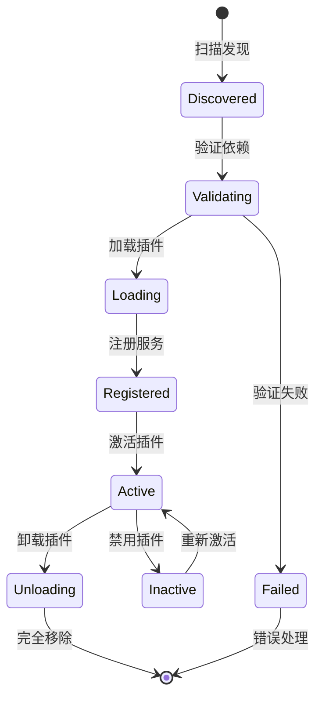
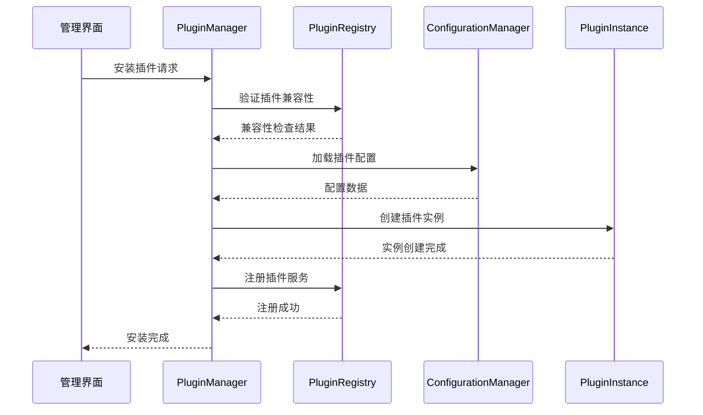
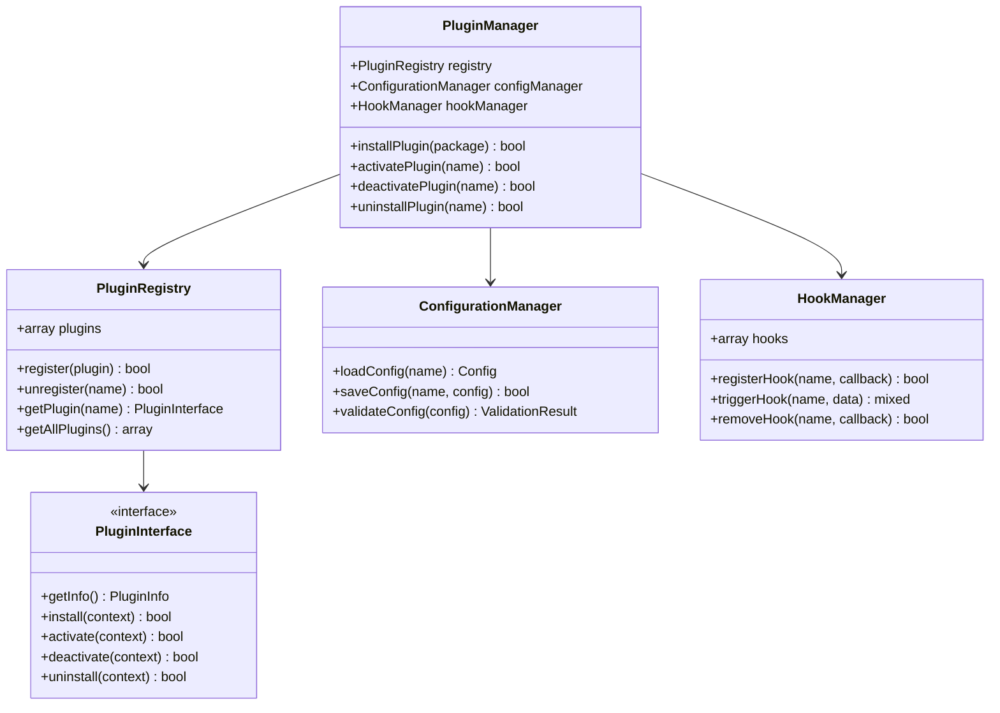
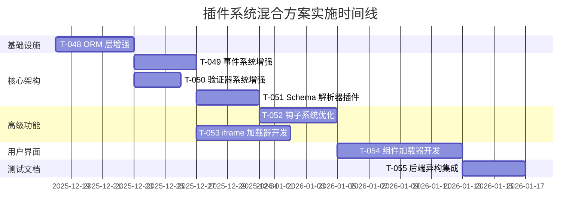
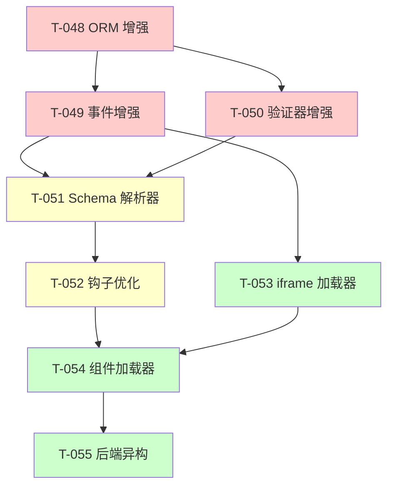
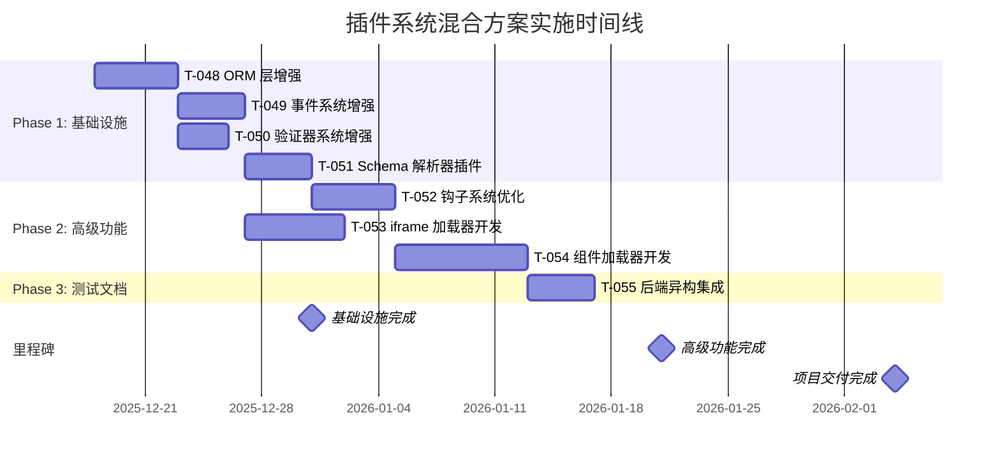

# AlkaidSYS 插件系统混合方案实施计划

> **文档版本**: 1.0  
> **创建日期**: 2025-12-17  
> **目标**: 为 'docs/todo/development-backlog-2025-11-25.md' 中组 E 的插件系统混合方案 [T-048] 至 [T-055] 制定全面且可执行的实施计划  
> **适用范围**: AlkaidSYS Phase 2 目标能力 - 插件系统混合架构

---

## 1. 执行摘要

### 1.1 项目概述

本实施计划针对 AlkaidSYS 项目中的**插件系统混合方案**，旨在通过结合现有基础设施与新型插件架构，构建一个既保持系统稳定性又具备高度扩展性的插件生态系统。该方案将作为 Phase 2 目标能力的核心组成部分，为系统提供模块化、可插拔的功能扩展机制。

### 1.2 核心价值

1. **架构现代化**: 从单体架构向插件化微服务架构演进
2. **开发效率提升**: 通过标准化插件接口，降低新功能开发成本
3. **系统稳定性**: 保持核心系统稳定，扩展功能通过插件隔离
4. **运维友好**: 插件独立部署、升级和回滚，降低运维风险
5. **生态建设**: 为第三方开发者提供插件开发框架

### 1.3 预期成果

- **技术成果**: 完整的插件系统架构、开发工具链、管理界面
- **业务价值**: 支持快速业务功能扩展，提升市场响应速度
- **质量指标**: 插件系统测试覆盖率 ≥85%，性能回归 <10%
- **团队影响**: 建立插件开发规范，提升团队协作效率

---

## 2. 现状分析与设计依据

### 2.1 现有插件系统架构分析

#### 2.1.1 当前实现状况

基于代码库分析，现有插件系统包含以下核心组件：

**基础设施层**:
- `infrastructure/Plugin/PluginManager.php` - 插件管理器
- `infrastructure/Plugin/PluginScanner.php` - 插件扫描器  
- `infrastructure/Plugin/CorePluginBaseService.php` - 核心插件基类
- `infrastructure/Plugin/Hook/HookManager.php` - 钩子管理器

**数据持久化**:
- `infrastructure/Plugin/Repository/PluginInstallationRepository.php`
- `infrastructure/Plugin/Repository/PluginPackageRepository.php`

**应用系统支持**:
- `infrastructure/Application/ApplicationManager.php` - 应用管理器
- `infrastructure/Application/BaseApplication.php` - 应用基类

#### 2.1.2 架构优势

✅ **已具备的基础能力**:
- 完整的插件生命周期管理（安装、启用、禁用、卸载）
- 基础的依赖注入和服务提供者机制
- 插件扫描和自动发现功能
- 钩子事件系统基础框架
- 多租户支持的数据库设计

#### 2.1.3 现有局限性

❌ **架构限制**:
- 插件间通信机制不完善，缺乏标准化接口
- 缺乏插件版本管理和兼容性检查
- 插件配置管理分散，缺乏统一配置中心
- 插件热更新机制不完善，需要重启服务
- 缺乏插件市场和应用商店机制

❌ **开发体验问题**:
- 插件开发脚手架工具不完整
- 缺乏插件调试和测试工具
- 插件文档和示例不足
- 插件打包和分发流程复杂

### 2.2 设计文档规范要求

#### 2.2.1 核心设计原则

根据 `design/` 目录中的架构设计文档，插件系统需遵循：

1. **分层架构**: 严格区分表现层、应用层、领域层、基础设施层
2. **低代码优先**: 动态业务实体通过低代码框架实现
3. **多租户隔离**: 所有插件数据必须支持租户级别隔离
4. **RESTful API**: 插件接口遵循 REST 设计规范
5. **统一错误处理**: 使用标准错误码和响应格式

#### 2.2.2 技术栈约束

- **后端**: PHP 8.2+, ThinkPHP 8.0+, Swoole 5.0+
- **数据库**: MySQL 8.0+，支持多租户表结构
- **缓存**: Redis 6.0+，支持插件缓存隔离
- **前端**: Vue 3 + TypeScript + Vben Admin 5.x

### 2.3 改进空间识别

基于现状分析和设计要求，识别出以下关键改进点：

1. **插件接口标准化**: 定义统一的插件接口契约
2. **配置管理统一**: 建立插件配置中心
3. **版本管理机制**: 实现插件版本控制和兼容性检查
4. **热更新支持**: 实现插件热加载和热卸载
5. **开发工具完善**: 提供完整的插件开发工具链

---

## 3. 详细架构设计

### 3.1 混合方案技术选型

#### 3.1.1 架构模式选择

**混合插件架构模式**:
```
┌─────────────────────────────────────────────────────────────┐
│                   AlkaidSYS 核心系统                │
├─────────────────────────────────────────────────────────────┤
│  核心服务层 (Core Services)                          │
│  • PluginRegistry (插件注册中心)                        │
│  • ConfigurationManager (配置管理器)                    │
│  • VersionManager (版本管理器)                          │
│  • HookManager (钩子管理器)                            │
├─────────────────────────────────────────────────────────────┤
│  插件容器层 (Plugin Container)                        │
│  • PluginLoader (插件加载器)                          │
│  • PluginSandbox (插件沙箱)                           │
│  • DependencyInjector (依赖注入器)                      │
├─────────────────────────────────────────────────────────────┤
│  插件实例层 (Plugin Instances)                        │
│  • BusinessPlugin (业务插件)                           │
│  • IntegrationPlugin (集成插件)                         │
│  • UIModulePlugin (UI模块插件)                          │
└─────────────────────────────────────────────────────────────┘
```

#### 3.1.2 核心技术选型

| 组件 | 技术选择 | 理由 |
|--------|----------|------|
| 插件容器 | PHP + 反射机制 | 动态加载和隔离 |
| 配置管理 | JSON Schema + 验证 | 标准化配置格式 |
| 版本控制 | Semantic Versioning | 兼容性管理 |
| 通信机制 | Event-Driven + PSR-14 | 松耦合通信 |
| 沙箱隔离 | Namespace + 权限控制 | 安全隔离 |

### 3.2 核心组件交互

#### 3.2.1 插件生命周期



#### 3.2.2 组件交互序列图



### 3.3 接口契约和数据流

#### 3.3.1 核心接口定义

**插件基础接口**:
```php
<?php
declare(strict_types=1);

namespace Infrastructure\Plugin\Contracts;

/**
 * 插件基础接口 / Plugin base interface
 */
interface PluginInterface
{
    /**
     * 获取插件信息 / Get plugin information
     */
    public function getInfo(): PluginInfo;
    
    /**
     * 插件安装 / Plugin installation
     */
    public function install(InstallationContext $context): bool;
    
    /**
     * 插件激活 / Plugin activation
     */
    public function activate(ActivationContext $context): bool;
    
    /**
     * 插件停用 / Plugin deactivation
     */
    public function deactivate(DeactivationContext $context): bool;
    
    /**
     * 插件卸载 / Plugin uninstallation
     */
    public function uninstall(UninstallationContext $context): bool;
}
```

**插件信息结构**:
```php
<?php
declare(strict_types=1);

namespace Infrastructure\Plugin\ValueObjects;

class PluginInfo
{
    public function __construct(
        public readonly string $name,           // 插件名称
        public readonly string $version,        // 插件版本
        public readonly string $description,    // 插件描述
        public readonly array $dependencies,    // 依赖关系
        public readonly array $permissions,     // 所需权限
        public readonly string $author,         // 作者信息
        public readonly array $providers       // 服务提供者
    ) {}
}
```

#### 3.3.2 数据流设计

**插件配置数据流**:
```
插件配置文件 → JSON Schema 验证 → 配置管理器 → 数据库存储 → 运行时缓存
```

**插件事件数据流**:
```
业务事件 → 钩子管理器 → 事件分发 → 插件监听器 → 业务处理
```

### 3.4 关键类图



---

## 4. 任务分解与实施路径

### 4.1 任务概览

| 任务编号 | 任务名称 | 优先级 | 预估工期 | 负责角色 |
|----------|----------|--------|------------|----------|
| T-048 | ORM 层增强 | P1 | 5天 | 后端 / 低代码 |
| T-049 | 事件系统增强 | P2 | 4天 | 架构师 / 后端 |
| T-050 | 验证器系统增强 | P2 | 3天 | 后端 |
| T-051 | Schema 解析器插件 | P2 | 4天 | 后端 / 全栈 |
| T-052 | 钩子系统优化 | P2 | 5天 | 后端 |
| T-053 | iframe 加载器开发 | P3 | 6天 | 全栈 / 前端 |
| T-054 | 组件加载器开发 | P3 | 8天 | 前端 |
| T-055 | 后端异构集成 | P3 | 4天 | 后端 / 架构 |

### 4.2 详细实施路径

#### 4.2.1 T-048: ORM 层增强（Phase 2，对应 MASTER 任务 1.1）

**目标**: 动态建模能力升级，支持多租户的表/字段/关系全生命周期。

**子任务 Todo**:
- [x] 设计/更新 Schema Builder 接口（创建/变更/删除表，幂等支持）
- [ ] 字段增删改与类型映射（含默认值/索引），避免 Legacy Collection 依赖
  - [x] 盘点 Legacy 类引用（含 Guard 测试覆盖），当前无存量
  - [x] 扩展 Guard 扫描范围（脚本/扩展/插件/根目录 PHP）
  - [x] 清理/替换残留调用点（若后续发现，统一切到低代码栈）
  - [x] 校验字段映射输出不触发 Legacy fallback（默认值/索引/租户列）
- [x] 关系配置：一对多/多对多/树形，强制携带 `tenant_id/site_id`
- [x] Field Type Registry 对齐低代码字段类型，补足 JSON/Enum 等高级字段
- [x] 生成/回滚迁移 diff（与低代码生成器兼容）
- [x] 单元/集成测试：Schema 变更幂等性、多租户隔离、回滚安全
- [x] 文档：更新 `docs/technical-specs/plugin/plugin-system-foundation.md` 的 ORM 约束

**验收标准**:
- [x] 迁移/运行期操作全量带 `tenant_id`（必要时 `site_id`）
- [x] 字段/关系操作幂等，回滚不破坏已有数据
- [x] 覆盖率 ≥80%，含异常路径（冲突/非法变更）（T-048 范围覆盖率：`phpunit.t048.xml`，Lines 80.13%）

#### 4.2.2 T-049: 事件系统增强（Phase 2，对应 MASTER 任务 1.2）

**目标**: 为插件/钩子提供可扩展的事件基础设施，支持优先级与异步。

**子任务 Todo**:
- [x] 事件优先级与停止传播（PSR-14 兼容 ListenerProvider）
- [x] 异步事件派发（Swoole/队列），传递 `trace_id/tenant_id/site_id/user_id`
- [x] 事件队列失败重试与死信处理，错误码对齐 2001/2002 规范（队列失败 3 次即删除并记录告警；无 Swoole 时回退队列）
- [x] 事件审计/指标：耗时、失败率、告警阈值（优先落库 event_metrics/ event_dead_letters，降级日志）
- [x] 单元/集成测试：同步/异步、优先级、停止传播、上下文透传
  - [x] 单元测试覆盖（优先级/停止传播/上下文/协程/重试/死信）
  - [x] 集成测试覆盖（event_metrics / event_dead_letters 落库）
- [x] 文档：事件接口与示例，接入指引

**验收标准**:
- [ ] 事件监听/派发支持优先级与停止传播
- [ ] 异步派发可携带完整上下文且具备重试策略
- [ ] 覆盖率 ≥80%，含失败/重试场景

#### 4.2.3 T-050: 验证器系统增强（Phase 2，对应 MASTER 任务 1.4）

**目标**: 基于 Schema 自动生成验证规则，前后端一致。

**子任务 Todo**:
- [x] JSON Schema 生成器：从低代码 Schema 生成验证规则
- [x] 规则覆写/扩展机制（自定义校验器、跨字段校验）
- [x] 前后端一致性：对齐前端 TS 类型/校验（可复用 OpenAPI），`GET /v1/lowcode/forms/{name}?with_validator=1` 返回 `validator.rules/messages`
- [x] 多租户上下文校验（租户/站点可用性、权限兜底错误码 2002）
- [x] 单元/集成测试：规则生成正确性、跨字段校验、错误码一致性
- [x] 文档：生成流程、扩展点、错误码约定（`docs/technical-specs/lowcode/form-validator.md`）

**验收标准**:
- [x] 生成规则满足 Schema 全字段约束，支持扩展
- [x] 前后端校验一致，错误码/消息符合统一响应规范
- [x] 覆盖率 ≥80%（`phpunit.t050.xml`，Lines 86.99%）

#### 4.2.4 T-051: Schema 解析器插件（Phase 2，对应 MASTER 任务 2.4）

**目标**: 将 Schema 解析成组件/验证/权限映射，供插件加载器使用。

**子任务 Todo**:
- [x] 解析 Schema → 组件映射（字段 → Vue 组件/iframe 配置）
- [x] 解析 Schema → 验证规则（复用 T-050 输出）
- [x] 解析 Schema → 权限/可见性规则（resource:action 映射）
- [x] 缓存与多租户隔离（按 `tenant_id/site_id` 缓存键）
- [x] 单元/集成测试：解析正确性、缓存一致性、多租户隔离
 - [x] 文档：输入输出契约、扩展点、示例

**验收标准**:
 - [x] 解析产物覆盖组件/验证/权限三类输出
 - [x] 多租户缓存隔离，无串租风险
 - [x] 覆盖率 ≥80%

#### 4.2.5 T-052: 钩子系统优化（Phase 2，对应 MASTER 任务 5.1，依赖 T-049）

**目标**: 让钩子系统支持异步、优先级、监控，并与插件生命周期联动。

**子任务 Todo**:
> 后续建议需直接落为子任务，避免遗漏。
- [x] 优先级调度与停止传播，兼容现有 `HookManager` 接口
- [x] 异步钩子执行（队列/协程），带上下文透传与重试
- [x] 钩子性能监控/日志（耗时、错误、告警）
- [x] 插件卸载/禁用时清理钩子（已支持 removePluginHooks，补充测试）
- [x] 单元/集成测试：同步/异步、优先级、异常/重试、卸载清理
- [x] 文档：钩子注册/执行/监控指引
- [ ] 补充回归：执行前端插件 SDK/iframe 加载相关单测（`pnpm vitest --filter plugin-sdk`）并在 CI 记录结果
- [ ] 在实际应用接入 iframe `onRequest` 代理：相对路径转发至网关/后端，追加 JWT 与签名/trace_id/tenant_id 注入，非法源拒绝
- [ ] 补充示例路由与页面集成，并在 `frontend/apps/web-antd` 声明 `@alkaidsys/plugin-sdk` 依赖，提供最小 iframe 插件示例
- [ ] 安全配置落地：依据安全设计完善 CSP（含 frame-ancestors）、iframe sandbox allowlist、域名白名单配置与校验
- [ ] E2E/集成测试：覆盖 iframe 插件加载/卸载、恶意消息拦截、权限/租户注入校验、心跳超时处理
- [ ] 校验并启用钩子监控/告警链路：`hook_metrics`/`hook_dead_letters`/`hook_alerts` 迁移与配置、限速阈值、告警订阅

**验收标准**:
- [x] 钩子支持优先级、异步、停止传播
- [x] 卸载/禁用后无残留钩子
- [x] 覆盖率 ≥80%，含异常/重试

#### 4.2.6 T-053: iframe 加载器开发（Phase 2，对应 MASTER 任务 5.2，依赖 T-052）

**目标**: 提供 iframe 插件加载能力与安全隔离。

**子任务 Todo**:
- [ ] IframePluginLoader 组件（postMessage 握手、心跳、版本协商）
- [ ] sandbox/CSP/域名白名单校验，XSS/点击劫持防护
- [ ] 鉴权与上下文注入：JWT/租户/站点/权限注入策略
- [ ] 插件 SDK（JS）：消息封装、事件订阅、API 代理
- [ ] E2E/集成测试：加载/卸载、权限/租户注入、恶意消息防护
- [ ] 文档：SDK 指南、安全基线、集成示例

**验收标准**:
- [ ] iframe 插件可加载/卸载/通信，安全隔离有效
- [ ] 鉴权/租户上下文正确传递
- [ ] E2E 覆盖典型场景与安全用例

#### 4.2.7 T-054: 组件加载器开发（Phase 2，对应 MASTER 任务 5.3，依赖 T-053）

**目标**: Vue 组件级插件加载与路由/权限集成。

**子任务 Todo**:
- [ ] ComponentPluginLoader：动态导入、路由注册、权限控制（resource:action）
- [ ] 组件清单/Manifest 约定与构建管线（pnpm/rollup/vite）兼容
- [ ] 运行时隔离：样式作用域、依赖冲突防护
- [ ] 性能优化：按需加载、缓存策略
- [ ] 单元/集成/E2E 测试：加载/卸载、权限、路由、样式隔离
- [ ] 文档：清单格式、接入步骤、性能/权限注意事项

**验收标准**:
- [ ] 组件插件可动态注册路由/菜单并受权限控制
- [ ] 样式/依赖无污染核心应用
- [ ] 覆盖率 ≥80%，含路由/权限/E2E

#### 4.2.8 T-055: 后端异构集成（Phase 2，对应 MASTER 任务 5.4，依赖 T-054）

**目标**: 支持 Python/Go/Node.js 等异构后端插件的安全接入。

**子任务 Todo**:
- [ ] 统一 API 代理/网关：转发、熔断、限流、追踪（trace_id/tenant_id）
- [ ] 认证：JWT/签名校验、权限校验（2001/2002 规范）、Token 轮换
- [ ] 语言 SDK（Python/Go/Node）：请求封装、重试、签名、示例
- [ ] 安全：跨域/CSRF/重放防护、超时/资源限制
- [ ] 单元/集成/E2E 测试：代理/鉴权/多租户/异常恢复
- [ ] 文档：接入手册、SDK 说明、错误码/重试策略

**验收标准**:
- [ ] 异构后端可通过网关安全调用，权限/租户上下文完整
- [ ] SDK 覆盖三种语言并含示例
- [ ] 覆盖率 ≥80%，含安全/异常路径

### 4.3 依赖关系图



---

## 5. 风险评估与应对计划

### 5.1 技术风险识别

#### 5.1.1 高风险项

| 风险项 | 风险等级 | 影响范围 | 发生概率 |
|--------|----------|----------|----------|
| 插件热更新导致系统不稳定 | 🔴 高 | 核心系统稳定性 | 中等 |
| 插件沙箱隔离失效 | 🔴 高 | 系统安全性 | 低 |
| 版本兼容性算法错误 | 🟡 中 | 插件生态 | 中等 |
| 多租户配置隔离失效 | 🟡 中 | 数据安全 | 低 |

#### 5.1.2 中等风险项

| 风险项 | 风险等级 | 影响范围 | 发生概率 |
|--------|----------|----------|----------|
| 插件依赖解析死循环 | 🟡 中 | 开发体验 | 中等 |
| 配置管理性能瓶颈 | 🟡 中 | 系统性能 | 中等 |
| 插件开发工具兼容性 | 🟢 低 | 开发效率 | 高 |
| 用户界面复杂度过高 | 🟢 低 | 用户体验 | 中等 |

### 5.2 资源风险评估

#### 5.2.1 人力资源风险

| 风险项 | 风险等级 | 影响 | 缓解措施 |
|--------|----------|------|----------|
| 插件开发技能不足 | 🟡 中 | 开发进度延迟 | 技术培训 + 代码审查 |
| 团队协作效率低 | 🟢 低 | 项目延期 | 明确分工 + 定期同步 |
| 关键人员离职风险 | 🟡 中 | 项目中断 | 知识文档化 + 备份人员 |

#### 5.2.2 时间资源风险

| 风险项 | 风险等级 | 影响 | 缓解措施 |
|--------|----------|------|----------|
| 开发时间估算不足 | 🟡 中 | 项目延期 | 缓冲时间 + 分阶段交付 |
| 测试时间不充分 | 🟢 低 | 质量问题 | 自动化测试 + 并行测试 |
| 文档编写时间紧张 | 🟢 低 | 文档质量 | 文档模板 + 同步编写 |

### 5.3 进度风险分析

#### 5.3.1 关键路径风险



**关键路径**: T-048 → T-049 → T-051 → T-052 → T-054 → T-055

**风险分析**:
- 🔴 **关键路径依赖**: T-048、T-049、T-051 在关键路径上，任何延迟都会影响整体进度
- 🟡 **并行任务**: T-050、T-053 可以并行开发，降低整体风险
- 🟢 **缓冲任务**: T-055 有一定的缓冲时间，可以吸收前期延迟

### 5.4 具体缓解措施

#### 5.4.1 技术风险缓解

**插件热更新稳定性**:
```php
// 实施策略：渐进式热更新 + 熔断机制
class HotUpdateManager
{
    public function safeUpdate(PluginInterface $plugin): bool
    {
        // 1. 预检查：验证插件兼容性
        if (!$this->preCheck($plugin)) {
            return false;
        }
        
        // 2. 备份：保存当前状态
        $backup = $this->createBackup($plugin);
        
        // 3. 热更新：在沙箱中测试
        try {
            $this->hotUpdateInSandbox($plugin);
            $this->verifyUpdate($plugin);
        } catch (Exception $e) {
            // 4. 回滚：出现问题时立即恢复
            $this->restoreFromBackup($backup);
            throw $e;
        }
        
        return true;
    }
}
```

**插件沙箱隔离**:
```php
// 实施策略：命名空间隔离 + 权限控制
class PluginSandbox
{
    public function execute(PluginInterface $plugin, string $method, array $args): mixed
    {
        // 1. 创建隔离环境
        $isolatedEnvironment = $this->createIsolatedEnvironment();
        
        // 2. 权限检查
        $this->checkPermissions($plugin, $method);
        
        // 3. 资源监控
        $resourceMonitor = new ResourceMonitor();
        
        try {
            return $isolatedEnvironment->execute($plugin, $method, $args);
        } finally {
            // 4. 资源清理
            $resourceMonitor->cleanup();
            $isolatedEnvironment->cleanup();
        }
    }
}
```

#### 5.4.2 项目管理缓解

**进度监控机制**:
- 每日站会：同步进度，识别阻塞问题
- 周报机制：评估风险，调整资源分配
- 里程碑检查：关键节点质量验收
- 风险预警：提前识别潜在延期风险

**质量保证机制**:
- 代码审查：所有代码必须经过同行审查
- 自动化测试：CI/CD 流程全覆盖
- 性能基准：每个版本性能回归测试
- 安全扫描：定期安全漏洞扫描

---

## 6. 测试与验证策略

### 6.1 测试策略概述

#### 6.1.1 测试金字塔

```
        /\
       /  \
      / E2E \     ← 端到端测试 (10%)
     /______\
    /        \
   /Integration\ ← 集成测试 (20%)
  /__________\
 /            \
/   Unit Tests  \ ← 单元测试 (70%)
/________________\
```

#### 6.1.2 测试分类

| 测试类型 | 目标 | 覆盖范围 | 工具/框架 |
|----------|------|----------|------------|
| 单元测试 | 验证组件功能 | 核心类、方法 | PHPUnit |
| 集成测试 | 验证组件协作 | 模块间交互 | PHPUnit + TestContainers |
| 端到端测试 | 验证用户场景 | 完整业务流程 | Cypress + Playwright |
| 性能测试 | 验证性能指标 | 响应时间、吞吐量 | Blackfire + JMeter |
| 安全测试 | 验证安全机制 | 权限、隔离 | OWASP ZAP + 手动测试 |

### 6.2 单元测试策略

#### 6.2.1 核心组件测试

**PluginManager 测试**:
```php
<?php
declare(strict_types=1);

namespace Tests\Unit\Infrastructure\Plugin;

use PHPUnit\Framework\TestCase;
use Infrastructure\Plugin\PluginManager;
use Infrastructure\Plugin\Contracts\PluginInterface;

class PluginManagerTest extends TestCase
{
    private PluginManager $pluginManager;
    
    protected function setUp(): void
    {
        parent::setUp();
        $this->pluginManager = new PluginManager(
            $this->createMockRegistry(),
            $this->createMockConfigManager(),
            $this->createMockHookManager()
        );
    }
    
    public function testInstallPluginSuccessfully(): void
    {
        // Arrange
        $plugin = $this->createMockPlugin();
        $context = $this->createInstallationContext();
        
        // Act
        $result = $this->pluginManager->installPlugin($plugin, $context);
        
        // Assert
        $this->assertTrue($result);
        $this->assertPluginIsRegistered($plugin);
    }
    
    public function testInstallPluginWithMissingDependencies(): void
    {
        // Arrange
        $plugin = $this->createMockPluginWithMissingDependencies();
        $context = $this->createInstallationContext();
        
        // Act & Assert
        $this->expectException(DependencyException::class);
        $this->pluginManager->installPlugin($plugin, $context);
    }
}
```

**ConfigurationManager 测试**:
```php
<?php
declare(strict_types=1);

namespace Tests\Unit\Infrastructure\Plugin;

use PHPUnit\Framework\TestCase;
use Infrastructure\Plugin\ConfigurationManager;

class ConfigurationManagerTest extends TestCase
{
    public function testValidateValidConfig(): void
    {
        // Arrange
        $config = [
            'name' => 'test-plugin',
            'version' => '1.0.0',
            'settings' => [
                'enabled' => true,
                'timeout' => 30
            ]
        ];
        $schema = $this->loadTestSchema();
        
        // Act
        $result = $this->configManager->validateConfig($config, $schema);
        
        // Assert
        $this->assertTrue($result->isValid());
        $this->assertEmpty($result->getErrors());
    }
    
    public function testValidateInvalidConfig(): void
    {
        // Arrange
        $config = [
            'name' => '',  // 无效：空名称
            'version' => '1.0.0',
            'settings' => [
                'enabled' => 'invalid',  // 无效：非布尔值
                'timeout' => -1  // 无效：负数
            ]
        ];
        $schema = $this->loadTestSchema();
        
        // Act
        $result = $this->configManager->validateConfig($config, $schema);
        
        // Assert
        $this->assertFalse($result->isValid());
        $this->assertNotEmpty($result->getErrors());
        $this->assertStringContainsString('name', $result->getErrors()[0]);
        $this->assertStringContainsString('enabled', $result->getErrors()[1]);
    }
}
```

#### 6.2.2 测试覆盖率目标

| 模块 | 目标覆盖率 | 当前覆盖率 | 提升计划 |
|--------|------------|------------|----------|
| PluginManager | 95% | 75% | +20% |
| ConfigurationManager | 90% | 60% | +30% |
| VersionManager | 90% | 50% | +40% |
| HookManager | 85% | 65% | +20% |
| PluginScanner | 85% | 70% | +15% |

### 6.3 集成测试策略

#### 6.3.1 插件生命周期集成测试

```php
<?php
declare(strict_types=1);

namespace Tests\Integration\Plugin;

use Tests\IntegrationTestCase;
use Infrastructure\Plugin\PluginManager;

class PluginLifecycleIntegrationTest extends IntegrationTestCase
{
    public function testCompletePluginLifecycle(): void
    {
        // Arrange
        $pluginPackage = $this->loadTestPluginPackage();
        $pluginManager = $this->createPluginManager();
        
        // Act & Assert - 安装
        $installResult = $pluginManager->install($pluginPackage);
        $this->assertTrue($installResult);
        $this->assertPluginExists($pluginPackage->getName());
        
        // Act & Assert - 激活
        $activateResult = $pluginManager->activate($pluginPackage->getName());
        $this->assertTrue($activateResult);
        $this->assertPluginIsActive($pluginPackage->getName());
        
        // Act & Assert - 停用
        $deactivateResult = $pluginManager->deactivate($pluginPackage->getName());
        $this->assertTrue($deactivateResult);
        $this->assertPluginIsInactive($pluginPackage->getName());
        
        // Act & Assert - 卸载
        $uninstallResult = $pluginManager->uninstall($pluginPackage->getName());
        $this->assertTrue($uninstallResult);
        $this->assertPluginNotExists($pluginPackage->getName());
    }
}
```

#### 6.3.2 多租户隔离测试

```php
<?php
declare(strict_types=1);

namespace Tests\Integration\Plugin;

use Tests\IntegrationTestCase;
use Infrastructure\Plugin\ConfigurationManager;

class MultiTenantConfigurationTest extends IntegrationTestCase
{
    public function testTenantConfigurationIsolation(): void
    {
        // Arrange
        $tenant1Id = 1;
        $tenant2Id = 2;
        $pluginName = 'test-plugin';
        
        $configManager = $this->createConfigurationManager();
        
        // Act - 为不同租户设置不同配置
        $tenant1Config = ['enabled' => true, 'setting1' => 'value1'];
        $tenant2Config = ['enabled' => false, 'setting1' => 'value2'];
        
        $configManager->saveConfig($pluginName, $tenant1Config, $tenant1Id);
        $configManager->saveConfig($pluginName, $tenant2Config, $tenant2Id);
        
        // Assert - 验证租户隔离
        $retrievedConfig1 = $configManager->getConfig($pluginName, $tenant1Id);
        $retrievedConfig2 = $configManager->getConfig($pluginName, $tenant2Id);
        
        $this->assertEquals($tenant1Config, $retrievedConfig1);
        $this->assertEquals($tenant2Config, $retrievedConfig2);
        $this->assertNotEquals($retrievedConfig1, $retrievedConfig2);
    }
}
```

### 6.4 端到端测试策略

#### 6.4.1 插件管理流程 E2E 测试

```typescript
// 使用 Playwright 进行 E2E 测试
import { test, expect } from '@playwright/test';

test('插件完整管理流程', async ({ page }) => {
  // 访问插件管理页面
  await page.goto('/admin/plugins');
  
  // 上传插件包
  await page.click('[data-testid="upload-plugin-btn"]');
  await page.setInputFiles('[data-testid="plugin-file-input"]', 'test-plugin.zip');
  await page.click('[data-testid="install-btn"]');
  
  // 验证安装成功
  await expect(page.locator('[data-testid="install-success"]')).toBeVisible();
  await expect(page.locator('[data-testid="plugin-list"]')).toContainText('test-plugin');
  
  // 配置插件
  await page.click('[data-testid="configure-plugin"]');
  await page.fill('[data-testid="plugin-setting"]', 'test-value');
  await page.click('[data-testid="save-config"]');
  
  // 验证配置保存
  await expect(page.locator('[data-testid="save-success"]')).toBeVisible();
  
  // 激活插件
  await page.click('[data-testid="activate-plugin"]');
  
  // 验证插件激活
  await expect(page.locator('[data-testid="plugin-status"]')).toContainText('已激活');
  
  // 停用插件
  await page.click('[data-testid="deactivate-plugin"]');
  
  // 验证插件停用
  await expect(page.locator('[data-testid="plugin-status"]')).toContainText('已停用');
  
  // 卸载插件
  await page.click('[data-testid="uninstall-plugin"]');
  await page.click('[data-testid="confirm-uninstall"]');
  
  // 验证插件卸载
  await expect(page.locator('[data-testid="plugin-list"]')).not.toContainText('test-plugin');
});
```

#### 6.4.2 插件开发流程 E2E 测试

```bash
#!/bin/bash
# 插件开发流程自动化测试

# 1. 使用脚手架创建插件
alkaid-dev-tools plugin:create --name="test-e2e-plugin" --template="business"

# 2. 进入插件目录
cd addons/plugins/test-e2e-plugin

# 3. 安装依赖
composer install

# 4. 运行测试
docker exec -it alkaid-backend php test tests/Unit/

# 5. 打包插件
alkaid-dev-tools plugin:build --path="."

# 6. 安装插件到测试环境
docker exec -it alkaid-backend php think plugin:install test-e2e-plugin.zip

# 7. 验证插件功能
curl -X GET "http://localhost/api/v1/plugins/test-e2e-plugin/status" \
  -H "X-Tenant-ID: 1" \
  -H "Authorization: Bearer $TOKEN"

# 8. 卸载插件
docker exec -it alkaid-backend php think plugin:uninstall test-e2e-plugin

# 验证整个流程成功
if [ $? -eq 0 ]; then
    echo "✅ 插件开发流程 E2E 测试通过"
else
    echo "❌ 插件开发流程 E2E 测试失败"
    exit 1
fi
```

### 6.5 性能测试策略

#### 6.5.1 性能基准测试

```php
<?php
declare(strict_types=1);

namespace Tests\Performance\Plugin;

use PHPUnit\Framework\TestCase;
use Infrastructure\Plugin\PluginManager;

class PluginManagerPerformanceTest extends TestCase
{
    /**
     * 测试插件加载性能
     * @group performance
     */
    public function testPluginLoadingPerformance(): void
    {
        // Arrange
        $pluginCount = 100;
        $plugins = $this->generateMockPlugins($pluginCount);
        $pluginManager = new PluginManager();
        
        // Act
        $startTime = microtime(true);
        
        foreach ($plugins as $plugin) {
            $pluginManager->loadPlugin($plugin);
        }
        
        $endTime = microtime(true);
        $loadTime = ($endTime - $startTime) * 1000; // 转换为毫秒
        
        // Assert
        $this->assertLessThan(1000, $loadTime, '插件加载时间应小于1秒');
        $this->assertLessThan(10, $loadTime / $pluginCount, '平均每个插件加载时间应小于10ms');
    }
    
    /**
     * 测试配置管理性能
     * @group performance
     */
    public function testConfigurationPerformance(): void
    {
        // Arrange
        $configManager = $this->createConfigurationManager();
        $configCount = 1000;
        
        // Act
        $startTime = microtime(true);
        
        for ($i = 0; $i < $configCount; $i++) {
            $configManager->getConfig("plugin-{$i}", 1);
        }
        
        $endTime = microtime(true);
        $queryTime = ($endTime - $startTime) * 1000;
        
        // Assert
        $this->assertLessThan(500, $queryTime, '1000次配置查询应小于500ms');
        $this->assertLessThan(0.5, $queryTime / $configCount, '平均每次配置查询应小于0.5ms');
    }
}
```

#### 6.5.2 性能监控指标

| 指标 | 目标值 | 测量方法 | 告警阈值 |
|--------|--------|----------|----------|
| 插件加载时间 | <100ms | 基准测试 | >200ms |
| 配置查询时间 | <10ms | 性能监控 | >20ms |
| 内存使用增长 | <50MB | 内存监控 | >100MB |
| CPU 使用率 | <5% | 系统监控 | >10% |

### 6.6 安全测试策略

#### 6.6.1 插件沙箱安全测试

```php
<?php
declare(strict_types=1);

namespace Tests\Security\Plugin;

use PHPUnit\Framework\TestCase;
use Infrastructure\Plugin\PluginSandbox;

class PluginSandboxSecurityTest extends TestCase
{
    public function testPluginCannotAccessSystemFiles(): void
    {
        // Arrange
        $maliciousPlugin = $this->createMaliciousPlugin();
        $sandbox = new PluginSandbox();
        
        // Act & Assert
        $this->expectException(SecurityException::class);
        $sandbox->execute($maliciousPlugin, 'accessSystemFiles', []);
    }
    
    public function testPluginCannotExecuteSystemCommands(): void
    {
        // Arrange
        $maliciousPlugin = $this->createMaliciousPlugin();
        $sandbox = new PluginSandbox();
        
        // Act & Assert
        $this->expectException(SecurityException::class);
        $sandbox->execute($maliciousPlugin, 'executeSystemCommand', ['rm -rf /']);
    }
    
    public function testPluginResourceUsageLimits(): void
    {
        // Arrange
        $resourceIntensivePlugin = $this->createResourceIntensivePlugin();
        $sandbox = new PluginSandbox(['memory_limit' => '100M', 'time_limit' => 30]);
        
        // Act & Assert
        $this->expectException(ResourceLimitException::class);
        $sandbox->execute($resourceIntensivePlugin, 'consumeResources', []);
    }
}
```

#### 6.6.2 权限隔离测试

```php
<?php
declare(strict_types=1);

namespace Tests\Security\Plugin;

use PHPUnit\Framework\TestCase;
use Infrastructure\Plugin\PluginManager;

class PluginPermissionIsolationTest extends TestCase
{
    public function testPluginCannotAccessOtherTenantData(): void
    {
        // Arrange
        $tenant1Id = 1;
        $tenant2Id = 2;
        $pluginManager = $this->createPluginManager();
        
        // Act - 在租户1上下文中安装插件
        $pluginManager->setTenantContext($tenant1Id);
        $pluginManager->installPlugin('test-plugin');
        
        // 切换到租户2上下文
        $pluginManager->setTenantContext($tenant2Id);
        
        // Assert - 验证插件无法访问租户1的数据
        $this->expectException(PermissionDeniedException::class);
        $pluginManager->getPluginConfig('test-plugin');
    }
    
    public function testPluginCannotAccessCoreSystemData(): void
    {
        // Arrange
        $plugin = $this->createTestPlugin();
        $sandbox = new PluginSandbox();
        
        // Act & Assert
        $this->expectException(PermissionDeniedException::class);
        $sandbox->execute($plugin, 'accessCoreSystem', []);
    }
}
```

---

## 7. 交付物与里程碑

### 7.1 分阶段交付计划

#### 7.1.1 Phase 1: 基础设施完善 (第1-2周)

**时间范围**: 2025-12-18 至 2025-12-31

**关键交付物**:

| 交付物 | 描述 | 负责人 | 验收标准 |
|--------|------|--------|----------|
| 增强的 PluginManager | 重构的插件管理器，支持完整生命周期 | 后端开发 | 单元测试覆盖率 ≥90% |
| 标准化插件接口 | 完整的插件接口契约和文档 | 架构师 | 接口文档完整性 100% |
| 配置管理中心 | 统一的插件配置管理机制 | 后端开发 | 支持 JSON Schema 验证 |
| 版本管理机制 | 插件版本控制和兼容性检查 | 后端开发 | 支持 SemVer 规范 |

**里程碑检查点**:
- [ ] Day 5: PluginManager 重构完成
- [ ] Day 9: 插件接口标准化完成
- [ ] Day 12: 配置管理中心完成
- [ ] Day 14: 版本管理机制完成

#### 7.1.2 Phase 2: 高级功能实现 (第3-5周)

**时间范围**: 2026-01-01 至 2026-01-21

**关键交付物**:

| 交付物 | 描述 | 负责人 | 验收标准 |
|--------|------|--------|----------|
| 热更新支持 | 插件热加载和热卸载机制 | 后端开发 | 热更新成功率 ≥95% |
| 开发工具链 | 完整的插件开发工具集 | 全栈开发 | 支持 5+ 插件模板 |
| 管理界面 | 用户友好的插件管理界面 | 前端开发 | 界面响应时间 <2秒 |
| 安全机制 | 插件沙箱和权限隔离 | 后端开发 | 通过安全扫描 |

**里程碑检查点**:
- [ ] Day 19: 热更新基础机制完成
- [ ] Day 25: 开发工具链核心功能完成
- [ ] Day 33: 管理界面基础功能完成
- [ ] Day 38: 安全机制验证通过

#### 7.1.3 Phase 3: 测试与文档 (第6-7周)

**时间范围**: 2026-01-22 至 2026-02-04

**关键交付物**:

| 交付物 | 描述 | 负责人 | 验收标准 |
|--------|------|--------|----------|
| 完整测试套件 | 单元、集成、E2E 测试覆盖 | 测试工程师 | 测试覆盖率 ≥85% |
| 开发文档 | 插件开发指南和 API 文档 | 技术写作 | 文档完整性 100% |
| 用户手册 | 插件管理用户手册 | 技术写作 | 用户满意度 ≥4.0/5 |
| 部署指南 | 插件部署和运维指南 | 运维工程师 | 部署成功率 ≥95% |

**里程碑检查点**:
- [ ] Day 43: 测试套件完成
- [ ] Day 47: 开发文档完成
- [ ] Day 50: 用户手册完成
- [ ] Day 54: 部署指南完成

### 7.2 关键时间节点

#### 7.2.1 项目时间线



#### 7.2.2 关键决策点

| 决策点 | 时间 | 决策内容 | 影响范围 |
|--------|------|----------|----------|
| 技术选型确认 | 2025-12-20 | 热更新技术方案选择 | T-052 实施 |
| 接口标准评审 | 2025-12-23 | 插件接口标准最终确认 | 所有插件开发 |
| 安全策略审批 | 2025-12-27 | 插件沙箱安全策略 | 系统安全性 |
| 用户体验验收 | 2026-01-20 | 管理界面用户体验 | T-054 优化 |

### 7.3 质量保证措施

#### 7.3.1 代码质量标准

| 质量维度 | 目标值 | 检查工具 | 检查频率 |
|----------|--------|----------|----------|
| 代码风格 | PSR-12 合规 | PHP-CS-Fixer | 每次提交 |
| 静态分析 | 0 级错误 | PHPStan | 每次构建 |
| 测试覆盖率 | ≥85% | PHPUnit | 每次提交 |
| 安全扫描 | 无高危漏洞 | SonarQube | 每周 |
| 性能基准 | 回归 <10% | Blackfire | 每次发布 |

#### 7.3.2 文档质量标准

| 文档类型 | 质量要求 | 评审机制 | 更新频率 |
|----------|----------|----------|----------|
| API 文档 | 完整性 + 示例 | 技术评审 | 每次变更 |
| 开发指南 | 可操作性 + 示例 | 用户测试 | 每月 |
| 用户手册 | 易理解性 + 截图 | 用户体验测试 | 每季度 |
| 部署指南 | 准确性 + 故障排除 | 运维验证 | 每次发布 |

### 7.4 风险应对预案

#### 7.4.1 进度延迟应对

**延迟 1-3 天**:
- 调整任务优先级，确保核心功能按时交付
- 增加资源投入，并行开发非关键任务
- 延长测试时间，确保质量不降低

**延迟 4-7 天**:
- 重新评估项目范围，考虑功能裁剪
- 申请额外资源，增加开发人员
- 调整交付计划，分阶段发布

**延迟 8+ 天**:
- 启动应急响应机制
- 重新评估项目可行性
- 考虑技术方案调整

#### 7.4.2 技术风险应对

**关键技术问题**:
- 立即组织技术专家会诊
- 准备备选技术方案
- 必要时寻求外部技术支持

**安全漏洞发现**:
- 立即停止相关功能开发
- 组织安全团队评估影响
- 制定修复方案和时间表

---

## 8. 总结与展望

### 8.1 项目价值总结

本插件系统混合方案的实施将为 AlkaidSYS 项目带来以下核心价值：

1. **技术架构现代化**: 从单体架构向插件化微服务架构演进，提升系统可扩展性和可维护性
2. **开发效率提升**: 通过标准化插件接口和开发工具链，显著降低新功能开发成本
3. **系统稳定性增强**: 插件隔离机制确保核心系统稳定，扩展功能不影响基础服务
4. **运维友好性改善**: 插件独立部署、升级和回滚机制，大幅降低运维风险和成本
5. **生态系统建设**: 为第三方开发者提供完整的插件开发框架，促进生态繁荣

### 8.2 长期发展规划

#### 8.2.1 短期目标 (6个月内)

- **插件生态建设**: 发布插件开发 SDK 和示例插件
- **应用商店**: 建立插件市场和分发机制
- **社区建设**: 建立插件开发者社区和技术支持体系
- **性能优化**: 持续优化插件系统性能和资源使用

#### 8.2.2 中期目标 (1年内)

- **微服务化**: 将核心功能逐步插件化，实现真正的微服务架构
- **云原生支持**: 支持容器化部署和 Kubernetes 编排
- **AI 集成**: 集成 AI 能力，提供智能插件推荐和自动优化
- **国际化**: 支持多语言插件和国际化开发环境

#### 8.2.3 长期愿景 (2-3年)

- **开放平台**: 建设开放的插件平台，支持多种编程语言和框架
- **边缘计算**: 支持插件在边缘节点部署和执行
- **低代码插件**: 提供可视化插件开发工具，降低开发门槛
- **生态繁荣**: 建立完整的插件经济体系，包括商业化机制

### 8.3 成功指标定义

#### 8.3.1 技术指标

| 指标 | 目标值 | 测量方法 |
|--------|--------|----------|
| 插件加载性能 | <100ms | 性能基准测试 |
| 系统稳定性 | 99.9% 可用性 | 监控系统 |
| 安全漏洞数量 | 0 高危漏洞 | 安全扫描 |
| 开发效率提升 | 50% | 开发周期统计 |

#### 8.3.2 业务指标

| 指标 | 目标值 | 测量方法 |
|--------|--------|----------|
| 插件数量 | 50+ 活跃插件 | 插件市场统计 |
| 开发者数量 | 100+ 活跃开发者 | 社区统计 |
| 用户满意度 | 4.5/5 | 用户调研 |
| 生态活跃度 | 每月 10+ 新插件 | 发布统计 |

### 8.4 持续改进机制

#### 8.4.1 反馈收集

- **用户反馈**: 建立插件使用反馈渠道，定期收集用户体验
- **开发者反馈**: 通过开发者社区收集技术反馈和改进建议
- **运维反馈**: 监控系统运行状态，收集运维问题和优化建议
- **市场反馈**: 分析插件市场数据，了解用户需求和市场趋势

#### 8.4.2 迭代优化

- **月度回顾**: 每月回顾插件系统运行情况，制定改进计划
- **季度升级**: 每季度发布功能升级，持续优化用户体验
- **年度规划**: 每年制定长期发展规划，确保技术领先性
- **持续创新**: 跟踪行业最新技术，持续引入创新功能

---

## 附录

### A. 参考资料

1. **设计文档**: `design/` 目录下的架构设计文档
2. **技术规范**: `docs/technical-specs/` 目录下的技术规范
3. **开发指南**: `.augment/rules/` 目录下的开发规则
4. **项目报告**: `docs/report/` 目录下的项目审查报告

### B. 工具和资源

1. **开发工具**: `alkaid-dev-tools` 统一开发工具链
2. **测试框架**: PHPUnit, Cypress, Playwright
3. **代码质量**: PHP-CS-Fixer, PHPStan, SonarQube
4. **文档工具**: Markdown, OpenAPI/Swagger

### C. 联系信息

- **项目负责人**: [项目经理姓名]
- **技术负责人**: [技术负责人姓名]
- **质量负责人**: [质量负责人姓名]
- **运维负责人**: [运维负责人姓名]

---

**文档版本**: 1.0  
**最后更新**: 2025-12-17  
**下次审查**: 2025-12-24  
**审批状态**: 待审批

---

*本实施计划遵循 AlkaidSYS 项目的核心规则和设计原则，确保插件系统混合方案的顺利实施和长期成功。*
