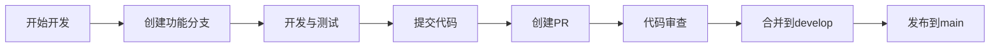

# Git工作流团队培训材料

## 📚 培训大纲

### 1. Git工作流概述
### 1.1 分支策略
- **主分支**: `main` - 生产环境代码
- **开发分支**: `develop` - 开发环境代码  
- **功能分支**: `feature/<scope>-<summary>` - 新功能开发
- **修复分支**: `fix/<scope>-<summary>` - 问题修复
- **发布分支**: `release/<version>` - 版本发布准备

### 1.2 工作流程


## 🎯 核心规范

### 2.1 提交信息规范 (Conventional Commits)

#### 格式要求
```
<type>(<scope>): <subject> (T-XXX)

<body>

<footer>
```

#### 提交类型
- `feat`: 新功能
- `fix`: 问题修复
- `docs`: 文档更新
- `style`: 代码格式调整
- `refactor`: 代码重构
- `test`: 测试相关
- `chore`: 构建工具、依赖更新
- `perf`: 性能优化

#### 示例
```bash
# ✅ 正确示例
feat(auth): 添加JWT双Token认证机制 (T-001)
fix(db): 修复多租户查询性能问题 (T-002)
docs(api): 更新用户管理API文档 (T-003)

# ❌ 错误示例
add new feature
fix bug
update docs
```

### 2.2 Pull Request规范

#### PR标题
- 使用Conventional Commits格式
- 包含任务编号：`feat(auth): 添加JWT认证 (T-001)`

#### PR描述模板
```markdown
## 📝 变更描述
[详细描述本次变更的内容和目的]

## 🎯 关联任务
- T-001: JWT认证功能实现
- T-002: 安全性增强

## 🧪 测试情况
- [x] 单元测试通过
- [x] 集成测试通过
- [x] 手动测试完成

## 📸 测试命令
```bash
# 后端测试
docker exec -it alkaid-backend php think test --testsuite=Feature

# 前端测试
cd frontend && pnpm test:unit

# 代码风格检查
docker exec -it alkaid-backend ./vendor/bin/php-cs-fixer fix --dry-run --diff
```

## 📋 检查清单
- [ ] 代码符合PSR-12规范
- [ ] 提交信息符合规范
- [ ] 包含必要的测试
- [ ] 文档已更新
- [ ] 无敏感信息泄露
- [ ] 无调试代码残留

## 📸 截图（如有UI变更）
[上传相关截图]
```

### 2.3 代码质量要求

#### PHP代码规范
```php
<?php
declare(strict_types=1);

namespace App\Service;

/**
 * 用户服务类
 * 
 * 用户认证和权限管理的核心服务
 * User authentication and permission management core service
 * 
 * @package App\Service
 */
class UserService
{
    private UserRepository $repository;
    
    public function __construct(UserRepository $repository)
    {
        $this->repository = $repository;
    }
    
    /**
     * 创建新用户
     * Create new user
     * 
     * @param array $userData 用户数据
     * @return User 创建的用户对象
     */
    public function createUser(array $userData): User
    {
        // 实现逻辑
        return $this->repository->create($userData);
    }
}
```

#### 前端代码规范
```typescript
// Vue 3 + TypeScript + Composition API
<script setup lang="ts">
import { ref, computed } from 'vue'
import { useAuth } from '@/composables/useAuth'

// 响应式数据
const loading = ref(false)
const user = computed(() => useAuth().user)

// 方法定义
const handleSubmit = async (): Promise<void> => {
  try {
    loading.value = true
    // 提交逻辑
  } catch (error) {
    console.error('提交失败:', error)
  } finally {
    loading.value = false
  }
}
</script>
```

## 🛠️ 开发工具使用

### 3.1 本地开发环境

#### Docker容器使用
```bash
# 启动开发环境
docker compose up -d

# 查看容器状态
docker compose ps

# 进入后端容器
docker exec -it alkaid-backend bash

# 查看日志
docker logs -f alkaid-backend
```

#### 常用命令
```bash
# 后端测试（必须在容器内执行）
docker exec -it alkaid-backend php think test
docker exec -it alkaid-backend php think test --testsuite=Feature

# 数据库迁移
docker exec -it alkaid-backend php think migrate:run
docker exec -it alkaid-backend php think migrate:rollback --step=1

# 代码格式检查
docker exec -it alkaid-backend ./vendor/bin/php-cs-fixer fix --dry-run --diff

# 前端开发
cd frontend
pnpm install
pnpm dev
pnpm build
pnpm lint
```

### 3.2 IDE配置

#### VSCode推荐插件
- GitLens - Git历史和分支管理
- PHP Intelephense - PHP智能提示
- Vue Language Features (Volar) - Vue 3支持
- ESLint - 代码质量检查
- Prettier - 代码格式化

#### 配置文件
```json
// .vscode/settings.json
{
  "editor.formatOnSave": true,
  "editor.codeActionsOnSave": {
    "source.fixAll.eslint": true
  },
  "php.suggest.basic": false,
  "intelephense.environment.phpVersion": "8.2"
}
```

## 🔒 安全最佳实践

### 4.1 敏感信息处理

#### 禁止提交的内容
```bash
# .gitignore 已配置，但需要特别注意：
.env.local
.env.production
node_modules/
vendor/
runtime/
storage/logs/
*.key
*.pem
```

#### 环境变量使用
```php
// ✅ 正确：使用环境变量
$apiKey = $_ENV['API_KEY'] ?? '';

// ❌ 错误：硬编码敏感信息
$apiKey = 'sk-1234567890abcdef';
```

### 4.2 代码安全检查

#### SQL注入防护
```php
// ✅ 正确：使用参数化查询
$user = $this->db->query('SELECT * FROM users WHERE id = ?', [$userId]);

// ❌ 错误：直接拼接SQL
$user = $this->db->query("SELECT * FROM users WHERE id = " . $userId);
```

#### XSS防护
```php
// ✅ 正确：输出转义
echo htmlspecialchars($userInput, ENT_QUOTES, 'UTF-8');

// ❌ 错误：直接输出
echo $userInput;
```

## 🧪 测试策略

### 5.1 测试分层

```
tests/
├── Unit/           # 单元测试
├── Feature/        # 功能测试
├── Integration/    # 集成测试
└── E2E/           # 端到端测试
```

### 5.2 测试编写示例

#### PHP单元测试
```php
<?php

declare(strict_types=1);

namespace Tests\Unit;

use PHPUnit\Framework\TestCase;
use App\Service\UserService;

class UserServiceTest extends TestCase
{
    private UserService $userService;
    
    protected function setUp(): void
    {
        $this->userService = new UserService(new UserRepository());
    }
    
    public function testCreateUser(): void
    {
        $userData = [
            'name' => 'Test User',
            'email' => 'test@example.com'
        ];
        
        $user = $this->userService->createUser($userData);
        
        $this->assertEquals('Test User', $user->getName());
        $this->assertEquals('test@example.com', $user->getEmail());
    }
}
```

#### 前端组件测试
```typescript
import { describe, it, expect } from 'vitest'
import { mount } from '@vue/test-utils'
import UserForm from '@/components/UserForm.vue'

describe('UserForm', () => {
  it('should render form fields', () => {
    const wrapper = mount(UserForm)
    
    expect(wrapper.find('input[name="name"]').exists()).toBe(true)
    expect(wrapper.find('input[name="email"]').exists()).toBe(true)
  })
  
  it('should validate required fields', async () => {
    const wrapper = mount(UserForm)
    
    await wrapper.find('form').trigger('submit')
    
    expect(wrapper.text()).toContain('姓名是必填项')
    expect(wrapper.text()).toContain('邮箱是必填项')
  })
})
```

## 🚨 常见问题与解决方案

### 6.1 Git相关问题

#### Q: 如何解决合并冲突？
```bash
# 1. 更新主分支
git checkout main
git pull origin main

# 2. 切换回功能分支
git checkout feature/my-feature

# 3. 合并主分支
git merge main

# 4. 解决冲突（编辑文件）
# 5. 标记冲突已解决
git add .

# 6. 提交合并结果
git commit -m "fix: 解决合并冲突 (T-XXX)"
```

#### Q: 如何撤销最近的提交？
```bash
# 撤销最后一次提交（保留更改）
git reset --soft HEAD~1

# 撤销最后一次提交（丢弃更改）
git reset --hard HEAD~1

# 撤销多个提交
git reset --hard HEAD~3
```

#### Q: 如何修改提交信息？
```bash
# 修改最后一次提交信息
git commit --amend -m "feat(auth): 修正提交信息 (T-001)"

# 修改更早的提交信息
git rebase -i HEAD~3
# 在编辑器中修改要改的提交
```

### 6.2 CI/CD相关问题

#### Q: CI检查失败怎么办？
1. **查看失败原因**
   - 检查GitHub Actions日志
   - 本地运行相同的检查命令

2. **常见失败类型**
   - 代码风格问题：运行`php-cs-fixer`
   - 测试失败：运行`php think test`
   - 安全扫描：检查敏感信息

3. **修复后重新提交**
   ```bash
   git add .
   git commit -m "fix: 修复CI检查问题 (T-XXX)"
   git push
   ```

#### Q: 如何调试CI问题？
```bash
# 在本地模拟CI环境
docker run -it --rm \
  -v $(pwd):/workspace \
  -w /workspace \
  node:18 \
  bash

# 在容器内运行CI命令
cd /workspace
npm install
npm run lint
npm test
```

### 6.3 开发环境问题

#### Q: Docker容器启动失败？
```bash
# 检查端口占用
netstat -tulpn | grep :80
netstat -tulpn | grep :3306

# 重新构建容器
docker compose down
docker compose build --no-cache
docker compose up -d

# 查看详细日志
docker compose logs alkaid-backend
```

#### Q: 依赖安装失败？
```bash
# 清理缓存重新安装
docker exec -it alkaid-backend composer clear-cache
docker exec -it alkaid-backend composer install --no-cache

# 前端依赖问题
cd frontend
rm -rf node_modules package-lock.json
pnpm install
```

## 📈 性能优化建议

### 7.1 Git性能

#### 使用浅克隆
```bash
# 克隆最近100个提交
git clone --depth 100 <repository-url>

# 克隆单个分支
git clone --single-branch --branch main <repository-url>
```

#### 优化.gitignore
```bash
# 排除不必要的文件
echo "node_modules/" >> .gitignore
echo "*.log" >> .gitignore
echo ".env.local" >> .gitignore
```

### 7.2 开发效率

#### 使用Git别名
```bash
# 常用别名设置
git config --global alias.co checkout
git config --global alias.br branch
git config --global alias.st status
git config --global alias.ci commit
git config --global alias.unstage 'reset HEAD --'
```

#### IDE快捷键
```json
// VSCode快捷键配置
{
  "key": "ctrl+s",
  "command": "workbench.action.files.save",
  "when": "editorTextFocus"
}
```

## 🎓 培训考核

### 8.1 实践任务

#### 初级任务
1. 创建功能分支并提交符合规范的代码
2. 创建PR并通过所有检查
3. 解决一个简单的合并冲突
4. 编写一个单元测试

#### 中级任务
1. 重构一个现有模块并保持测试通过
2. 实现一个完整的CRUD功能
3. 优化一个性能瓶颈
4. 编写集成测试

#### 高级任务
1. 设计并实现一个新的微服务
2. 优化CI/CD流程
3. 实现自动化部署
4. 建立监控和告警系统

### 8.2 评估标准

#### 代码质量 (40%)
- 遵循编码规范
- 测试覆盖率 > 80%
- 无安全漏洞
- 性能指标达标

#### Git工作流 (30%)
- 提交信息规范
- PR质量高
- 分支策略正确
- 及时处理反馈

#### 协作能力 (20%)
- 代码审查质量
- 文档完整性
- 知识分享
- 问题解决能力

#### 学习能力 (10%)
- 主动学习新技术
- 改进工作流程
- 分享最佳实践
- 持续自我提升

## 📞 参考资源

### 9.1 官方文档
- [Git Pro Book](https://git-scm.com/book)
- [Conventional Commits](https://www.conventionalcommits.org/)
- [PHP PSR-12](https://www.php-fig.org/psr/psr-12/)
- [Vue 3 Guide](https://vuejs.org/guide/)

### 9.2 内部资源
- 项目技术规范文档
- API设计文档
- 数据库设计文档
- 部署运维文档

### 9.3 工具文档
- Docker官方文档
- GitHub Actions文档
- PHPUnit文档
- Vue Test Utils文档

---

## 📞 培训反馈

请将培训反馈发送至：dev-team@alkaidsys.com

### 反馈内容
- 培训内容满意度 (1-5分)
- 最有用的部分
- 需要改进的部分
- 建议增加的内容
- 其他意见和建议

---

*最后更新时间: 2025-12-17*
*维护者: 开发团队*