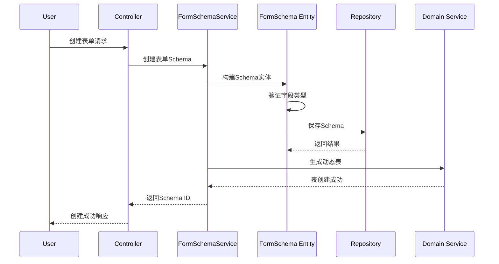
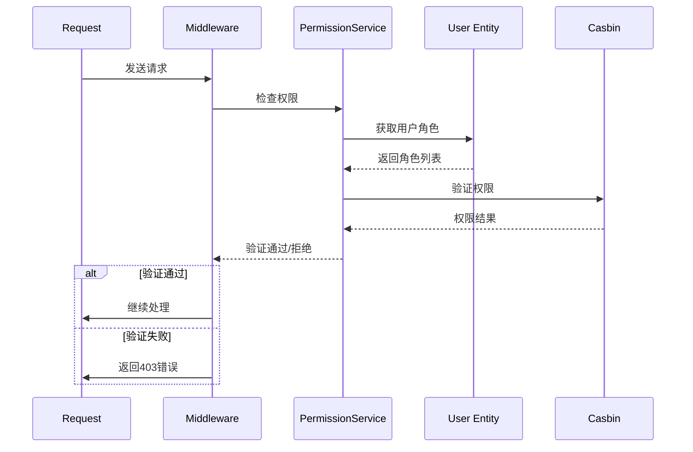

# 领域层 (Domain Layer) - CLAUDE.md

> **导航**: [返回根目录](../CLAUDE.md) | 领域层概览
>
> **最后更新**: 2025-12-15 22:20:04
>
> **主要职责**: 领域模型定义、业务规则实现、核心业务逻辑

---

## 📋 概述

领域层是系统的**核心业务层**，采用**领域驱动设计（DDD）**架构模式，负责：
- 定义领域模型（Entity、Value Object）
- 实现业务规则和业务逻辑
- 维护领域内的不变量
- 处理业务用例（Use Case）
- 提供领域服务

---

## 📁 目录结构

```
domain/
├── Application/         # 应用用例
│   └── UseCase/         # 具体用例实现
├── Auth/                # 身份认证领域
├── User/                # 用户领域
├── Tenant/              # 租户领域
├── Permission/          # 权限领域
├── Lowcode/             # 低代码引擎领域
│   ├── Entity/          # 实体
│   ├── Service/         # 领域服务
│   └── Repository/      # 仓储接口
├── Field/               # 字段类型领域
├── Schema/              # 数据结构领域
├── Collection/          # 集合管理领域
├── Validator/           # 验证器领域
├── I18n/                # 国际化领域
├── RateLimit/           # 限流领域
└── DI/                  # 依赖注入
```

---

## 🎯 核心领域模块

### 1. Auth 领域 - 身份认证

**职责**: 用户身份验证、Token 管理、会话处理

**核心组件**:
- `Entity/User.php` - 用户实体
- `Service/AuthService.php` - 认证服务
- `Repository/UserRepository.php` - 用户仓储接口
- `ValueObject/Token.php` - Token 值对象

**业务规则**:
- Token 有效期管理
- 密码加密策略
- 登录失败次数限制

### 2. Tenant 领域 - 多租户

**职责**: 租户管理、租户隔离、数据隔离

**核心组件**:
- `Entity/Tenant.php` - 租户实体
- `Service/TenantService.php` - 租户服务
- `Repository/TenantRepository.php` - 租户仓储接口

**业务规则**:
- 租户唯一性检查
- 租户状态管理（激活/停用）
- 租户资源配额管理

### 3. Permission 领域 - 权限控制

**职责**: RBAC 权限模型、角色管理、权限分配

**核心组件**:
- `Entity/Role.php` - 角色实体
- `Entity/Permission.php` - 权限实体
- `Service/PermissionService.php` - 权限服务
- `Repository/PermissionRepository.php` - 权限仓储接口

**业务规则**:
- 角色层级管理
- 权限继承规则
- 租户内权限隔离

### 4. Lowcode 领域 - 低代码引擎

**职责**: 表单设计、数据管理、动态 CRUD

**核心组件**:

#### Entity 层
- `Lowcode/Entity/FormSchema.php` - 表单 Schema 实体
- `Lowcode/Entity/Collection.php` - 数据集合实体
- `Lowcode/Entity/Field.php` - 字段实体
- `Lowcode/Entity/FormData.php` - 表单数据实体

#### Service 层
- `Lowcode/Service/FormSchemaService.php` - 表单 Schema 服务
- `Lowcode/Service/CollectionService.php` - 集合服务
- `Lowcode/Service/FormDataService.php` - 表单数据服务
- `Lowcode/Service/FieldService.php` - 字段服务

#### Repository 层
- `Lowcode/Repository/FormSchemaRepository.php` - Schema 仓储接口
- `Lowcode/Repository/CollectionRepository.php` - 集合仓储接口
- `Lowcode/Repository/FormDataRepository.php` - 数据仓储接口

**业务规则**:
- Schema 版本管理
- 字段类型验证
- 数据完整性检查
- 动态关系处理

### 5. Field 领域 - 字段类型

**职责**: 字段类型注册、类型转换、验证规则

**核心组件**:
- `Entity/FieldType.php` - 字段类型实体
- `Service/FieldTypeService.php` - 字段类型服务
- `Registry/FieldTypeRegistry.php` - 字段类型注册表

**内置字段类型**:
- 文本类型（Text、Email、URL）
- 数值类型（Integer、Float、Decimal）
- 日期时间类型（Date、DateTime、Time）
- 选择类型（Select、Radio、Checkbox）
- 关系类型（HasOne、HasMany、BelongsTo）
- 文件类型（File、Image、Video）

### 6. Schema 领域 - 数据结构

**职责**: 表结构管理、Schema 定义、结构验证

**核心组件**:
- `Entity/TableSchema.php` - 表结构实体
- `Service/SchemaService.php` - Schema 服务
- `Repository/SchemaRepository.php` - Schema 仓储接口

### 7. Collection 领域 - 集合管理

**职责**: 数据集合管理、关系维护、数据查询

**核心组件**:
- `Entity/DataCollection.php` - 数据集合实体
- `Service/CollectionService.php` - 集合服务
- `Repository/CollectionRepository.php` - 集合仓储接口

### 8. Validator 领域 - 数据验证

**职责**: 动态验证器生成、验证规则管理

**核心组件**:
- `Entity/ValidationRule.php` - 验证规则实体
- `Service/ValidationService.php` - 验证服务
- `Generator/ValidatorGenerator.php` - 验证器生成器

### 9. I18n 领域 - 国际化

**职责**: 多语言支持、语言包管理

**核心组件**:
- `Entity/Language.php` - 语言实体
- `Service/I18nService.php` - 国际化服务
- `Repository/TranslationRepository.php` - 翻译仓储接口

### 10. RateLimit 领域 - 限流控制

**职责**: 限流算法实现、限流规则管理

**核心组件**:
- `Entity/RateLimitRule.php` - 限流规则实体
- `Service/RateLimitService.php` - 限流服务
- `Strategy/` - 限流策略（令牌桶、漏桶）

---

## 🔄 领域交互流程

### 低代码表单创建流程



### 权限验证流程



---

## 🎨 DDD 模式应用

### 1. 实体 (Entity)
```php
<?php
namespace Domain\User\Entity;

class User
{
    private string $id;
    private string $username;
    private string $email;
    private string $password;
    private UserStatus $status;
    private \DateTime $createdAt;

    // 业务方法
    public function activate(): void
    {
        if ($this->status === UserStatus::ACTIVATED) {
            throw new BusinessException('User already activated');
        }
        $this->status = UserStatus::ACTIVATED;
    }

    public function changePassword(string $newPassword): void
    {
        // 密码强度检查
        if (!$this->validatePasswordStrength($newPassword)) {
            throw new BusinessException('Password too weak');
        }
        $this->password = password_hash($newPassword, PASSWORD_DEFAULT);
    }
}
```

### 2. 值对象 (Value Object)
```php
<?php
namespace Domain\Auth\ValueObject;

class Email
{
    private string $value;

    public function __construct(string $value)
    {
        if (!filter_var($value, FILTER_VALIDATE_EMAIL)) {
            throw new InvalidArgumentException('Invalid email format');
        }
        $this->value = $value;
    }

    public function getValue(): string
    {
        return $this->value;
    }

    public function equals(Email $other): bool
    {
        return $this->value === $other->value;
    }
}
```

### 3. 领域服务 (Domain Service)
```php
<?php
namespace Domain\User\Service;

use Domain\User\Entity\User;
use Domain\User\Repository\UserRepositoryInterface;

class UserService
{
    public function __construct(
        private UserRepositoryInterface $userRepository
    ) {}

    public function register(string $username, string $email, string $password): User
    {
        // 检查用户名唯一性
        if ($this->userRepository->existsByUsername($username)) {
            throw new BusinessException('Username already exists');
        }

        // 检查邮箱唯一性
        if ($this->userRepository->existsByEmail($email)) {
            throw new BusinessException('Email already exists');
        }

        // 创建用户
        $user = new User($username, $email, $password);
        $this->userRepository->save($user);

        return $user;
    }
}
```

### 4. 聚合根 (Aggregate Root)
```php
<?php
namespace Domain\Tenant\Entity;

class Tenant implements \JsonSerializable
{
    private Collection $users;
    private Collection $applications;
    private TenantStatus $status;

    public function __construct(
        private string $id,
        private string $name,
        private string $code,
        private TenantType $type
    ) {
        $this->users = new Collection();
        $this->applications = new Collection();
        $this->status = TenantStatus::ACTIVE;
    }

    public function addUser(User $user): void
    {
        if ($this->status !== TenantStatus::ACTIVE) {
            throw new BusinessException('Cannot add user to inactive tenant');
        }

        if ($this->users->contains($user)) {
            throw new BusinessException('User already in tenant');
        }

        $this->users->add($user);
        $user->setTenant($this);
    }

    public function removeUser(User $user): void
    {
        $this->users->removeElement($user);
        $user->setTenant(null);
    }

    public function jsonSerialize(): array
    {
        return [
            'id' => $this->id,
            'name' => $this->name,
            'code' => $this->code,
            'type' => $this->type,
            'status' => $this->status,
            'userCount' => $this->users->count(),
            'applicationCount' => $this->applications->count()
        ];
    }
}
```

---

## 📊 关键接口

### Repository 接口
```php
<?php
namespace Domain\User\Repository;

interface UserRepositoryInterface
{
    public function findById(string $id): ?User;

    public function findByEmail(string $email): ?User;

    public function existsByUsername(string $username): bool;

    public function save(User $user): void;

    public function delete(User $user): void;
}
```

### Domain Service 接口
```php
<?php
namespace Domain\Permission\Service;

interface PermissionServiceInterface
{
    public function checkPermission(string $userId, string $resource, string $action): bool;

    public function grantRole(string $userId, string $roleId): void;

    public function revokeRole(string $userId, string $roleId): void;

    public function getUserPermissions(string $userId): array;
}
```

---

## 🚀 最佳实践

### 1. 领域模型设计
- **贫血模型 vs 富领域模型**: 优先使用富领域模型
- **不变式**: 在实体中封装业务规则和不变量
- **领域语言**: 使用业务术语命名类和接口

### 2. 业务逻辑组织
- **用例驱动**: 按照用例（Use Case）组织业务逻辑
- **服务分层**: 应用服务编排，领域服务实现业务规则
- **仓库模式**: 使用 Repository 隐藏数据访问细节

### 3. 领域边界
- **有界上下文**: 明确领域边界，避免上下文混淆
- **防腐层**: 在领域边界使用防腐层隔离外部系统
- **领域隔离**: 领域之间通过明确的接口交互

### 4. 测试策略
- **单元测试**: 测试领域模型和业务规则
- **集成测试**: 测试领域服务与仓储的协作
- **契约测试**: 测试领域接口的契约

---

## 📚 相关资源

- [DDD 领域驱动设计](https://martinfowler.com/tags/domain%20driven%20design.html)
- [领域建模实践](../docs/developer-guides/domain-modeling.md)
- [低代码架构设计](../design/05-lowcode/01-lowcode-design.md)
- [多租户设计](../design/04-multi-tenant/01-tenant-design.md)
- [权限模型设计](../docs/developer-guides/rbac-model.md)

---

## 🔍 测试示例

### 实体测试
```php
public function testUserCannotActivateTwice()
{
    $user = new User('john', 'john@example.com', 'password123');
    $user->activate();

    $this->expectException(BusinessException::class);
    $this->expectExceptionMessage('User already activated');

    $user->activate();
}
```

### 领域服务测试
```php
public function testRegisterWithDuplicateEmail()
{
    $userRepository = $this->createMock(UserRepositoryInterface::class);
    $userRepository->method('existsByEmail')->willReturn(true);

    $userService = new UserService($userRepository);

    $this->expectException(BusinessException::class);
    $this->expectExceptionMessage('Email already exists');

    $userService->register('john', 'john@example.com', 'password123');
}
```

---

*本文档最后更新：2025-12-15 22:20:04*
