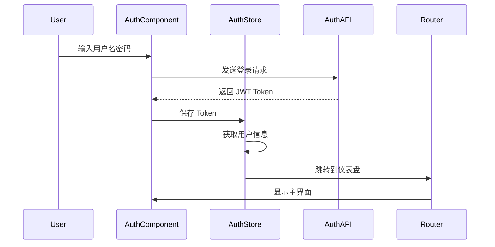
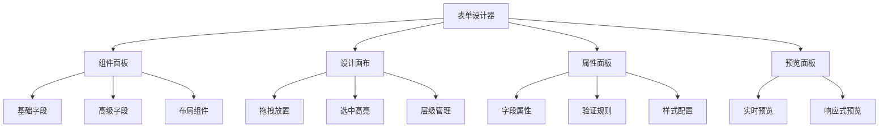
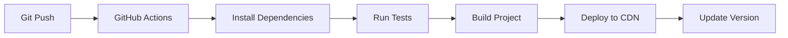

# 前端层 (Frontend Layer) - CLAUDE.md

> **导航**: [返回根目录](../CLAUDE.md) | 前端层概览
>
> **最后更新**: 2025-12-15 22:20:04
>
> **主要职责**: 用户界面、业务交互、数据展示

---

## 📋 概述

前端层基于 **Vue 3 + Vue Vben Admin 5.x** 构建，采用 **TypeScript** 开发，提供现代化的管理后台界面。

### 技术栈
- **Vue 3.4+** - 前端框架（组合式 API）
- **TypeScript 5.x** - 开发语言
- **Vite 5.x** - 构建工具
- **Vue Vben Admin 5.x** - 管理后台框架
- **Ant Design Vue 4.x** - UI 组件库
- **Pinia 2.x** - 状态管理
- **Vue Router 4.x** - 路由管理

---

## 📁 目录结构

```
frontend/
├── apps/                    # 应用目录
│   └── admin/              # 管理后台应用
│       ├── src/
│       │   ├── api/        # API 接口
│       │   ├── components/ # 公共组件
│       │   ├── layouts/    # 布局组件
│       │   ├── pages/      # 页面组件
│       │   ├── router/     # 路由配置
│       │   ├── stores/     # Pinia 状态
│       │   ├── types/      # TypeScript 类型
│       │   ├── utils/      # 工具函数
│       │   └── env.d.ts    # 环境类型声明
│       └── package.json
├── packages/               # 共享包
│   ├── 共享工具 shared/             #
│   ├── types/              # 共享类型
│   └── utils/              # 通用函数
├── docs/                   # 文档
├── internal/               # 内部配置
│   ├── build/              # 构建配置
│   ├── config/             # 通用配置
│   └── type/               # 类型定义
├── scripts/                # 构建脚本
├── playground/             # 开发测试
├── .github/                # GitHub 配置
├── package.json            # 根依赖配置
├── pnpm-workspace.yaml     # 工作空间配置
└── turbo.json              # Turbo 配置
```

---

## 🎯 核心模块

### 1. 管理后台应用 (apps/admin)

#### 目录结构
```
apps/admin/src/
├── api/                    # API 接口层
│   ├── auth.ts            # 认证相关 API
│   ├── user.ts            # 用户管理 API
│   ├── permission.ts      # 权限管理 API
│   └── lowcode/           # 低代码模块 API
│       ├── schema.ts      # 表单 Schema API
│       ├── collection.ts  # 集合管理 API
│       ├── field.ts       # 字段类型 API
│       └── formData.ts    # 表单数据 API
├── components/            # 公共组件
│   ├── Basic/             # 基础组件
│   ├── Business/          # 业务组件
│   └── Lowcode/           # 低代码组件
│       ├── FormDesigner/  # 表单设计器
│       ├── DataTable/     # 动态数据表格
│       └── FormRenderer/  # 表单渲染器
├── layouts/               # 布局组件
│   ├── DefaultLayout.vue  # 默认布局
│   ├── TopLayout.vue      # 顶部布局
│   └── MixedLayout.vue    # 混合布局
├── pages/                 # 页面组件
│   ├── auth/              # 认证页面
│   ├── dashboard/         # 仪表盘
│   ├── system/            # 系统管理
│   │   ├── user/          # 用户管理
│   │   ├── role/          # 角色管理
│   │   └── permission/    # 权限管理
│   └── lowcode/           # 低代码管理
│       ├── schema/        # Schema 管理
│       ├── collection/    # 集合管理
│       └── form/          # 表单管理
├── router/                # 路由配置
│   ├── index.ts           # 路由入口
│   ├── guards.ts          # 路由守卫
│   └── modules/           # 路由模块
│       ├── auth.ts
│       ├── system.ts
│       └── lowcode.ts
├── stores/                # Pinia 状态管理
│   ├── auth.ts            # 认证状态
│   ├── user.ts            # 用户状态
│   ├── permission.ts      # 权限状态
│   └── lowcode.ts         # 低代码状态
├── types/                 # TypeScript 类型
│   ├── api.ts             # API 类型
│   ├── auth.ts            # 认证类型
│   ├── user.ts            # 用户类型
│   └── lowcode.ts         # 低代码类型
└── utils/                 # 工具函数
    ├── auth.ts            # 认证工具
    ├── request.ts         # 请求封装
    ├── cache.ts           # 缓存工具
    └── helper.ts          # 辅助函数
```

#### 核心页面

**认证模块**
- `pages/auth/Login.vue` - 登录页面
- `pages/auth/Register.vue` - 注册页面
- `pages/auth/ResetPassword.vue` - 重置密码

**系统管理**
- `pages/system/user/index.vue` - 用户管理
- `pages/system/role/index.vue` - 角色管理
- `pages/system/permission/index.vue` - 权限管理

**低代码模块**
- `pages/lowcode/schema/index.vue` - Schema 管理
- `pages/lowcode/collection/index.vue` - 集合管理
- `pages/lowcode/form/index.vue` - 表单管理
- `pages/lowcode/form/Designer.vue` - 表单设计器

### 2. 共享包 (packages)

#### packages/shared - 共享工具
- 通用工具函数
- 格式化函数
- 校验函数
- 常量定义

#### packages/types - 共享类型
- API 响应类型
- 业务实体类型
- 组件 Props 类型
- 工具函数类型

#### packages/utils - 通用函数
- 日期处理
- 字符串处理
- 数组处理
- 对象处理

---

## 🔄 核心功能

### 1. 认证与权限

**认证流程**


**权限控制**
- 基于角色的访问控制（RBAC）
- 路由守卫：页面级权限控制
- 指令控制：组件级权限控制
- API 权限：接口级权限控制

**实现方式**:
```typescript
// 1. 路由守卫
router.beforeEach(async (to, from, next) => {
  const authStore = useAuthStore();

  if (!authStore.isLoggedIn) {
    await authStore.login();
  }

  if (to.meta.permission) {
    const hasPermission = await authStore.checkPermission(
      to.meta.permission as string
    );
    if (!hasPermission) {
      next('/403');
      return;
    }
  }

  next();
});

// 2. 权限指令
<template>
  <Button v-hasPermission="'user:create'">创建用户</Button>
</template>

// 3. 权限检查函数
const hasPermission = (permission: string) => {
  return authStore.permissions.includes(permission);
};
```

### 2. 低代码设计器

**表单设计器**
- 拖拽式设计
- 实时预览
- 字段配置面板
- 响应式布局

**设计器架构**


**表单渲染器**
- 基于 Schema 动态渲染
- 支持自定义组件
- 自动表单验证
- 数据联动支持

**实现示例**:
```vue
<template>
  <FormRenderer
    :schema="formSchema"
    :model-value="formData"
    @update:model-value="handleUpdate"
  />
</template>

<script setup lang="ts">
import { FormRenderer } from '@/components/Lowcode';

interface Props {
  schemaId: string;
}

const props = defineProps<Props>();
const formSchema = ref<FormSchema>();
const formData = ref<Record<string, any>>();

// 加载 Schema
const loadSchema = async () => {
  formSchema.value = await lowcodeAPI.getSchema(props.schemaId);
};

// 监听数据变化
const handleUpdate = (data: Record<string, any>) => {
  formData.value = data;
};
</script>
```

### 3. 动态数据表格

**功能特性**
- 基于 Collection 动态生成
- 列配置可视化
- 排序、筛选、分页
- 行内编辑
- 批量操作

**实现架构**
```vue
<template>
  <DataTable
    :collection-id="collectionId"
    :columns="columns"
    :actions="actions"
    :toolbar="toolbar"
    @selection-change="handleSelectionChange"
  />
</template>

<script setup lang="ts">
import { DataTable } from '@/components/Lowcode';

interface Props {
  collectionId: string;
}

const props = defineProps<Props>();

// 列配置
const columns = ref([
  {
    title: 'ID',
    dataIndex: 'id',
    width: 100,
    sorter: true,
  },
  {
    title: '名称',
    dataIndex: 'name',
    editable: true,
    required: true,
  },
  {
    title: '状态',
    dataIndex: 'status',
    type: 'select',
    options: [
      { label: '启用', value: 1 },
      { label: '禁用', value: 0 },
    ],
  },
]);

// 操作配置
const actions = [
  {
    type: 'edit',
    label: '编辑',
    icon: 'EditOutlined',
  },
  {
    type: 'delete',
    label: '删除',
    icon: 'DeleteOutlined',
    danger: true,
  },
];

// 工具栏配置
const toolbar = [
  {
    type: 'create',
    label: '新建',
    icon: 'PlusOutlined',
    permission: 'collection:create',
  },
  {
    type: 'export',
    label: '导出',
    icon: 'DownloadOutlined',
  },
  {
    type: 'import',
    label: '导入',
    icon: 'UploadOutlined',
  },
];
</script>
```

---

## 🎨 UI 组件库

### 1. Ant Design Vue

**使用规范**
- 统一使用 Ant Design Vue 组件
- 保持设计语言一致性
- 响应式布局
- 无障碍访问支持

**常用组件**
```vue
<template>
  <!-- 基础表单 -->
  <Form :model="form" :rules="rules" @finish="onSubmit">
    <FormItem name="username" label="用户名">
      <Input v-model:value="form.username" />
    </FormItem>
    <FormItem name="email" label="邮箱">
      <Input v-model:value="form.email" type="email" />
    </FormItem>
    <FormItem>
      <Button type="primary" html-type="submit">提交</Button>
    </FormItem>
  </Form>

  <!-- 数据表格 -->
  <Table
    :columns="columns"
    :data-source="data"
    :loading="loading"
    :pagination="pagination"
    @change="handleTableChange"
  >
    <template #bodyCell="{ column, record }">
      <template v-if="column.key === 'actions'">
        <Space>
          <Button type="link" @click="edit(record)">编辑</Button>
          <Button type="link" danger @click="del(record)">删除</Button>
        </Space>
      </template>
    </template>
  </Table>
</template>
```

### 2. 自定义组件

**基础组件**
- `BaseTable` - 基础表格组件
- `BaseForm` - 基础表单组件
- `BaseModal` - 基础弹窗组件
- `BaseDrawer` - 基础抽屉组件

**业务组件**
- `UserAvatar` - 用户头像
- `PermissionTag` - 权限标签
- `StatusBadge` - 状态徽章
- `TenantSelector` - 租户选择器

**低代码组件**
- `FormDesigner` - 表单设计器
- `FormRenderer` - 表单渲染器
- `DynamicTable` - 动态表格
- `FieldEditor` - 字段编辑器
- **校验指引**：低代码表单调用应带 `with_validator=1&with_parsed=1`，使用返回的 `validator.rules/messages` 构建校验，用 `parsed.components` 渲染 UI、`parsed.permissions` 控制可见/禁用；已有本地 zod 规则仅作兜底。

---

## 📦 状态管理 (Pinia)

### Store 结构

```typescript
// stores/auth.ts
export const useAuthStore = defineStore('auth', () => {
  // state
  const token = ref<string>('');
  const user = ref<User | null>(null);
  const permissions = ref<string[]>([]);

  // getters
  const isLoggedIn = computed(() => !!token.value);
  const userName = computed(() => user.value?.username || '');

  // actions
  const login = async (credentials: LoginCredentials) => {
    const response = await authAPI.login(credentials);
    token.value = response.token;
    user.value = response.user;
    permissions.value = response.permissions;
  };

  const logout = async () => {
    await authAPI.logout();
    token.value = '';
    user.value = null;
    permissions.value = [];
  };

  const checkPermission = async (permission: string) => {
    return permissions.value.includes(permission);
  };

  return {
    token,
    user,
    permissions,
    isLoggedIn,
    userName,
    login,
    logout,
    checkPermission,
  };
});
```

### 状态持久化
- 使用 `pinia-plugin-persistedstate` 插件
- 本地存储 Token 和用户信息
- 页面刷新后自动恢复状态

---

## 🔐 安全机制

### 1. XSS 防护
- 自动转义用户输入
- 使用 `v-text` 代替 `v-html`
- CSP（内容安全策略）配置

### 2. CSRF 防护
- CSRF Token 验证
- SameSite Cookie 配置
- 双重提交 Cookie

### 3. 敏感信息保护
- 避免在客户端存储敏感数据
- Token 使用 httpOnly Cookie
- 定期刷新 Token

---

## 🚀 性能优化

### 1. 代码分割
- 路由级别代码分割
- 组件懒加载
- 动态导入

```typescript
// 路由懒加载
const routes = [
  {
    path: '/lowcode',
    name: 'Lowcode',
    component: () => import('@/pages/lowcode/index.vue'),
  },
];

// 组件懒加载
const FormDesigner = defineAsyncComponent(
  () => import('@/components/Lowcode/FormDesigner')
);
```

### 2. 缓存策略
- 接口缓存
- 组件缓存
- 本地存储

### 3. 虚拟滚动
- 大列表虚拟滚动
- 表格虚拟滚动
- 减少 DOM 节点

### 4. 图片优化
- WebP 格式
- 懒加载
- 响应式图片

---

## 🧪 测试策略

### 1. 单元测试
- 使用 Vitest + Vue Test Utils
- 测试组件行为
- 测试工具函数

```typescript
// 测试组件
import { mount } from '@vue/test-utils';
import UserForm from '@/pages/system/user/UserForm.vue';

describe('UserForm', () => {
  it('renders form fields', () => {
    const wrapper = mount(UserForm);
    expect(wrapper.find('input[name="username"]').exists()).toBe(true);
    expect(wrapper.find('input[name="email"]').exists()).toBe(true);
  });

  it('validates required fields', async () => {
    const wrapper = mount(UserForm);
    await wrapper.find('form').trigger('submit.prevent');
    expect(wrapper.find('.ant-form-item-explain-error').exists()).toBe(true);
  });
});
```

### 2. E2E 测试
- 使用 Playwright
- 端到端测试
- 关键流程测试

### 3. 视觉回归测试
- Chromatic
- 组件视觉测试
- 样式一致性检查

---

## 📦 构建与部署

### 1. 构建配置

**Vite 配置** (`vite.config.ts`)
```typescript
import { defineConfig } from 'vite';
import vue from '@vitejs/plugin-vue';
import { resolve } from 'path';

export default defineConfig({
  plugins: [vue()],
  resolve: {
    alias: {
      '@': resolve(__dirname, 'src'),
    },
  },
  build: {
    target: 'es2015',
    outDir: 'dist',
    sourcemap: false,
    chunkSizeWarningLimit: 1000,
    rollupOptions: {
      output: {
        manualChunks: {
          'vendor-vue': ['vue', 'vue-router', 'pinia'],
          'vendor-ui': ['ant-design-vue'],
          'vendor-utils': ['lodash', 'dayjs'],
        },
      },
    },
  },
  server: {
    port: 3000,
    proxy: {
      '/api': {
        target: 'http://localhost:8080',
        changeOrigin: true,
      },
    },
  },
});
```

### 2. 环境变量
```typescript
// .env.development
VITE_APP_TITLE=AlkaidSYS 开发环境
VITE_API_BASE_URL=http://localhost:8080/api
VITE_APP_ENV=development

// .env.production
VITE_APP_TITLE=AlkaidSYS 生产环境
VITE_API_BASE_URL=https://api.alkaidsys.com/api
VITE_APP_ENV=production
```

### 3. 部署流程


---

## 📚 相关资源

### 官方文档
- [Vue 3 文档](https://cn.vuejs.org/)
- [Vue Vben Admin 文档](https://vvbin.cn/doc/)
- [Ant Design Vue 文档](https://antdv.com/docs/vue/introduce-cn)
- [TypeScript 文档](https://www.typescriptlang.org/)
- [Pinia 文档](https://pinia.vuejs.org/)
- [Vite 文档](https://vitejs.dev/)

### 内部资源
- [前端开发规范](../docs/developer-guides/frontend-coding-standards.md)
- [组件开发指南](../docs/developer-guides/component-development.md)
- [状态管理最佳实践](../docs/developer-guides/state-management.md)

---

## 🔍 最佳实践

### 1. 组件设计
- 单一职责原则
- 高度可复用
- Props 文档化
- 错误边界处理

### 2. 状态管理
- 最小化状态
- 不可变数据
- 异步处理
- 错误处理

### 3. 性能优化
- 懒加载
- 虚拟滚动
- 防抖节流
- 缓存策略

### 4. 代码质量
- ESLint + Prettier
- TypeScript 严格模式
- 单元测试覆盖
- 代码审查

---

## 🛠️ 开发工具

### 推荐插件
- Volar - Vue 3 IDE 支持
- TypeScript Vue Plugin (Volar)
- Auto Rename Tag
- Bracket Pair Colorizer
- Tailwind CSS IntelliSense

### 调试工具
- Vue DevTools
- React Developer Tools
- vite-plugin-inspect
- Error Lens

---

*本文档最后更新：2025-12-15 22:20:04*
