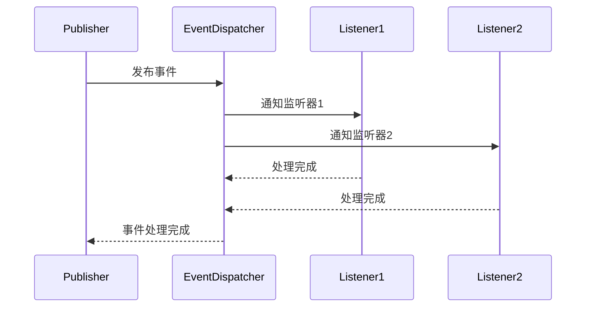
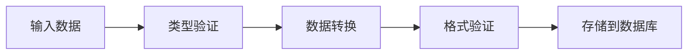
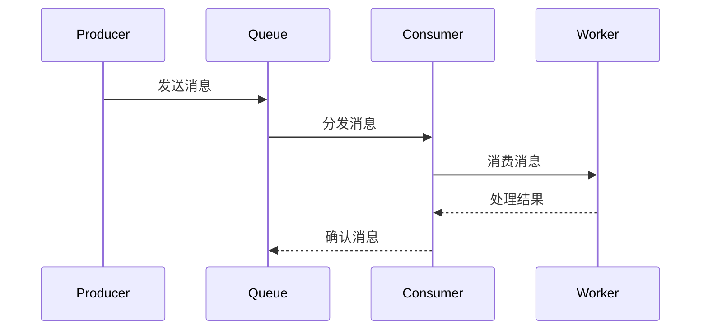

# 基础设施层 (Infrastructure Layer) - CLAUDE.md

> **导航**: [返回根目录](../CLAUDE.md) | 基础设施层概览
>
> **最后更新**: 2025-12-15 22:20:04
>
> **主要职责**: 数据访问实现、外部服务集成、技术基础设施

---

## 📋 概述

基础设施层是系统的**最底层**，为上层（领域层、应用层）提供技术支撑，负责：
- 数据持久化实现（MySQL、Redis）
- 外部服务集成（RabbitMQ、第三方 API）
- 缓存管理
- 消息队列
- 日志记录
- 工具类库

---

## 📁 目录结构

```
infrastructure/
├── DI/                   # 依赖注入容器
│   └── ServiceContainer.php
├── Event/                # 事件基础设施
│   ├── ListenerRegistry.php
│   └── EventDispatcher.php
├── Field/                # 字段类型实现
│   ├── Text.php
│   ├── Number.php
│   ├── Date.php
│   ├── Select.php
│   └── File.php
├── Lowcode/              # 低代码基础设施
│   ├── SchemaRepository.php      # Schema 仓储实现
│   ├── CollectionRepository.php  # 集合仓储实现
│   ├── FormDataRepository.php    # 数据仓储实现
│   └── FieldRepository.php       # 字段仓储实现
├── Model/                # 数据模型
├── Permission/           # 权限基础设施
│   └── CasbinAdapter.php  # Casbin 适配器
├── Schema/               # Schema 基础设施
├── Tenant/               # 租户基础设施
├── User/                 # 用户基础设施
└── Validator/            # 验证基础设施
```

---

## 🎯 核心组件

### 1. DI 容器 - 依赖注入

**文件**: `DI/ServiceContainer.php`

**职责**:
- 管理依赖注入
- 控制反转（IoC）
- 服务注册与解析

**功能特性**:
- 构造函数注入
- 属性注入
- 方法注入
- 单例模式支持
- 循环依赖检测

**使用示例**:
```php
$container = new ServiceContainer();

// 注册服务
$container->bind(UserRepositoryInterface::class, UserRepository::class);

// 解析服务
$userRepo = $container->make(UserRepositoryInterface::class);
```

### 2. Event 基础设施 - 事件系统

**组件**:
- `Event/EventDispatcher.php` - 事件调度器
- `Event/ListenerRegistry.php` - 监听器注册表

**职责**:
- 事件发布/订阅
- 监听器管理
- 异步事件支持

**事件流程**:


### 3. Field 基础设施 - 字段类型实现

**目录**: `Field/`

**职责**: 实现各种字段类型的持久化和转换

**支持的字段类型**:

| 类型 | 文件 | 说明 |
|------|------|------|
| 文本 | `Text.php` | 文本、邮箱、URL 等 |
| 数值 | `Number.php` | 整数、浮点数、货币 |
| 日期 | `Date.php` | 日期、日期时间、时间 |
| 选择 | `Select.php` | 单选、多选、下拉 |
| 文件 | `File.php` | 文件、图片、视频 |
| 关系 | `Relation.php` | 一对一、一对多、多对多 |

**字段处理流程**:


### 4. Repository 实现 - 数据仓储

**低代码仓储实现**:

#### Schema 仓储
- `Lowcode/SchemaRepository.php`
  - 保存/更新表单 Schema
  - Schema 版本管理
  - Schema 依赖解析

#### Collection 仓储
- `Lowcode/CollectionRepository.php`
  - 集合（数据表）管理
  - 动态表结构维护
  - 索引管理

#### FormData 仓储
- `Lowcode/FormDataRepository.php`
  - 表单数据 CRUD
  - 批量数据操作
  - 数据查询优化

#### Field 仓储
- `Lowcode/FieldRepository.php`
  - 字段定义存储
  - 字段类型管理
  - 字段关联关系

**仓储实现模式**:
```php
<?php
namespace Infrastructure\Lowcode;

use Domain\Lowcode\Repository\SchemaRepositoryInterface;
use think\Db;

class SchemaRepository implements SchemaRepositoryInterface
{
    public function findById(string $id): ?array
    {
        return Db::table('form_schemas')
            ->where('id', $id)
            ->where('deleted_at', null)
            ->find();
    }

    public function save(array $schema): void
    {
        $schema['updated_at'] = date('Y-m-d H:i:s');

        if (isset($schema['id'])) {
            Db::table('form_schemas')
                ->where('id', $schema['id'])
                ->update($schema);
        } else {
            $schema['id'] = generate_id();
            $schema['created_at'] = date('Y-m-d H:i:s');
            Db::table('form_schemas')->insert($schema);
        }
    }
}
```

### 5. Model 基础设施 - 数据模型

**目录**: `Model/`

**职责**:
- ORM 模型定义
- 数据关联配置
- 软删除支持
- 多租户数据隔离

**模型示例**:
```php
<?php
namespace Infrastructure\Model;

use think\Model;
use think\model\concern\SoftDelete;

class User extends Model
{
    // 表名
    protected $table = 'users';

    // 主键
    protected $pk = 'id';

    // 自动时间戳
    protected $autoWriteTimestamp = true;

    // 软删除
    use SoftDelete;
    protected $deleteTime = 'deleted_at';

    // 字段类型转换
    protected $type = [
        'created_at' => 'datetime',
        'updated_at' => 'datetime',
    ];

    // 关联关系
    public function tenant()
    {
        return $this->belongsTo(Tenant::class, 'tenant_id');
    }

    public function roles()
    {
        return $this->belongsToMany(Role::class, 'user_roles');
    }
}
```

### 6. Permission 基础设施 - 权限实现

**文件**: `Permission/CasbinAdapter.php`

**职责**:
- Casbin 适配器实现
- 动态权限加载
- 权限缓存管理

**功能特性**:
- RBAC 权限模型
- 策略动态更新
- 租户权限隔离

### 7. Validator 基础设施 - 验证实现

**目录**: `Validator/`

**职责**:
- 验证规则实现
- 动态验证器生成
- 验证消息国际化

---

## 🗄️ 数据库设计

### 核心表结构

#### 用户相关表
```sql
-- 用户表
CREATE TABLE users (
    id VARCHAR(32) PRIMARY KEY,
    tenant_id VARCHAR(32) NOT NULL,
    username VARCHAR(50) NOT NULL UNIQUE,
    email VARCHAR(100) NOT NULL UNIQUE,
    password VARCHAR(255) NOT NULL,
    status TINYINT DEFAULT 1,
    created_at DATETIME,
    updated_at DATETIME,
    INDEX idx_tenant (tenant_id),
    INDEX idx_username (username)
);

-- 租户表
CREATE TABLE tenants (
    id VARCHAR(32) PRIMARY KEY,
    name VARCHAR(100) NOT NULL,
    code VARCHAR(50) NOT NULL UNIQUE,
    type TINYINT NOT NULL, -- 1:共享数据库 2:独立数据库
    status TINYINT DEFAULT 1,
    created_at DATETIME,
    updated_at DATETIME
);
```

#### 低代码相关表
```sql
-- 表单Schema表
CREATE TABLE form_schemas (
    id VARCHAR(32) PRIMARY KEY,
    tenant_id VARCHAR(32) NOT NULL,
    name VARCHAR(100) NOT NULL,
    table_name VARCHAR(100) NOT NULL,
    schema_data JSON NOT NULL,
    version INT DEFAULT 1,
    status TINYINT DEFAULT 1,
    created_at DATETIME,
    updated_at DATETIME,
    INDEX idx_tenant (tenant_id),
    INDEX idx_table (table_name)
);

-- 表单数据表（动态生成）
CREATE TABLE data_{collection_id} (
    id VARCHAR(32) PRIMARY KEY,
    tenant_id VARCHAR(32) NOT NULL,
    form_data JSON NOT NULL,
    created_at DATETIME,
    updated_at DATETIME,
    created_by VARCHAR(32),
    updated_by VARCHAR(32,
    INDEX idx_tenant (tenant_id)
);
```

#### 权限相关表
```sql
-- 角色表
CREATE TABLE roles (
    id VARCHAR(32) PRIMARY KEY,
    tenant_id VARCHAR(32) NOT NULL,
    name VARCHAR(50) NOT NULL,
    code VARCHAR(50) NOT NULL,
    description TEXT,
    created_at DATETIME,
    updated_at DATETIME,
    UNIQUE KEY uk_tenant_code (tenant_id, code)
);

-- 权限表
CREATE TABLE permissions (
    id VARCHAR(32) PRIMARY KEY,
    name VARCHAR(50) NOT NULL,
    code VARCHAR(50) NOT NULL,
    resource VARCHAR(50) NOT NULL,
    action VARCHAR(50) NOT NULL,
    created_at DATETIME,
    UNIQUE KEY uk_code (code)
);

-- 用户角色关联表
CREATE TABLE user_roles (
    id VARCHAR(32) PRIMARY KEY,
    user_id VARCHAR(32) NOT NULL,
    role_id VARCHAR(32) NOT NULL,
    created_at DATETIME,
    UNIQUE KEY uk_user_role (user_id, role_id)
);
```

---

## 🔌 外部服务集成

### 1. Redis 缓存

**配置**: `config/cache.php`

**用途**:
- Session 存储
- 权限策略缓存
- 限流计数
- 临时数据缓存

**使用示例**:
```php
$cache = app()->cache;

$cache->set('key', 'value', 3600);
$value = $cache->get('key');

$cache->tag('users')->set('user:1', $userData);
```

### 2. RabbitMQ 消息队列

**配置**: `config/queue.php`

**用途**:
- 异步任务处理
- 事件广播
- 邮件发送
- 数据同步

**消息处理流程**:


### 3. MySQL 主从复制

**配置**: `config/database.php`

**架构**:
- 主库：写操作
- 从库：读操作
- 读写分离

---

## 📊 性能优化

### 1. 数据库优化
- **索引优化**: 合理使用索引，避免过度索引
- **查询优化**: 使用 Explain 分析查询计划
- **连接池**: 使用 Swoole 连接池复用数据库连接
- **分库分表**: 大量数据场景考虑水平拆分

### 2. 缓存策略
- **多级缓存**: 应用缓存 + Redis 缓存
- **缓存更新**: 写后删缓存策略
- **缓存穿透**: 使用布隆过滤器
- **缓存雪崩**: 设置随机过期时间

### 3. 消息队列优化
- **批量处理**: 批量消费消息
- **优先级队列**: 重要任务优先处理
- **死信队列**: 处理失败的消息
- **重试机制**: 指数退避重试策略

---

## 🔒 数据安全

### 1. 数据加密
- **密码加密**: 使用 bcrypt 或 Argon2
- **敏感数据**: 使用 AES-256 加密存储
- **传输加密**: HTTPS/TLS 加密传输

### 2. 数据脱敏
- **日志脱敏**: 敏感信息打码
- **测试数据**: 使用 Faker 生成测试数据
- **数据访问控制**: 基于角色的数据访问

### 3. 审计日志
- **操作日志**: 记录所有关键操作
- **数据变更**: 记录数据变更历史
- **访问日志**: 记录数据访问记录

---

## 🚀 部署与运维

### 1. 容器化部署
- **Docker**: 使用 Docker 容器化部署
- **Docker Compose**: 本地开发环境
- **Kubernetes**: 生产环境集群部署

### 2. 监控告警
- **Prometheus**: 指标收集
- **Grafana**: 指标可视化
- **Sentry**: 错误追踪
- **ELK**: 日志分析

### 3. CI/CD
- **GitHub Actions**: 自动化构建
- **代码检查**: PHPStan、PHP-CS-Fixer
- **自动测试**: PHPUnit 单元测试
- **自动化部署**: 蓝绿部署

---

## 📚 相关资源

- [ThinkPHP 文档](https://www.thinkphp.cn/)
- [Swoole 文档](https://www.swoole.com/)
- [RabbitMQ 文档](https://www.rabbitmq.com/)
- [Redis 文档](https://redis.io/documentation)
- [MySQL 性能优化](https://dev.mysql.com/doc/)

---

## 🔍 最佳实践

### 1. 数据访问
- 使用 Repository 模式隐藏数据访问细节
- 避免在领域层直接使用 ORM
- 使用事务保证数据一致性
- 实现软删除避免数据丢失

### 2. 缓存管理
- 缓存键命名规范
- 设置合理的过期时间
- 使用缓存标签管理相关缓存
- 监控缓存命中率

### 3. 消息队列
- 幂等性设计：重复消费不影响结果
- 消息持久化：避免消息丢失
- 消费确认：手动确认消息处理完成
- 死信处理：处理多次失败的消息

### 4. 错误处理
- 记录详细错误日志
- 区分业务错误和系统错误
- 实现降级策略
- 监控告警机制

---

*本文档最后更新：2025-12-15 22:20:04*
